

  

# 1회차 랩미팅 · EchoTrace

> [← 전체 목록으로](../../README.md)

| | |
|---|---|
| **논문** | *EchoTrace: Diagnosing Risks in LLM-Powered Recommender System* |
| **저자** | Donguk Park (UNIST), Dongwon Lee (Penn State), Yeon-Chang Lee (UNIST) |
| **링크** | [arXiv:2602.07442](https://arxiv.org/abs/2602.07442) |
| **발표** | 박민성 (2026-09-17) |
| **자료** | [발표 PDF](EchoTrace_labmeeting_01.pdf) · 슬라이드 38장 |
| **키워드** | `LLM4RS` `Bias` `Hallucination` `Feedback Loop` `Polarization` |

## 한눈에 보기

| 문제 | 방법 | 결과 | 배운 점 |
|---|---|---|---|
| LLM이 만든 편향·환각이 추천 피드백 루프에서 누적된다 | EchoTrace: 콘텐츠 생성 → 추천 → 피드백 루프 3단계 진단 프레임워크와 통제된 시뮬레이션 | 편향·인기 편향 증폭, 임베딩 양극화, 성능 하락. 실제 소비를 섞으면 완화되지만 제거되지는 않음 | 성능과 위험은 별개의 축이며, 피드백 인식 평가가 필요하다 |

  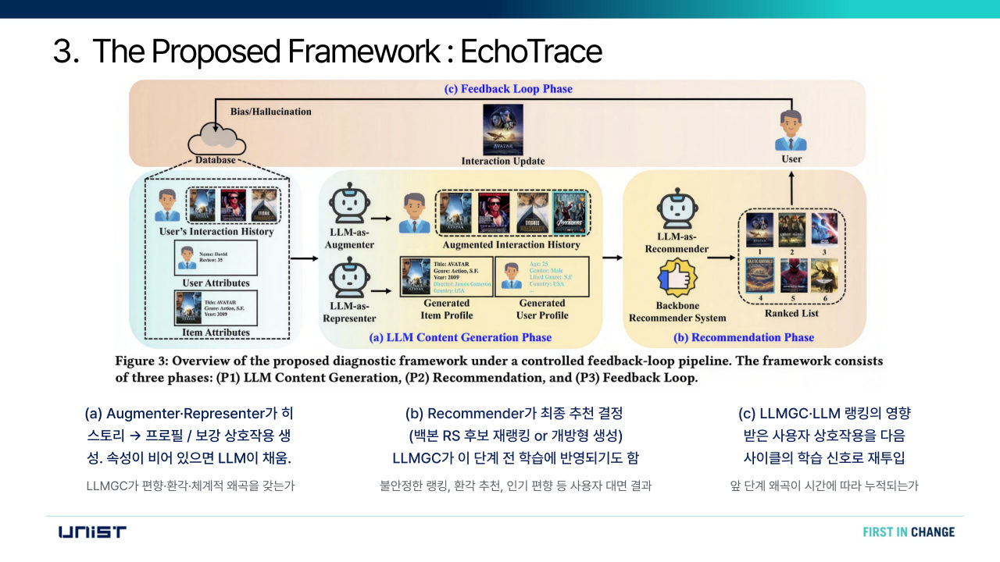 
  EchoTrace 프레임워크 (슬라이드 10)

## 목차

0. [Introduction](#0-introduction) · 슬라이드 1–2
1. [Why LLM4RS?](#1-why-llm4rs) · 슬라이드 3–7
2. [LLM의 5가지 역할과 위험 가설](#2-llm의-5가지-역할과-위험-가설) · 슬라이드 8–9
3. [제안 프레임워크 EchoTrace](#3-제안-프레임워크-echotrace) · 슬라이드 10–20
4. [실험 설정](#4-실험-설정) · 슬라이드 21–23
5. [결과: Phase 1 · 2 · 3](#5-결과-phase-1--2--3) · 슬라이드 24–33
6. [추가 분석](#6-추가-분석-성능--실제-소비-혼합--백본-교체) · 슬라이드 34–36
7. [결론과 한계](#7-결론과-한계) · 슬라이드 37–38

---

## 슬라이드별 상세 설명

### 0. Introduction

#### 슬라이드 1 · 표지

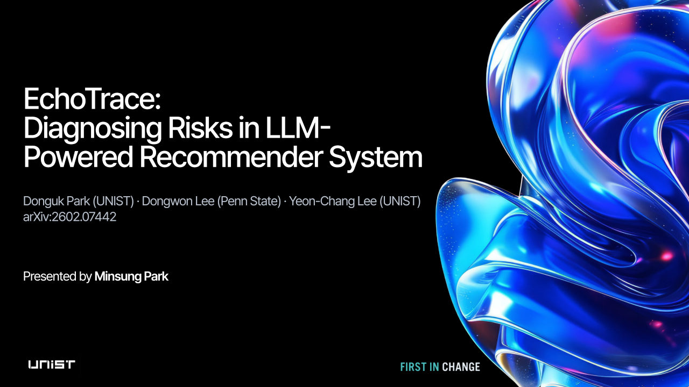

- 리뷰 논문은 *EchoTrace: Diagnosing Risks in LLM-Powered Recommender System* (Donguk Park · Dongwon Lee · Yeon-Chang Lee, arXiv:2602.07442).
- 제목의 "Echo"는 LLM이 만든 신호가 추천 시스템 안에서 메아리처럼 되돌아와 다시 학습되는 현상을, "Trace"는 그 경로를 추적한다는 뜻으로 읽을 수 있다.

#### 슬라이드 2 · Introduction

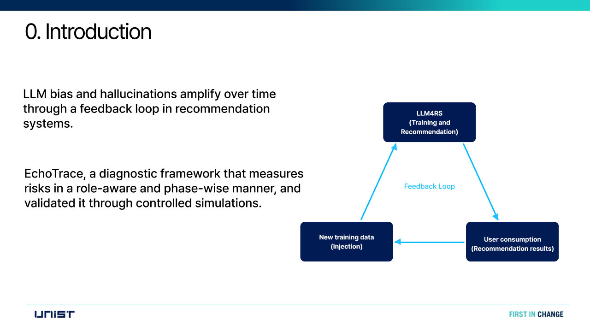

- 논문의 한 줄 주장: **LLM의 편향과 환각은 추천 시스템의 피드백 루프를 거치며 시간이 지날수록 증폭된다.**
- 오른쪽 그림은 피드백 루프의 세 꼭짓점이다. ① LLM4RS가 학습하고 추천한다 → ② 사용자가 추천 결과를 소비한다 → ③ 소비 기록이 새 학습 데이터로 주입(injection)된다 → 다시 ①.
- EchoTrace는 이 위험을 **역할별(role-aware)**, **단계별(phase-wise)**로 측정하는 진단 프레임워크이고, 통제된 시뮬레이션으로 검증했다.

### 1. Why LLM4RS?

#### 슬라이드 3 · 전통 추천 시스템의 세 가지 방식

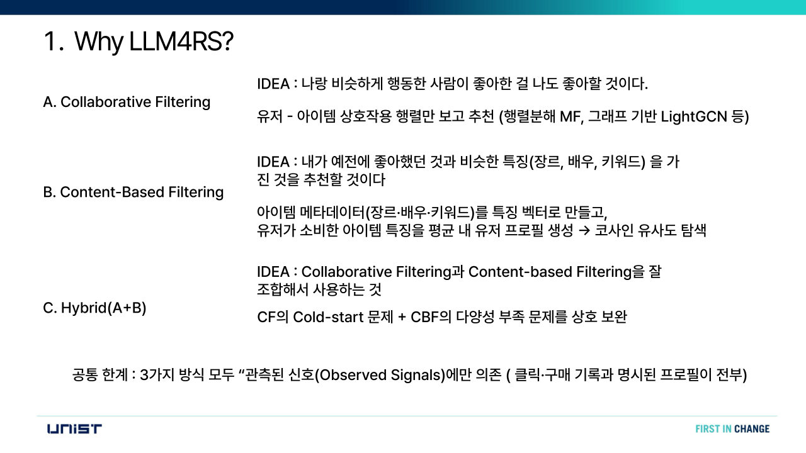

| 방식 | 아이디어 | 방법 |
|---|---|---|
| A. Collaborative Filtering | 나와 비슷하게 행동한 사람이 좋아한 것을 나도 좋아할 것이다 | 유저–아이템 상호작용 행렬만 보고 추천 (행렬분해 MF, 그래프 기반 LightGCN 등) |
| B. Content-Based Filtering | 내가 예전에 좋아했던 것과 비슷한 특징(장르·배우·키워드)을 가진 것을 추천 | 아이템 메타데이터를 특징 벡터로 만들고, 소비한 아이템 특징을 평균 내 유저 프로필 생성 → 코사인 유사도 탐색 |
| C. Hybrid (A+B) | 둘을 잘 조합 | CF의 콜드스타트 문제와 CBF의 다양성 부족 문제를 서로 보완 |

- **공통 한계**: 세 방식 모두 "관측된 신호(Observed Signals)", 즉 클릭·구매 기록과 명시된 프로필에만 의존한다. 관측되지 않은 것은 알 수 없다.

#### 슬라이드 4 · CF(전통) vs LightGCN

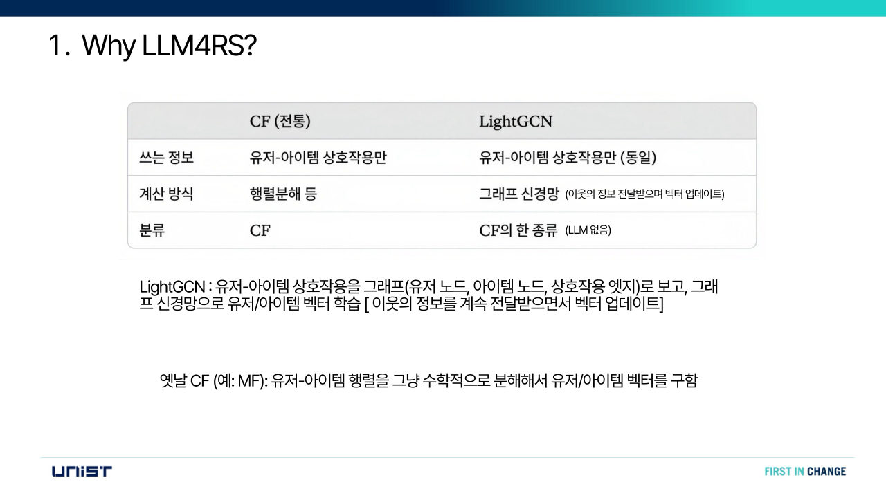

| | CF (전통) | LightGCN |
|---|---|---|
| 쓰는 정보 | 유저–아이템 상호작용만 | 유저–아이템 상호작용만 (동일) |
| 계산 방식 | 행렬분해 등 | 그래프 신경망 (이웃 정보를 전달받으며 벡터 업데이트) |
| 분류 | CF | CF의 한 종류 (LLM 없음) |

- 옛날 CF(예: MF)는 유저–아이템 행렬을 수학적으로 분해해 유저·아이템 벡터를 구한다.
- LightGCN은 상호작용을 그래프(유저 노드, 아이템 노드, 상호작용 엣지)로 보고, 이웃 정보를 계속 전달받으며 벡터를 학습한다. 쓰는 정보는 같고 계산 방식만 다르다. 이후 실험에서 **LLM이 없는 대조군**으로 쓰인다.

#### 슬라이드 5 · 전통 추천 시스템의 6가지 한계와 LLM의 해법

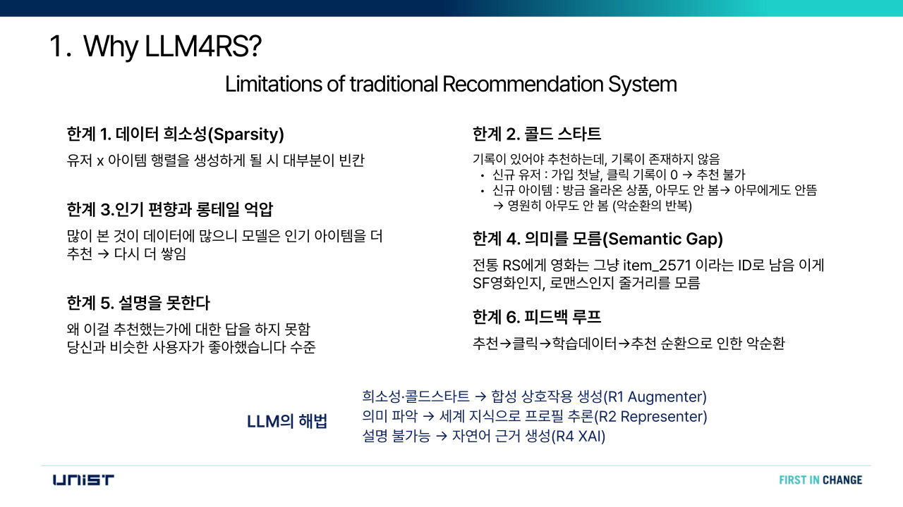

| 한계 | 내용 |
|---|---|
| 1. 데이터 희소성 (Sparsity) | 유저 × 아이템 행렬을 만들면 대부분이 빈칸 |
| 2. 콜드 스타트 | 신규 유저(클릭 기록 0)·신규 아이템(아무도 안 봄)은 추천 불가 → 영원히 아무도 안 보는 악순환 |
| 3. 인기 편향과 롱테일 억압 | 많이 본 것이 데이터에 많으니 인기 아이템을 더 추천 → 더 쌓임 |
| 4. 의미 모름 (Semantic Gap) | 전통 RS에게 영화는 `item_2571`이라는 ID일 뿐, SF인지 로맨스인지 모름 |
| 5. 설명 불가 | "당신과 비슷한 사용자가 좋아했습니다" 수준을 넘지 못함 |
| 6. 피드백 루프 | 추천 → 클릭 → 학습 데이터 → 추천으로 순환하는 악순환 |

- **LLM의 해법**: 희소성·콜드스타트 → 합성 상호작용 생성 (R1 Augmenter), 의미 파악 → 세계 지식으로 프로필 추론 (R2 Representer), 설명 불가 → 자연어 근거 생성 (R4 XAI).

#### 슬라이드 6 · LLM-Powered RS의 등장

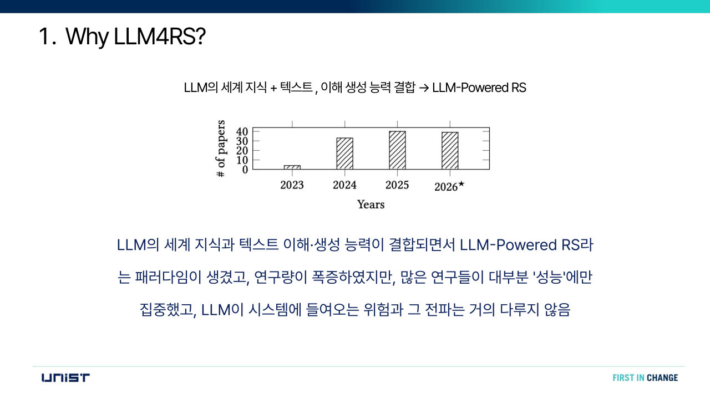

- LLM의 세계 지식과 텍스트 이해·생성 능력이 결합되면서 LLM-Powered RS라는 패러다임이 생겼고, 그래프처럼 관련 논문 수가 2023년 이후 급증했다 (2026년은 추정치).
- 그러나 대부분의 연구는 **'성능'에만 집중**했고, LLM이 시스템에 들여오는 위험과 그 전파는 거의 다루지 않았다. 이것이 논문의 연구 공백(gap)이다.

#### 슬라이드 7 · LLM4RS의 역설적 한계

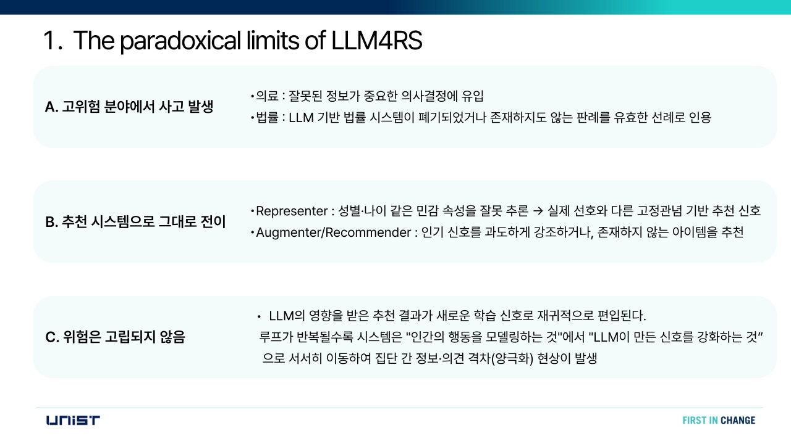

- **A. 고위험 분야에서 사고 발생**: 의료(잘못된 정보가 중요한 의사결정에 유입), 법률(폐기되었거나 존재하지 않는 판례를 유효한 선례로 인용).
- **B. 추천 시스템으로 그대로 전이**: Representer는 성별·나이 같은 민감 속성을 잘못 추론해 고정관념 기반 추천 신호를 만들고, Augmenter·Recommender는 인기 신호를 과도하게 강조하거나 존재하지 않는 아이템을 추천한다.
- **C. 위험은 고립되지 않음**: LLM의 영향을 받은 추천 결과가 새 학습 신호로 재귀적으로 편입된다. 루프가 반복될수록 시스템은 "인간의 행동을 모델링하는 것"에서 "LLM이 만든 신호를 강화하는 것"으로 서서히 이동하고, 집단 간 정보·의견 격차(양극화)가 생긴다.

### 2. LLM의 5가지 역할과 위험 가설

#### 슬라이드 8 · 5 roles of LLM (Taxonomy)

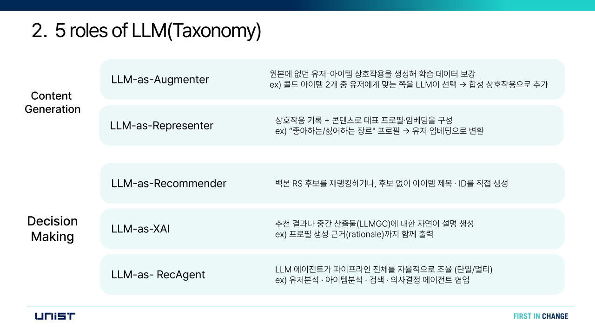

| 구분 | 역할 | 하는 일 · 예시 |
|---|---|---|
| Content Generation | LLM-as-Augmenter | 원본에 없던 유저–아이템 상호작용을 생성해 학습 데이터 보강 (예: 콜드 아이템 2개 중 유저에게 맞는 쪽을 LLM이 선택 → 합성 상호작용으로 추가) |
| | LLM-as-Representer | 상호작용 기록 + 콘텐츠로 대표 프로필·임베딩 구성 (예: "좋아하는/싫어하는 장르" 프로필 → 유저 임베딩) |
| Decision Making | LLM-as-Recommender | 백본 RS 후보를 재랭킹하거나, 후보 없이 아이템 제목·ID를 직접 생성 |
| | LLM-as-XAI | 추천 결과나 중간 산출물(LLMGC)에 대한 자연어 설명 생성 (예: 프로필 생성 근거까지 출력) |
| | LLM-as-RecAgent | LLM 에이전트가 파이프라인 전체를 자율적으로 조율 (유저 분석·아이템 분석·검색·의사결정 에이전트 협업) |

- LLMGC = LLM-Generated Content, 즉 LLM이 만든 중간 산출물(프로필, 보강 상호작용 등).

#### 슬라이드 9 · 위험 가설과 4개의 연구 질문

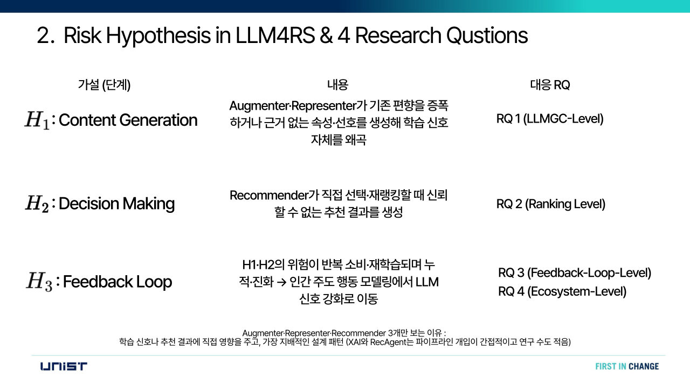

| 가설 (단계) | 내용 | 대응 RQ |
|---|---|---|
| H1: Content Generation | Augmenter·Representer가 기존 편향을 증폭하거나 근거 없는 속성·선호를 생성해 학습 신호 자체를 왜곡 | RQ1 (LLMGC-Level) |
| H2: Decision Making | Recommender가 직접 선택·재랭킹할 때 신뢰할 수 없는 추천 결과를 생성 | RQ2 (Ranking Level) |
| H3: Feedback Loop | H1·H2의 위험이 반복 소비·재학습되며 누적·진화 → 인간 주도 행동 모델링에서 LLM 신호 강화로 이동 | RQ3 (Feedback-Loop-Level), RQ4 (Ecosystem-Level) |

- **Augmenter·Representer·Recommender 3개만 보는 이유**: 학습 신호나 추천 결과에 직접 영향을 주는 가장 지배적인 설계 패턴이기 때문이다. XAI와 RecAgent는 파이프라인 개입이 간접적이고 연구 수도 적다.

### 3. 제안 프레임워크 EchoTrace

#### 슬라이드 10 · 전체 구조 (Figure 3)

- 세 단계로 구성된다.
  - **(a) LLM Content Generation Phase**: Augmenter·Representer가 유저 히스토리로 프로필·보강 상호작용을 생성한다. 속성이 비어 있으면 LLM이 채운다. → *LLMGC가 편향·환각·체계적 왜곡을 갖는가?*
  - **(b) Recommendation Phase**: Recommender가 최종 추천을 결정한다(백본 RS 후보 재랭킹 또는 개방형 생성). LLMGC가 이 단계 전 학습에 반영되기도 한다. → *불안정한 랭킹, 환각 추천, 인기 편향 등 사용자 대면 결과*
  - **(c) Feedback Loop Phase**: LLMGC·LLM 랭킹의 영향을 받은 사용자 상호작용을 다음 사이클의 학습 신호로 재투입한다. → *앞 단계 왜곡이 시간에 따라 누적되는가?*

#### 슬라이드 11 · Feedback-Loop Pipeline ① 데이터 나누기

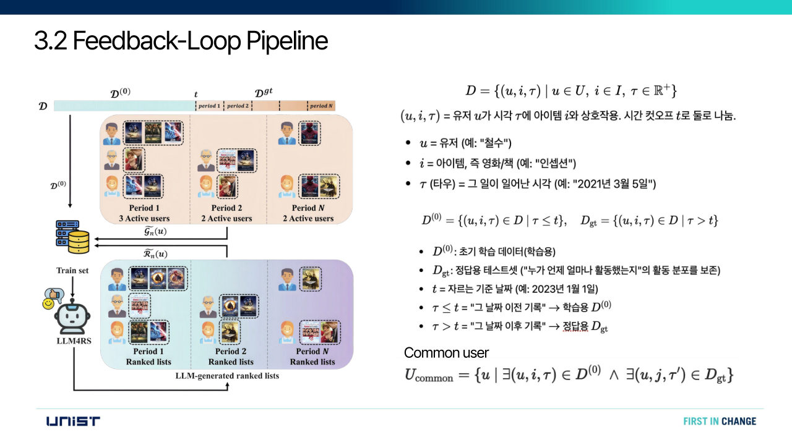

- 전체 데이터 D = {(u, i, τ)}: 유저 u가 시각 τ에 아이템 i와 상호작용한 기록 (예: "철수"가 "인셉션"을 "2021년 3월 5일"에).
- 기준 날짜 t(cutoff)로 데이터를 둘로 나눈다.
  - D⁽⁰⁾ = {τ ≤ t}: 초기 학습 데이터
  - Dgt = {τ > t}: 정답용 테스트셋. "누가 언제 얼마나 활동했는지"의 활동 분포를 보존하는 데 쓰인다.
- **Common user**: D⁽⁰⁾과 Dgt 양쪽에 모두 기록이 있는 유저. 이들만 대상으로 해야 학습과 평가가 연결된다.

#### 슬라이드 12 · ② 매 기간 반복되는 3단계: Recommend, Inject

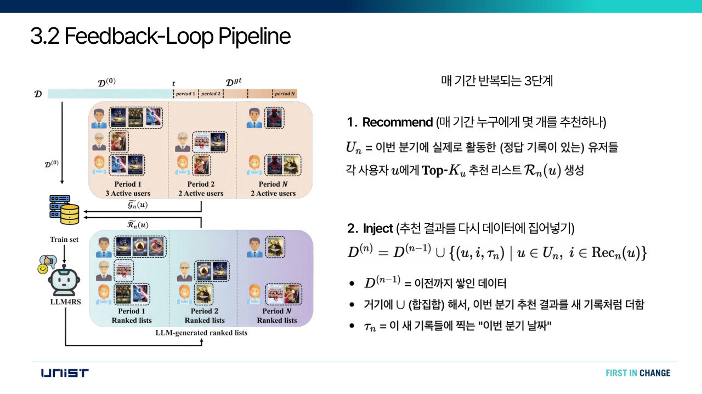

1. **Recommend**: Un = 이번 분기에 실제로 활동한(정답 기록이 있는) 유저들. 각 유저 u에게 Top-Ku 추천 리스트 Rn(u)를 만든다. Ku는 그 유저가 이 기간에 실제로 소비한 개수에 맞춘다.
2. **Inject**: D⁽ⁿ⁾ = D⁽ⁿ⁻¹⁾ ∪ {(u, i, τn) | u ∈ Un, i ∈ Recn(u)}. 이전까지 쌓인 데이터에 이번 분기 추천 결과를 새 기록처럼 합친다. τn은 이 새 기록에 찍는 "이번 분기 날짜".

#### 슬라이드 13 · ③ 주입 비율 α와 Train

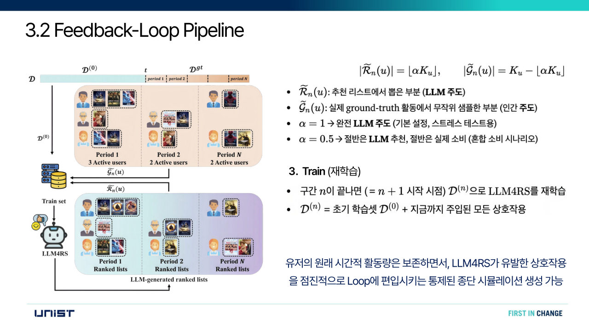

- 주입되는 Ku개를 두 부분으로 나눈다: |R̃n(u)| = ⌊αKu⌋ (추천 리스트에서 뽑은 부분, **LLM 주도**), |G̃n(u)| = Ku − ⌊αKu⌋ (실제 정답 활동에서 무작위 샘플, **인간 주도**).
  - α = 1 → 완전 LLM 주도 (기본 설정, 스트레스 테스트용)
  - α = 0.5 → 절반은 LLM 추천, 절반은 실제 소비 (혼합 소비 시나리오)
3. **Train**: 구간 n이 끝나면 D⁽ⁿ⁾ = D⁽⁰⁾ + 지금까지 주입된 모든 상호작용으로 LLM4RS를 재학습한다.
- 의의: 유저의 원래 시간적 활동량은 보존하면서, LLM4RS가 유발한 상호작용만 점진적으로 루프에 편입시키는 **통제된 종단 시뮬레이션**이 가능하다.

#### 슬라이드 14 · 위험의 정의

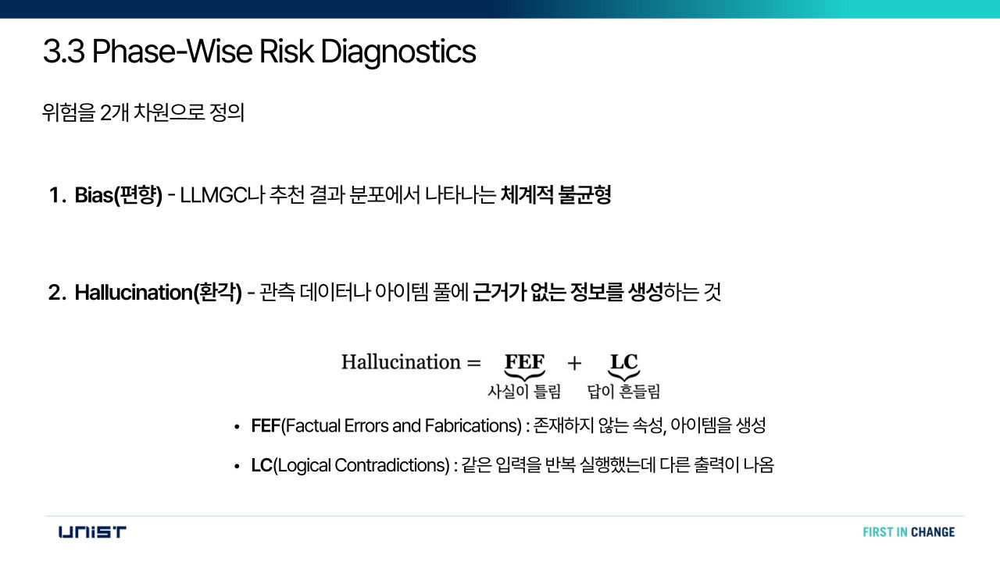

- **Bias (편향)**: LLMGC나 추천 결과 분포에 나타나는 체계적 불균형.
- **Hallucination (환각)** = **FEF** + **LC**: 관측 데이터나 아이템 풀에 근거가 없는 정보를 생성하는 것.
  - FEF (Factual Errors and Fabrications): 존재하지 않는 속성·아이템을 생성 → "사실이 틀림"
  - LC (Logical Contradictions): 같은 입력을 반복 실행했는데 다른 출력이 나옴 → "답이 흔들림"

#### 슬라이드 15 · Phase 1 진단 ① Bias in LLMGC

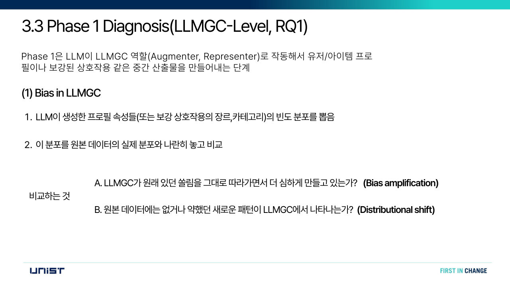

- Phase 1은 LLM이 Augmenter·Representer로 유저/아이템 프로필이나 보강 상호작용 같은 **중간 산출물**을 만드는 단계다.
- 측정: ① LLM이 생성한 프로필 속성(또는 보강 상호작용의 장르·카테고리)의 빈도 분포를 뽑고, ② 원본 데이터의 실제 분포와 나란히 비교한다.
- 비교하는 것: **(A) Bias amplification** — 원래 있던 쏠림을 그대로 따라가며 더 심하게 만드는가? **(B) Distributional shift** — 원본에는 없거나 약했던 새로운 패턴이 LLMGC에서 나타나는가?

#### 슬라이드 16 · Phase 1 진단 ② Hallucination in LLMGC

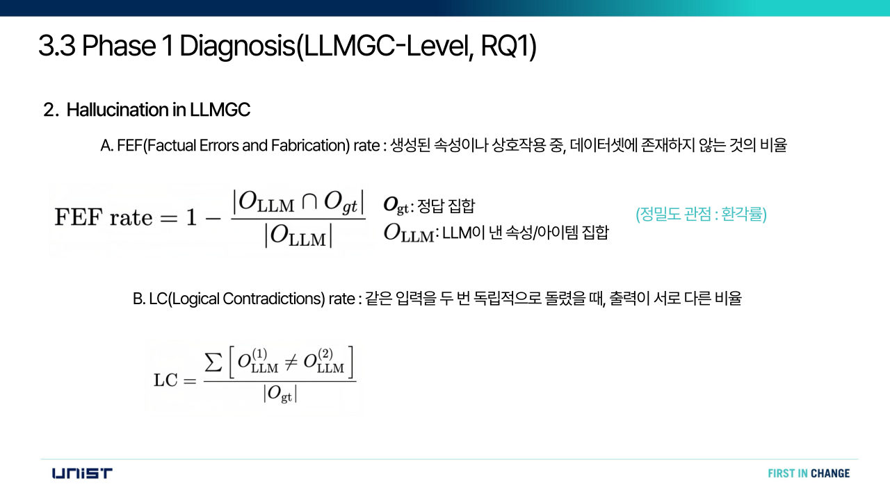

- **FEF rate** = 1 − |OLLM ∩ Ogt| / |OLLM|. Ogt는 정답 집합, OLLM은 LLM이 낸 속성/아이템 집합. LLM 출력 중 정답에 없는 비율이므로 정밀도(precision)를 뒤집은 값, 즉 **환각률**이다.
- **LC rate** = Σ[O(1)LLM ≠ O(2)LLM] / |Ogt|. 같은 입력을 독립적으로 두 번 돌렸을 때 출력이 다른 비율.

#### 슬라이드 17 · Phase 2 진단 ① Bias in Ranking

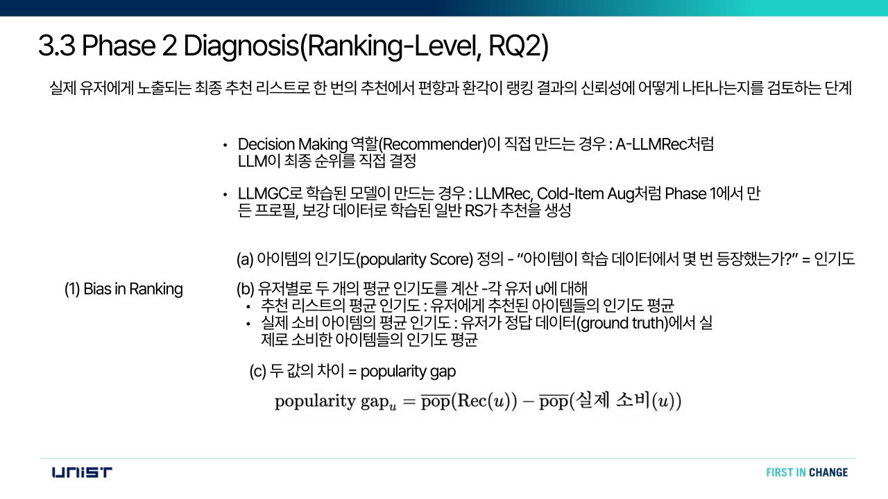

- Phase 2는 실제 유저에게 노출되는 **최종 추천 리스트**에서, 한 번의 추천만으로 편향·환각이 랭킹 신뢰성에 어떻게 나타나는지 보는 단계다.
- 추천 리스트가 만들어지는 두 경로: Recommender가 직접 만드는 경우(A-LLMRec처럼 LLM이 최종 순위 결정), LLMGC로 학습된 모델이 만드는 경우(LLMRec·Cold-Item Aug처럼 Phase 1의 프로필·보강 데이터로 학습된 일반 RS).
- **Popularity gap** 계산
  - (a) 아이템 인기도 = 학습 데이터에서 등장한 횟수
  - (b) 유저마다 추천 리스트의 평균 인기도와 실제 소비(ground truth) 아이템의 평균 인기도를 계산
  - (c) popularity gapu = pop(Rec(u)) − pop(실제 소비(u)). 양수일수록 실제보다 인기 아이템을 더 추천한다.

#### 슬라이드 18 · Phase 2 진단 ② Hallucination in Ranking

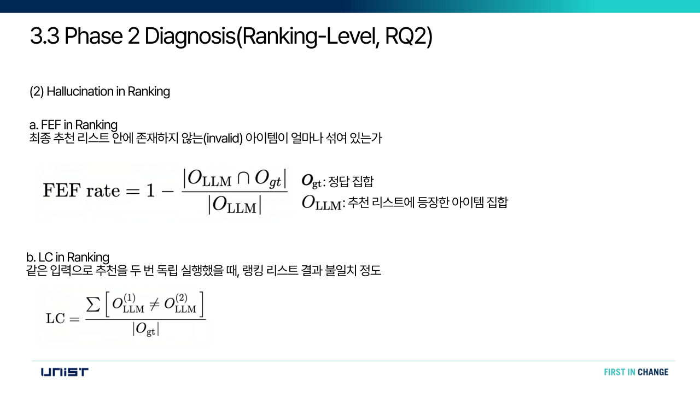

- **FEF in Ranking**: 최종 추천 리스트 안에 존재하지 않는(invalid) 아이템이 얼마나 섞여 있는가. 식은 Phase 1과 같고 OLLM이 추천 리스트의 아이템 집합으로 바뀐다.
- **LC in Ranking**: 같은 입력으로 추천을 두 번 독립 실행했을 때 랭킹 리스트가 불일치하는 정도.

#### 슬라이드 19 · Phase 3 진단 ① 누적 (RQ3)

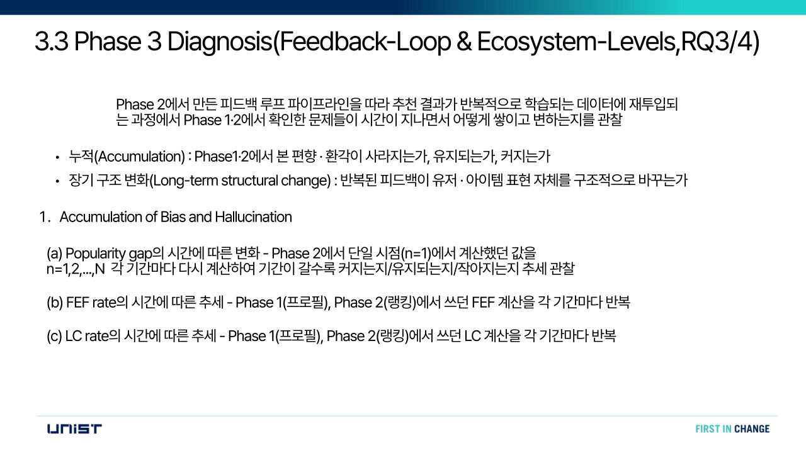

- Phase 3은 Phase 2의 결과가 피드백 루프를 따라 반복 재투입될 때, Phase 1·2의 문제가 시간이 지나며 어떻게 쌓이고 변하는지 관찰한다.
  - 누적(Accumulation): 편향·환각이 사라지는가, 유지되는가, 커지는가
  - 장기 구조 변화: 반복된 피드백이 유저·아이템 표현 자체를 구조적으로 바꾸는가
- 방법: popularity gap, FEF rate, LC rate를 n = 1, 2, …, N 각 기간마다 다시 계산해 추세를 본다.

#### 슬라이드 20 · Phase 3 진단 ② 표현 드리프트와 양극화 (RQ4)

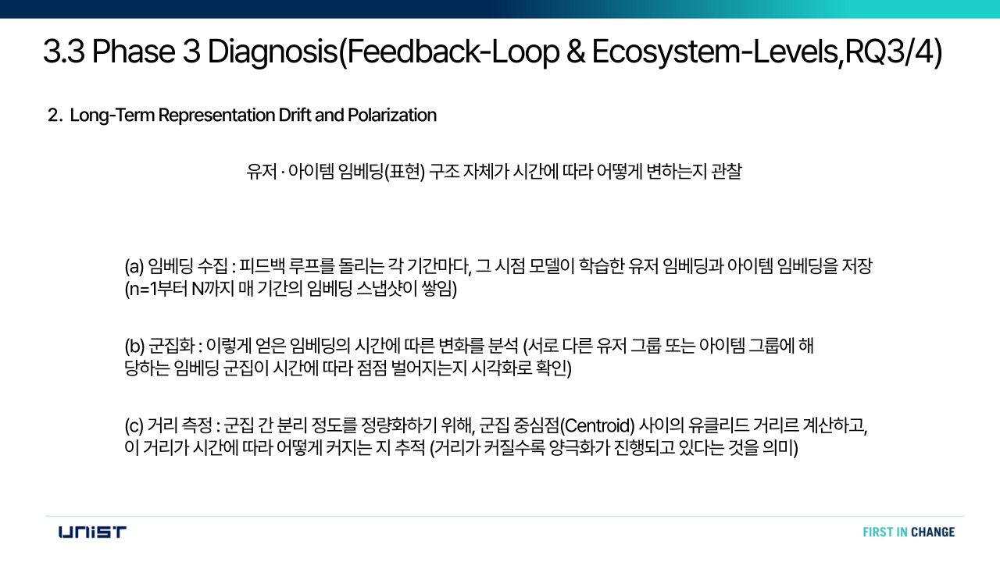

- (a) **임베딩 수집**: 각 기간마다 그 시점 모델이 학습한 유저·아이템 임베딩을 저장한다 (n = 1 ~ N 스냅샷).
- (b) **군집화**: 서로 다른 유저 그룹 또는 아이템 그룹의 임베딩 군집이 시간에 따라 벌어지는지 시각화한다.
- (c) **거리 측정**: 군집 중심점(centroid) 사이의 유클리드 거리를 기간별로 추적한다. 거리가 커질수록 양극화가 진행되고 있다는 뜻이다.

### 4. 실험 설정

#### 슬라이드 21 · 데이터셋과 비용 (Table 1)

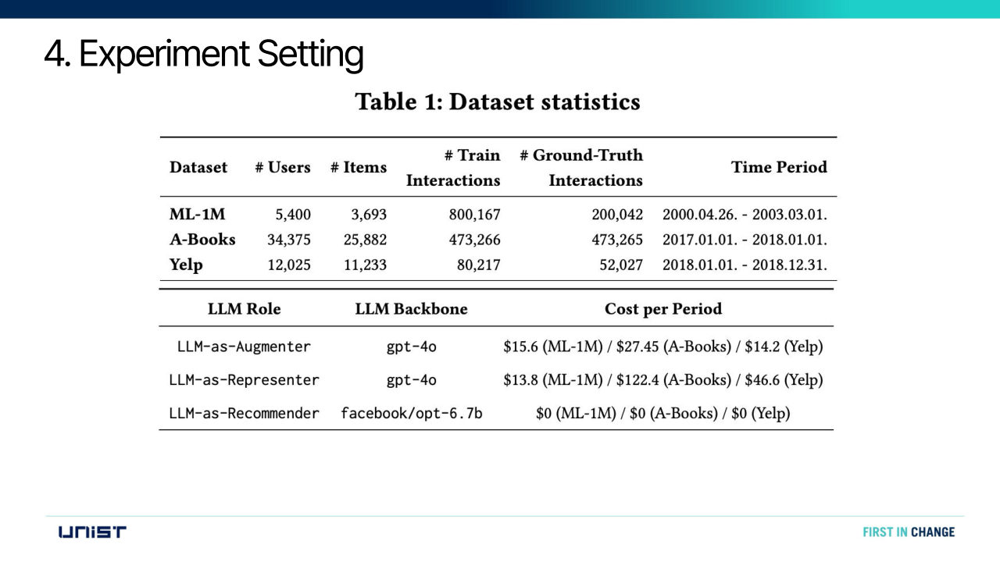

| 데이터셋 | 유저 | 아이템 | 학습 상호작용 | 정답 상호작용 | 기간 |
|---|---:|---:|---:|---:|---|
| ML-1M | 5,400 | 3,693 | 800,167 | 200,042 | 2000.04.26 – 2003.03.01 |
| A-Books | 34,375 | 25,882 | 473,266 | 473,265 | 2017.01.01 – 2018.01.01 |
| Yelp | 12,025 | 11,233 | 80,217 | 52,027 | 2018.01.01 – 2018.12.31 |

- 역할별 백본과 기간당 비용: Augmenter = gpt-4o ($15.6 / $27.45 / $14.2), Representer = gpt-4o ($13.8 / $122.4 / $46.6), Recommender = facebook/opt-6.7b (오픈소스라 $0). 순서는 ML-1M / A-Books / Yelp.

#### 슬라이드 22 · 진단 대상과 대조군

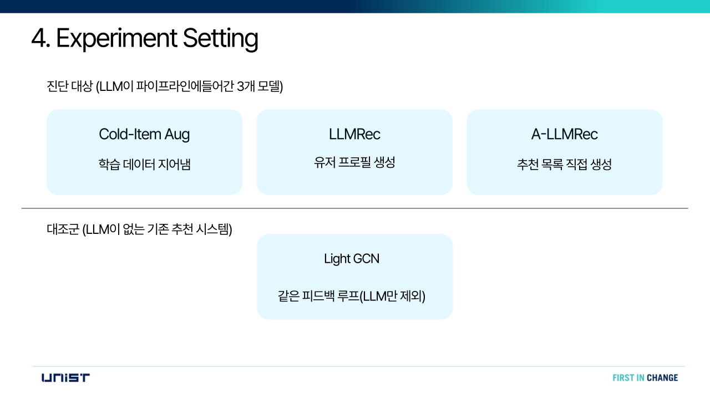

- 진단 대상 (LLM이 파이프라인에 들어간 3개 모델): **Cold-Item Aug** (Augmenter, 학습 데이터를 지어냄), **LLMRec** (Representer, 유저 프로필 생성), **A-LLMRec** (Recommender, 추천 목록 직접 생성).
- 대조군: **LightGCN**. 같은 피드백 루프에서 LLM만 뺀 기존 추천 시스템. 결과 차이가 피드백 루프 자체 때문인지 LLM 때문인지 가르는 기준이 된다.

#### 슬라이드 23 · 피드백 루프 구성

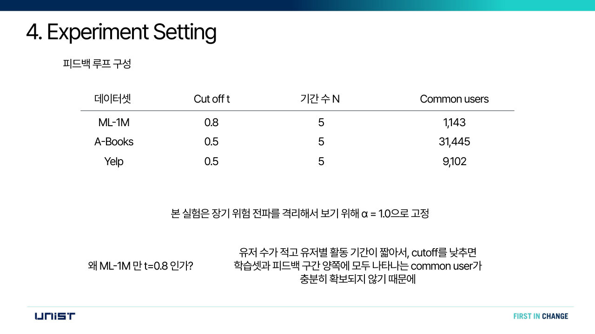

| 데이터셋 | Cutoff t | 기간 수 N | Common users |
|---|:---:|:---:|---:|
| ML-1M | 0.8 | 5 | 1,143 |
| A-Books | 0.5 | 5 | 31,445 |
| Yelp | 0.5 | 5 | 9,102 |

- 장기 위험 전파를 격리해서 보기 위해 **α = 1.0으로 고정**했다.
- ML-1M만 t = 0.8인 이유: 유저 수가 적고 유저별 활동 기간이 짧아, cutoff를 낮추면 학습셋과 피드백 구간 양쪽에 모두 나타나는 common user가 충분히 확보되지 않기 때문이다.

### 5. 결과: Phase 1 · 2 · 3

#### 슬라이드 24 · Phase 1 결과 ① Bias in LLMGC (Figure 5, 6)

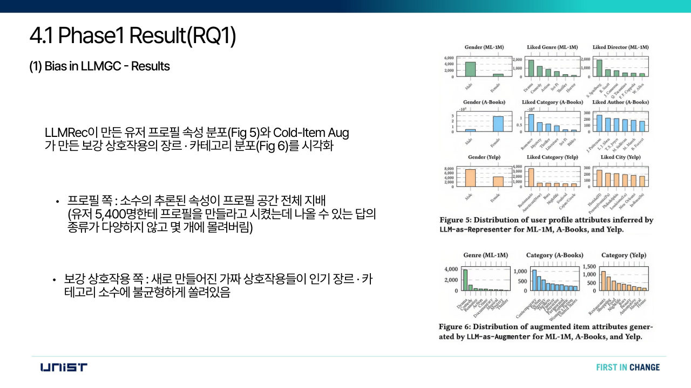

- LLMRec이 만든 유저 프로필 속성 분포(Fig 5)와 Cold-Item Aug가 만든 보강 상호작용의 장르·카테고리 분포(Fig 6)를 시각화했다.
- **프로필 쪽**: 소수의 추론된 속성이 프로필 공간 전체를 지배한다. 유저 5,400명에게 프로필을 만들게 했는데 답의 종류가 다양하지 않고 몇 개로 몰렸다.
- **보강 상호작용 쪽**: 새로 만들어진 가짜 상호작용들이 인기 장르·카테고리 소수에 불균형하게 쏠려 있다.

#### 슬라이드 25 · Phase 1 결과 ② 편향 증폭과 분포 이동 (Figure 7)

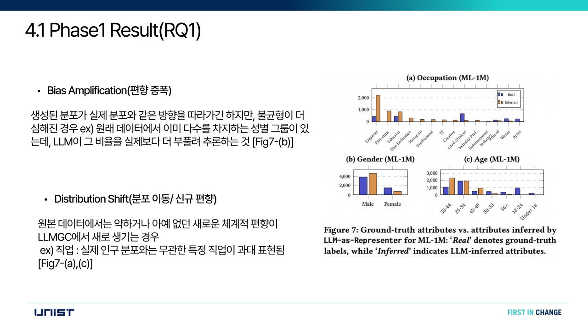

- **Bias Amplification**: 생성된 분포가 실제 분포와 같은 방향을 따라가지만 불균형이 더 심해진 경우. 예: 원래 데이터에서 이미 다수인 성별 그룹이 있는데, LLM이 그 비율을 실제보다 더 부풀려 추론한다 (Fig 7-(b)).
- **Distributional Shift**: 원본에는 약하거나 없던 새로운 체계적 편향이 LLMGC에서 생기는 경우. 예: 직업 속성에서 실제 인구 분포와 무관한 특정 직업이 과대 표현된다 (Fig 7-(a), (c)). 막대그래프에서 파랑(Real)과 주황(Inferred)의 높이가 크게 어긋나는 부분이 이에 해당한다.

#### 슬라이드 26 · Phase 1 결과 ③ FEF rate (Table 3)

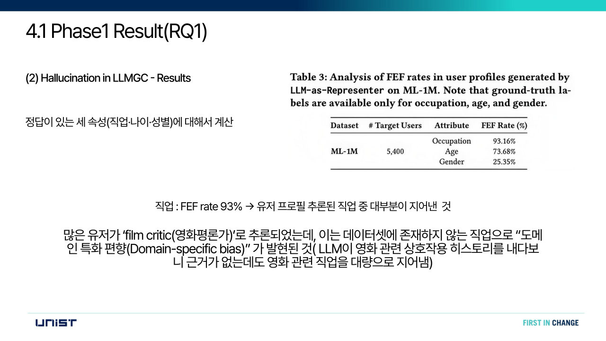

- 정답 라벨이 있는 세 속성(직업·나이·성별)에 대해 ML-1M 유저 5,400명 기준으로 계산했다.

| 속성 | FEF rate |
|---|---:|
| Occupation | 93.16% |
| Age | 73.68% |
| Gender | 25.35% |

- 직업의 FEF rate 93% → 추론된 직업 대부분이 지어낸 것이다. 많은 유저가 'film critic(영화평론가)'로 추론됐는데, 이는 데이터셋에 존재하지 않는 직업이다. LLM이 영화 관련 상호작용 히스토리를 보고 근거 없이 영화 관련 직업을 대량으로 지어낸 **도메인 특화 편향(Domain-specific bias)**이다.

#### 슬라이드 27 · Phase 1 결과 ④ LC rate (Table 4)

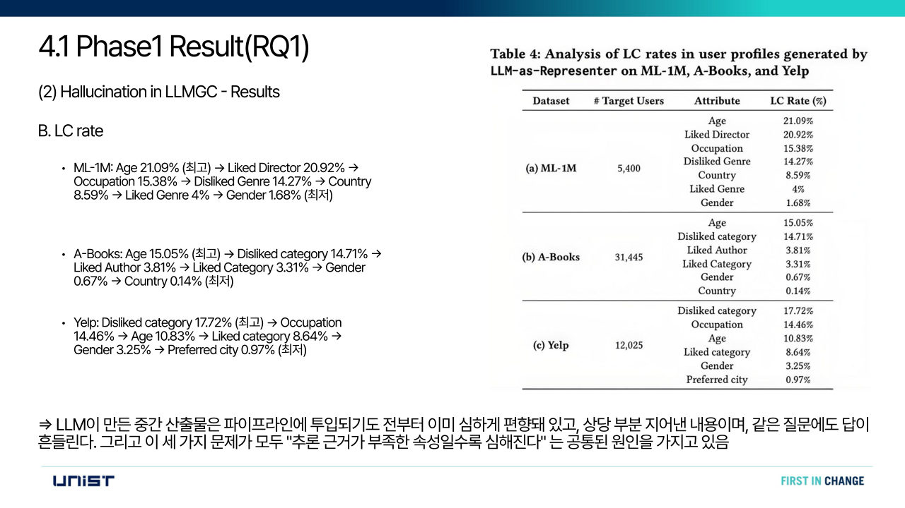

| 데이터셋 | LC rate 순서 (높음 → 낮음) |
|---|---|
| ML-1M | Age 21.09% → Liked Director 20.92% → Occupation 15.38% → Disliked Genre 14.27% → Country 8.59% → Liked Genre 4% → Gender 1.68% |
| A-Books | Age 15.05% → Disliked category 14.71% → Liked Author 3.81% → Liked Category 3.31% → Gender 0.67% → Country 0.14% |
| Yelp | Disliked category 17.72% → Occupation 14.46% → Age 10.83% → Liked category 8.64% → Gender 3.25% → Preferred city 0.97% |

- 정리: LLM이 만든 중간 산출물은 파이프라인에 투입되기 전부터 이미 심하게 편향돼 있고(편향), 상당 부분 지어낸 내용이며(FEF), 같은 질문에도 답이 흔들린다(LC). 세 문제 모두 **"추론 근거가 부족한 속성일수록 심해진다"**는 공통 원인을 가진다. 나이·싫어하는 카테고리처럼 상호작용 기록만으로 추론하기 어려운 속성이 상위에 있다.

#### 슬라이드 28 · Phase 2 결과 ① Bias in Ranking

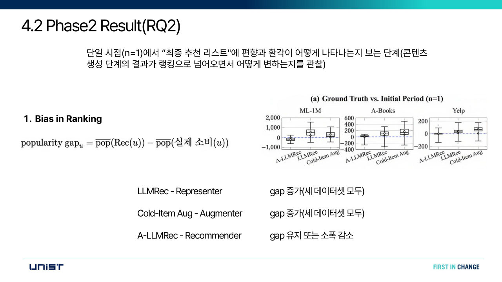

- 단일 시점(n = 1)에서 최종 추천 리스트에 편향과 환각이 어떻게 나타나는지, 콘텐츠 생성 단계의 결과가 랭킹으로 넘어오며 어떻게 변하는지 본다.
- 오른쪽 박스플롯은 ground truth 대비 초기 기간(n = 1)의 popularity gap이다.

| 모델 (역할) | popularity gap |
|---|---|
| LLMRec (Representer) | 세 데이터셋 모두 증가 |
| Cold-Item Aug (Augmenter) | 세 데이터셋 모두 증가 |
| A-LLMRec (Recommender) | 유지 또는 소폭 감소 |

#### 슬라이드 29 · Phase 2 결과 ② Hallucination in Ranking (Table 5)

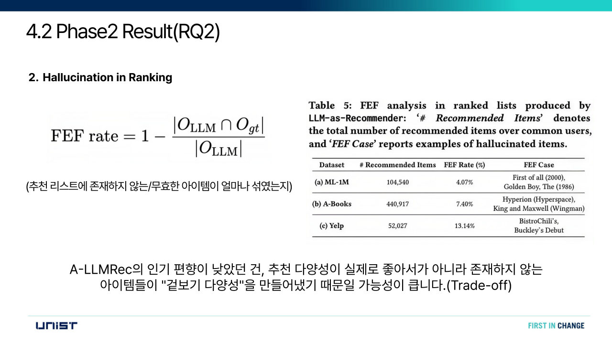

| 데이터셋 | 추천 아이템 수 | FEF rate | 환각 아이템 예시 |
|---|---:|---:|---|
| ML-1M | 104,540 | 4.07% | First of all (2000), Golden Boy, The (1986) |
| A-Books | 440,917 | 7.40% | Hyperion (Hyperspace), King and Maxwell (Wingman) |
| Yelp | 52,027 | 13.14% | BistroChili's, Buckley's Debut |

- A-LLMRec의 인기 편향이 낮았던 것은 추천 다양성이 실제로 좋아서가 아니라, **존재하지 않는 아이템들이 "겉보기 다양성"을 만들어냈기 때문**일 가능성이 크다. 편향 지표만 보면 좋아 보이지만 환각과 맞바꾼 결과다 (Trade-off).

#### 슬라이드 30 · Phase 3 결과 ① 누적 (RQ3)

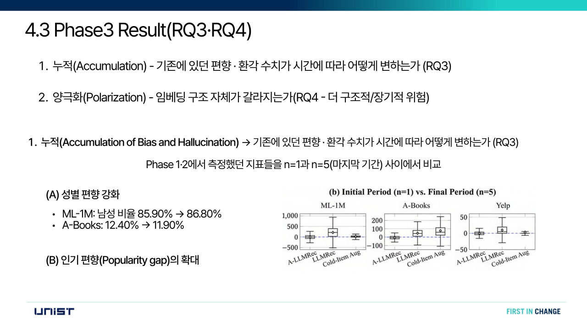

- Phase 3은 두 가지를 본다. 누적(Accumulation, RQ3): 기존 편향·환각 수치가 시간에 따라 어떻게 변하는가. 양극화(Polarization, RQ4): 임베딩 구조 자체가 갈라지는가.
- Phase 1·2에서 측정한 지표를 n = 1과 n = 5(마지막 기간) 사이에서 비교했다.
  - **(A) 성별 편향 강화**: 남성 비율이 ML-1M 85.90% → 86.80%, A-Books 12.40% → 11.90%로, 원래 다수인 쪽으로 더 쏠렸다.
  - **(B) 인기 편향(popularity gap)의 확대**: 오른쪽 박스플롯에서 n = 5의 gap 분포가 n = 1보다 위로 이동했다.

#### 슬라이드 31 · Phase 3 결과 ② 양극화 (RQ4)

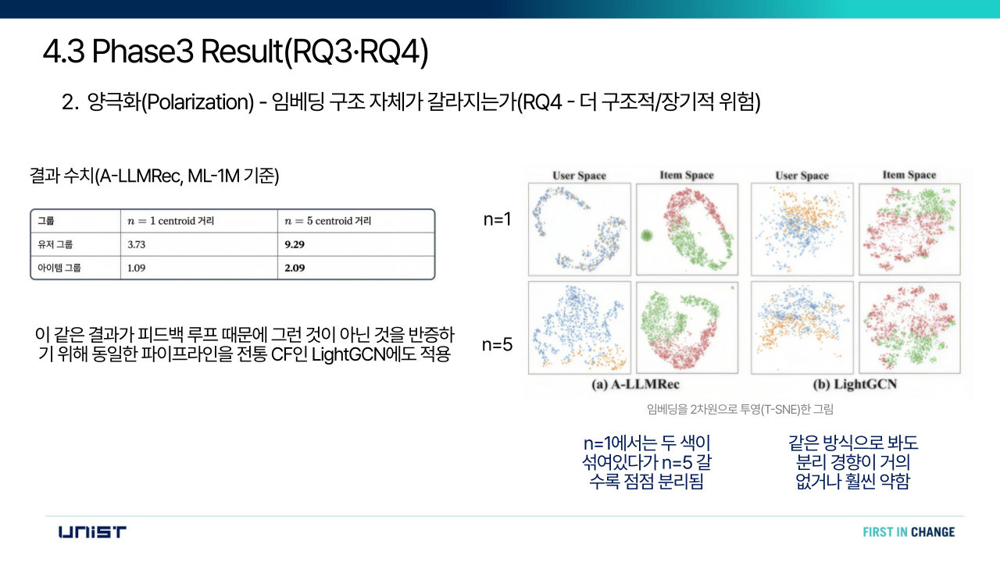

| 그룹 (A-LLMRec, ML-1M) | n = 1 centroid 거리 | n = 5 centroid 거리 |
|---|---:|---:|
| 유저 그룹 | 3.73 | 9.29 |
| 아이템 그룹 | 1.09 | 2.09 |

- 오른쪽 그림은 임베딩을 2차원으로 투영(t-SNE)한 것이다. A-LLMRec은 n = 1에서 두 색이 섞여 있다가 n = 5로 갈수록 점점 분리된다. 같은 방식으로 본 LightGCN은 분리 경향이 거의 없거나 훨씬 약하다.
- 같은 파이프라인을 전통 CF인 LightGCN에도 적용한 이유는, 이 결과가 **피드백 루프 자체 때문이 아님**을 보이기 위해서다.

#### 슬라이드 32 · Phase 3 결과 ③ 인간적 요인으로 설명되는가? → 설명되지 않음

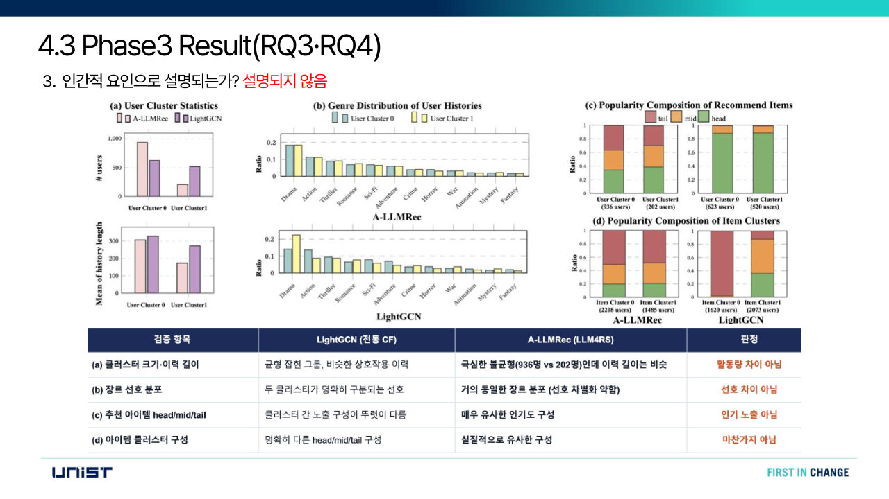

| 검증 항목 | LightGCN (전통 CF) | A-LLMRec (LLM4RS) | 판정 |
|---|---|---|---|
| (a) 클러스터 크기·이력 길이 | 균형 잡힌 그룹, 비슷한 상호작용 이력 | 극심한 불균형(936명 vs 202명)인데 이력 길이는 비슷 | 활동량 차이 아님 |
| (b) 장르 선호 분포 | 두 클러스터가 명확히 구분되는 선호 | 거의 동일한 장르 분포 (선호 차별화 약함) | 선호 차이 아님 |
| (c) 추천 아이템 head/mid/tail | 클러스터 간 노출 구성이 뚜렷이 다름 | 매우 유사한 인기도 구성 | 인기 노출 아님 |
| (d) 아이템 클러스터 구성 | 명확히 다른 head/mid/tail 구성 | 실질적으로 유사한 구성 | 마찬가지 아님 |

- 활동량·장르 선호·인기 노출 같은 사람 쪽 요인으로는 A-LLMRec의 군집 분리가 설명되지 않는다. 즉 분리는 **LLM이 만든 신호**에서 온다.

#### 슬라이드 33 · Phase 3 결과 ④ LLM 주입 신호의 자기강화 (Figure 11)

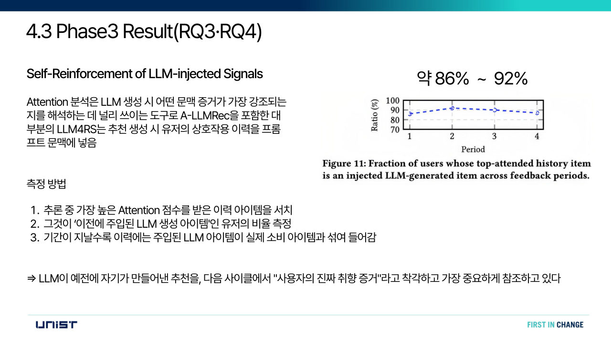

- Attention 분석은 LLM이 생성할 때 어떤 문맥 증거를 가장 강조하는지 해석하는 데 널리 쓰인다. A-LLMRec을 포함한 대부분의 LLM4RS는 추천할 때 유저의 상호작용 이력을 프롬프트 문맥에 넣는다.
- 측정 방법: ① 추론 중 가장 높은 attention을 받은 이력 아이템을 찾고, ② 그것이 '이전에 주입된 LLM 생성 아이템'인 유저의 비율을 잰다. ③ 기간이 지날수록 이력에는 주입된 LLM 아이템이 실제 소비 아이템과 섞여 들어간다.
- 결과: 그 비율이 **약 86% ~ 92%**로 모든 기간에서 높게 유지된다.
- 해석: LLM이 예전에 자기가 만들어낸 추천을, 다음 사이클에서 "사용자의 진짜 취향 증거"라고 착각하고 가장 중요하게 참조하고 있다.

### 6. 추가 분석: 성능 · 실제 소비 혼합 · 백본 교체

#### 슬라이드 34 · 재귀적 피드백에서의 성능 저하

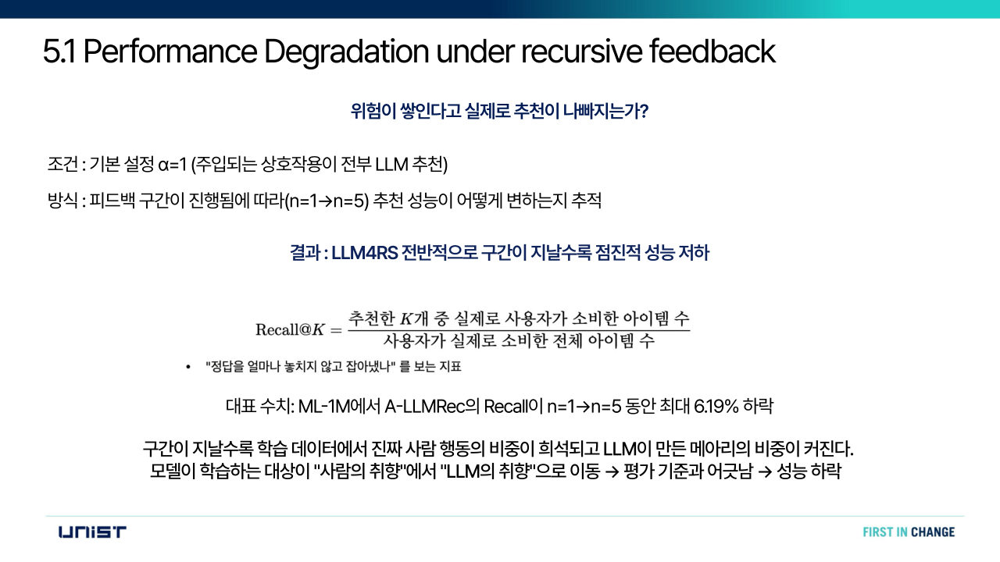

- 질문: 위험이 쌓인다고 실제로 추천이 나빠지는가?
- 조건: 기본 설정 α = 1 (주입되는 상호작용이 전부 LLM 추천). 피드백 구간이 n = 1 → 5로 진행됨에 따라 추천 성능을 추적.
- 지표: Recall@K = 추천한 K개 중 실제로 사용자가 소비한 아이템 수 / 사용자가 실제로 소비한 전체 아이템 수. "정답을 얼마나 놓치지 않고 잡아냈나"를 본다.
- 결과: LLM4RS 전반에서 구간이 지날수록 점진적으로 성능이 떨어진다. 대표 수치로 ML-1M에서 A-LLMRec의 Recall이 n = 1 → 5 동안 **최대 6.19% 하락**.
- 이유: 구간이 지날수록 학습 데이터에서 진짜 사람 행동의 비중이 희석되고 LLM이 만든 메아리의 비중이 커진다. 모델이 학습하는 대상이 "사람의 취향"에서 "LLM의 취향"으로 이동하면서 평가 기준(실제 소비)과 어긋난다.

#### 슬라이드 35 · 실제 사람의 상호작용을 남겨두면?

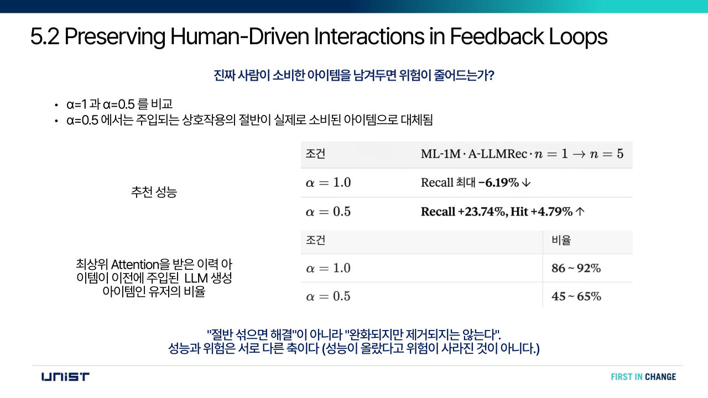

- α = 1과 α = 0.5를 비교했다. α = 0.5에서는 주입되는 상호작용의 절반이 실제로 소비된 아이템으로 대체된다.

| 조건 (ML-1M · A-LLMRec · n = 1 → 5) | 추천 성능 | 최상위 attention 이력이 LLM 생성 아이템인 유저 비율 |
|---|---|---|
| α = 1.0 | Recall 최대 −6.19% | 86 ~ 92% |
| α = 0.5 | Recall +23.74%, Hit +4.79% | 45 ~ 65% |

- 결론은 "절반 섞으면 해결"이 아니라 **"완화되지만 제거되지는 않는다"**. 성능은 크게 좋아졌지만 LLM 아이템 의존은 여전히 절반 안팎 남는다. 성능과 위험은 서로 다른 축이므로, 성능이 올랐다고 위험이 사라진 것이 아니다.

#### 슬라이드 36 · LLM 백본을 바꿔도 위험이 재발하는가

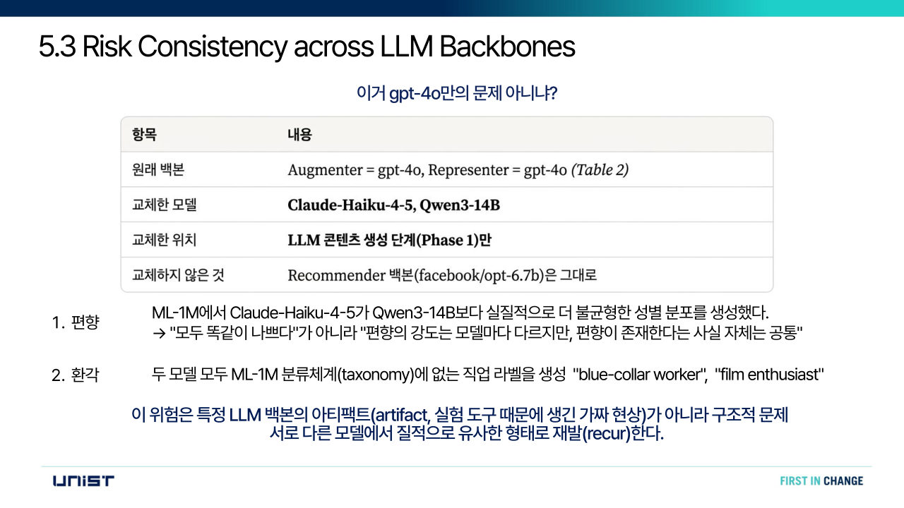

| 항목 | 내용 |
|---|---|
| 원래 백본 | Augmenter = gpt-4o, Representer = gpt-4o |
| 교체한 모델 | Claude-Haiku-4-5, Qwen3-14B |
| 교체한 위치 | LLM 콘텐츠 생성 단계(Phase 1)만 |
| 교체하지 않은 것 | Recommender 백본(facebook/opt-6.7b) |

1. **편향**: ML-1M에서 Claude-Haiku-4-5가 Qwen3-14B보다 실질적으로 더 불균형한 성별 분포를 생성했다. "모두 똑같이 나쁘다"가 아니라 "편향의 강도는 모델마다 다르지만 편향이 존재한다는 사실 자체는 공통"이다.
2. **환각**: 두 모델 모두 ML-1M 분류체계에 없는 직업 라벨("blue-collar worker", "film enthusiast")을 생성했다.
- 이 위험은 특정 LLM 백본의 아티팩트(실험 도구 때문에 생긴 가짜 현상)가 아니라 **구조적 문제**이며, 서로 다른 모델에서 질적으로 유사한 형태로 재발한다.

### 7. 결론과 한계

#### 슬라이드 37 · Conclusion

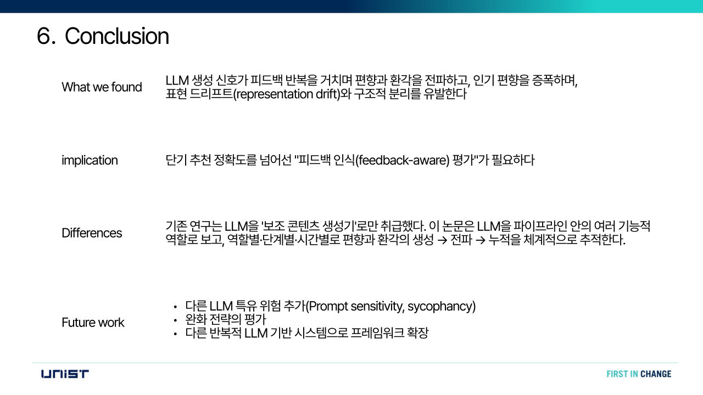

| | 내용 |
|---|---|
| What we found | LLM 생성 신호가 피드백 반복을 거치며 편향과 환각을 전파하고, 인기 편향을 증폭하며, 표현 드리프트와 구조적 분리를 유발한다 |
| Implication | 단기 추천 정확도를 넘어선 **피드백 인식(feedback-aware) 평가**가 필요하다 |
| Differences | 기존 연구는 LLM을 '보조 콘텐츠 생성기'로만 취급했다. 이 논문은 LLM을 파이프라인 안의 여러 기능적 역할로 보고, 역할별·단계별·시간별로 편향과 환각의 생성 → 전파 → 누적을 체계적으로 추적한다 |
| Future work | 다른 LLM 특유 위험 추가(prompt sensitivity, sycophancy), 완화 전략의 평가, 다른 반복적 LLM 기반 시스템으로 프레임워크 확장 |

#### 슬라이드 38 · Limitations

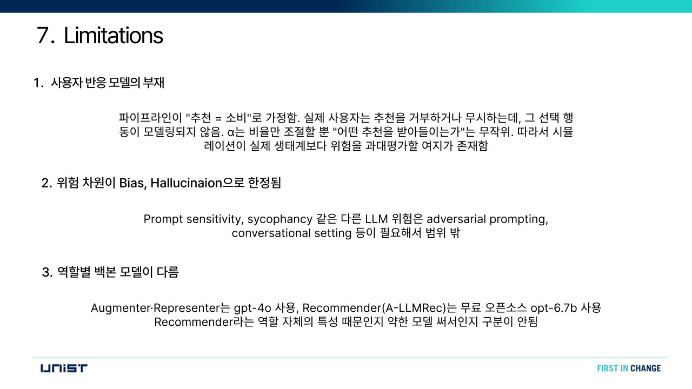

1. **사용자 반응 모델의 부재**: 파이프라인이 "추천 = 소비"로 가정한다. 실제 사용자는 추천을 거부하거나 무시하는데 그 선택 행동이 모델링되지 않는다. α는 비율만 조절할 뿐 "어떤 추천을 받아들이는가"는 무작위다. 따라서 시뮬레이션이 실제 생태계보다 위험을 과대평가할 여지가 있다.
2. **위험 차원이 Bias, Hallucination으로 한정됨**: prompt sensitivity, sycophancy 같은 다른 LLM 위험은 adversarial prompting, conversational setting 등이 필요해서 범위 밖이다.
3. **역할별 백본 모델이 다름**: Augmenter·Representer는 gpt-4o, Recommender(A-LLMRec)는 무료 오픈소스 opt-6.7b를 썼다. Recommender라는 역할 자체의 특성 때문인지 약한 모델을 써서인지 구분이 안 된다.

---

## 무엇을 배웠나

- **추천 시스템 기초 정리**: CF, Content-based, Hybrid, LightGCN의 아이디어와 차이, 그리고 전통 추천이 가진 6가지 한계를 정리했다.
- **LLM4RS를 역할 단위로 보는 시각**: '추천에 LLM을 쓴다'를 Augmenter / Representer / Recommender / XAI / RecAgent로 나누면 위험이 어디서 생기는지 분리해서 볼 수 있다.
- **피드백 루프 시뮬레이션 설계 방법**: 시간 cutoff로 학습/정답 데이터를 나누고, 기간마다 추천 → 주입 → 재학습을 반복하며, 주입 비율 α와 common user로 실험을 통제하는 방식.
- **위험을 정량화하는 지표 설계**: FEF rate, LC rate, popularity gap, 임베딩 centroid 거리처럼 편향·환각·양극화를 각각 측정 가능한 수치로 바꾸는 방법.
- **인과를 분리하는 실험 설계**: LightGCN 대조군, 활동량·장르·인기 노출 검증, 백본 교체로 '피드백 루프 때문인지, LLM 때문인지, 특정 모델 때문인지'를 하나씩 배제하는 과정이 인상적이었다.
- **비판적으로 읽기**: 성능과 위험은 별개 축이라 성능이 좋아졌다는 이유로 위험이 사라졌다고 볼 수 없고, α나 '추천=소비' 가정 같은 시뮬레이션의 전제가 결과 해석에 영향을 준다는 점을 한계 섹션에서 짚어 봤다.
