

  

# 2회차 랩미팅 · Multi-TAP

> [← 전체 목록으로](../../README.md)

| | |
|---|---|
| **논문** | *Multi-TAP: Multi-criteria Target Adaptive Persona Modeling for Cross-domain Recommendation* |
| **저자** | Daehee Kang (UNIST), Yeon-Chang Lee (UNIST) |
| **학회** | KDD 2026 · [arXiv:2603.07086](https://arxiv.org/abs/2603.07086) |
| **발표** | 박민성 (2026-10-02) |
| **자료** | [발표 PDF](Multi-TAP_labmeeting_02.pdf) · 슬라이드 26장 |
| **키워드** | `Cross-domain Recommendation` `LLM Persona` `Intra-Domain Heterogeneity` `Doppelganger` |

## 한눈에 보기

쿠팡의 전자제품관(A)에서 산 기록으로 가구관(B)을 추천한다고 하자. 기존 방법은 A에서 "이 사람은 비싼 걸 좋아함"처럼 한 줄로 요약해 B로 통째로 넘긴다. 그런데 같은 전자제품관 안에서도 컴퓨터는 비싼 걸, 이어폰은 싼 걸 사는 사람이 많아서 한 줄로 줄이는 순간 이 차이가 사라진다.

| 문제 | 방법 | 결과 | 배운 점 |
|---|---|---|---|
| 기존 CDR은 사용자를 도메인당 벡터 하나로 요약해, 같은 도메인 안에서도 카테고리마다 선호가 다른 현상(IDH)을 뭉갠다 | (P1) 가격·품질·인기·카테고리 다양성·친숙도 5개 기준으로 LLM 페르소나를 따로 만들고 Self-Attention으로 결합, (P2) target 기준의 '도플갱어'로 source 정보를 선별 전이 | 6개 전이 방향 중 5개에서 1위, 최대 HR@5 +36.3%(Home→Elec, vs PPA). 학습 9~30분 | 핵심 질문을 "어떻게 옮길까(How)"에서 "어떤 선호를 옮길까(What)"로 바꿨다 |

  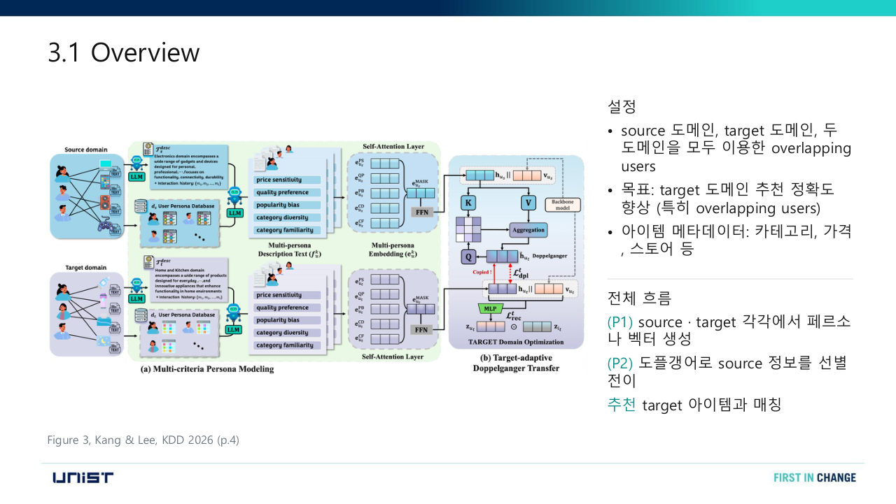 
  Multi-TAP 전체 구조 (슬라이드 10, Figure 3)

## 목차

0. [Overview](#0-overview) · 슬라이드 1–2
1. [Introduction](#1-introduction) · 슬라이드 3–6
2. [Motivation: IDH의 정의와 측정](#2-motivation-idh의-정의와-측정) · 슬라이드 7–9
3. [제안 방법 Multi-TAP](#3-제안-방법-multi-tap) · 슬라이드 10–17
4. [Evaluation](#4-evaluation) · 슬라이드 18–23
5. [Related Work · 결론 · 한계](#5-related-work--결론--한계) · 슬라이드 24–26

---

## 슬라이드별 상세 설명

### 0. Overview

#### 슬라이드 1 · 표지

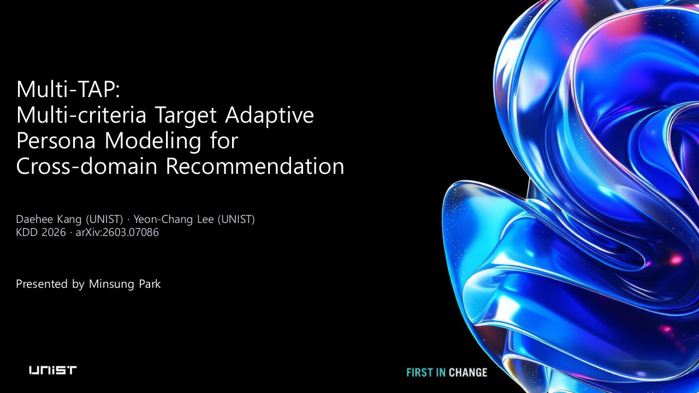

- 리뷰 논문은 *Multi-TAP: Multi-criteria Target Adaptive Persona Modeling for Cross-domain Recommendation* (Daehee Kang · Yeon-Chang Lee, KDD 2026, arXiv:2603.07086).
- 이름 풀이: **Multi-criteria**(여러 기준) · **Target Adaptive**(target 도메인에 맞춘) · **Persona Modeling**(페르소나로 사용자 표현).

#### 슬라이드 2 · Overview

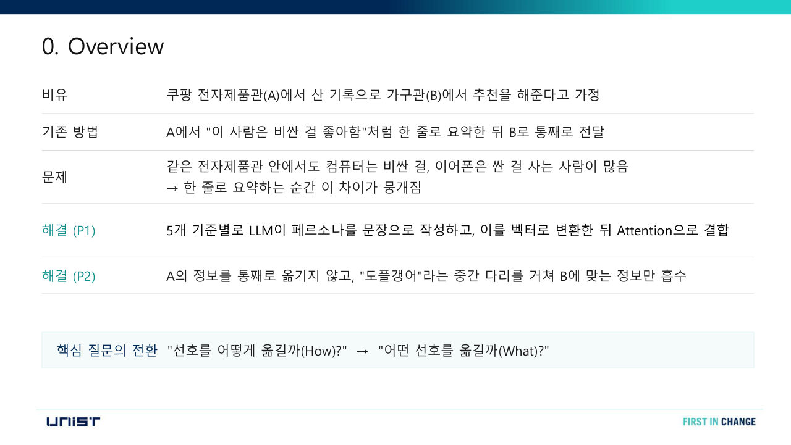

| | 내용 |
|---|---|
| 비유 | 쿠팡 전자제품관(A)에서 산 기록으로 가구관(B)에서 추천을 해준다고 가정 |
| 기존 방법 | A에서 "이 사람은 비싼 걸 좋아함"처럼 한 줄로 요약한 뒤 B로 통째로 전달 |
| 문제 | 같은 전자제품관 안에서도 컴퓨터는 비싼 걸, 이어폰은 싼 걸 사는 사람이 많음 → 한 줄로 요약하는 순간 이 차이가 뭉개짐 |
| 해결 (P1) | 5개 기준별로 LLM이 페르소나를 문장으로 작성하고, 이를 벡터로 변환한 뒤 Attention으로 결합 |
| 해결 (P2) | A의 정보를 통째로 옮기지 않고, "도플갱어"라는 중간 다리를 거쳐 B에 맞는 정보만 흡수 |

- 핵심 질문의 전환: **"선호를 어떻게 옮길까(How)?" → "어떤 선호를 옮길까(What)?"**

### 1. Introduction

#### 슬라이드 3 · CDR의 배경과 두 가지 접근

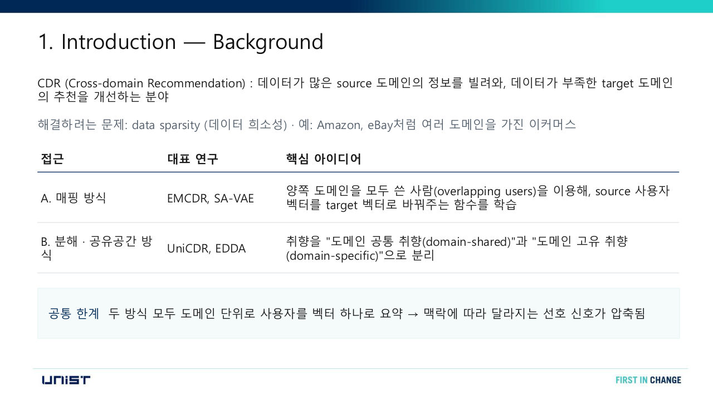

- **CDR (Cross-domain Recommendation)**: 데이터가 많은 source 도메인의 정보를 빌려와, 데이터가 부족한 target 도메인의 추천을 개선하는 분야. 해결하려는 문제는 data sparsity이고, Amazon·eBay처럼 여러 도메인을 가진 이커머스가 대표 환경이다.

| 접근 | 대표 연구 | 핵심 아이디어 |
|---|---|---|
| A. 매핑 방식 | EMCDR, SA-VAE | 양쪽 도메인을 모두 쓴 사람(overlapping users)을 이용해, source 사용자 벡터를 target 벡터로 바꿔주는 함수를 학습 |
| B. 분해·공유공간 방식 | UniCDR, EDDA | 취향을 "도메인 공통 취향(domain-shared)"과 "도메인 고유 취향(domain-specific)"으로 분리 |

- **공통 한계**: 두 방식 모두 도메인 단위로 사용자를 벡터 하나로 요약한다. 맥락에 따라 달라지는 선호 신호가 그 안에 압축된다.

#### 슬라이드 4 · 기존 CDR 방법 비교

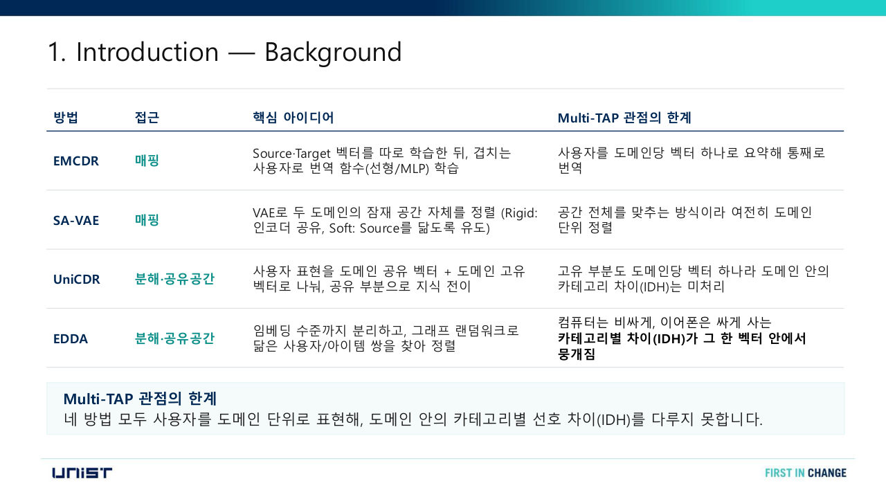

| 방법 | 접근 | 핵심 아이디어 | Multi-TAP 관점의 한계 |
|---|---|---|---|
| EMCDR | 매핑 | Source·Target 벡터를 따로 학습한 뒤, 겹치는 사용자로 번역 함수(선형/MLP) 학습 | 사용자를 도메인당 벡터 하나로 요약해 통째로 번역 |
| SA-VAE | 매핑 | VAE로 두 도메인의 잠재공간 자체를 정렬 (Rigid: 인코더 공유, Soft: Source를 닮도록 유도) | 공간 전체를 맞추는 방식이라 여전히 도메인 단위 정렬 |
| UniCDR | 분해·공유공간 | 사용자 표현을 도메인 공유 벡터 + 도메인 고유 벡터로 나눠, 공유 부분으로 지식 전이 | 고유 부분도 도메인당 벡터 하나라 도메인 안의 카테고리 차이(IDH)는 미처리 |
| EDDA | 분해·공유공간 | 임베딩 수준까지 분리하고, 그래프 랜덤워크로 닮은 사용자/아이템 쌍을 찾아 정렬 | 컴퓨터는 비싸게, 이어폰은 싸게 사는 카테고리별 차이(IDH)가 그 한 벡터 안에서 뭉개짐 |

- 네 방법 모두 사용자를 도메인 단위로 표현해, 도메인 안의 카테고리별 선호 차이(IDH)를 다루지 못한다.

#### 슬라이드 5 · Motivation: 무엇을 옮길 것인가

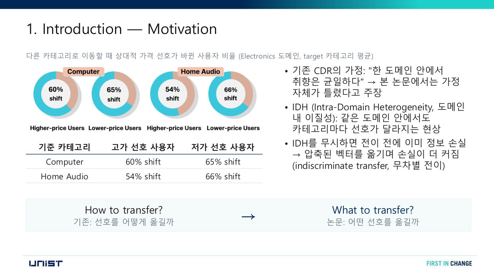

- 표는 Electronics 도메인에서 다른 카테고리로 이동할 때 상대적 가격 선호가 바뀐 사용자 비율(target 카테고리 평균)이다.

| 기준 카테고리 | 고가 선호 사용자 | 저가 선호 사용자 |
|---|:---:|:---:|
| Computer | 60% shift | 65% shift |
| Home Audio | 54% shift | 66% shift |

- 기존 CDR의 가정: "한 도메인 안에서 취향은 균일하다." 논문은 이 가정 자체가 틀렸다고 주장한다.
- **IDH (Intra-Domain Heterogeneity, 도메인 내 이질성)**: 같은 도메인 안에서도 카테고리마다 선호가 달라지는 현상.
- IDH를 무시하면 전이 전에 이미 정보가 손실되고, 압축된 벡터를 옮기며 손실이 더 커진다 (indiscriminate transfer, 무차별 전이). 그래서 질문이 How to transfer에서 **What to transfer**로 바뀐다.

#### 슬라이드 6 · Contributions

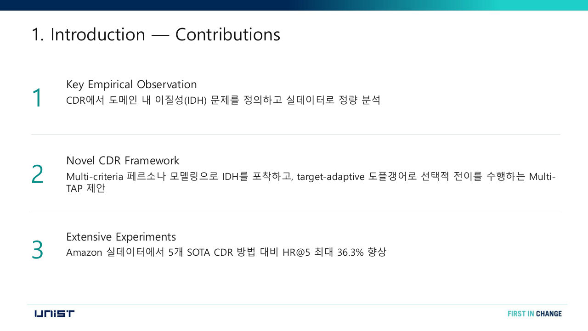

1. **Key Empirical Observation**: CDR에서 도메인 내 이질성(IDH) 문제를 정의하고 실데이터로 정량 분석.
2. **Novel CDR Framework**: Multi-criteria 페르소나 모델링으로 IDH를 포착하고, target-adaptive 도플갱어로 선택적 전이를 수행하는 Multi-TAP 제안.
3. **Extensive Experiments**: Amazon 실데이터에서 5개 SOTA CDR 방법 대비 HR@5 최대 36.3% 향상.

### 2. Motivation: IDH의 정의와 측정

#### 슬라이드 7 · IDH 측정 ① 아이템 등급과 사용자 점수

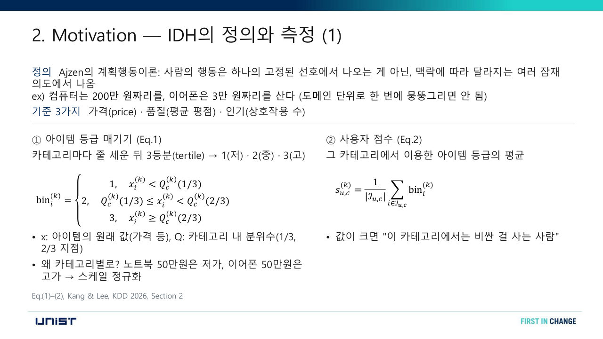

- **정의의 근거**: Ajzen의 계획행동이론. 사람의 행동은 하나의 고정된 선호가 아니라 맥락에 따라 달라지는 여러 잠재 의도에서 나온다. 예: 컴퓨터는 200만 원짜리를, 이어폰은 3만 원짜리를 산다. 도메인 단위로 한 번에 뭉뚱그리면 안 된다.
- 기준 3가지: 가격(price) · 품질(평균 평점) · 인기(상호작용 수).
- **① 아이템 등급 매기기 (Eq. 1)**: 카테고리마다 줄 세운 뒤 3등분(tertile)해 1(저) · 2(중) · 3(고)을 준다. x는 아이템의 원래 값, Q는 카테고리 내 분위수(1/3, 2/3 지점).
  - 왜 카테고리별로? 노트북 50만 원은 저가, 이어폰 50만 원은 고가이므로 스케일을 정규화하기 위해서다.
- **② 사용자 점수 (Eq. 2)**: su,c(k) = 그 카테고리에서 이용한 아이템 등급의 평균. 값이 크면 "이 카테고리에서는 비싼 걸 사는 사람"이다.

#### 슬라이드 8 · IDH 측정 ② 사용자 라벨과 선호 보존율

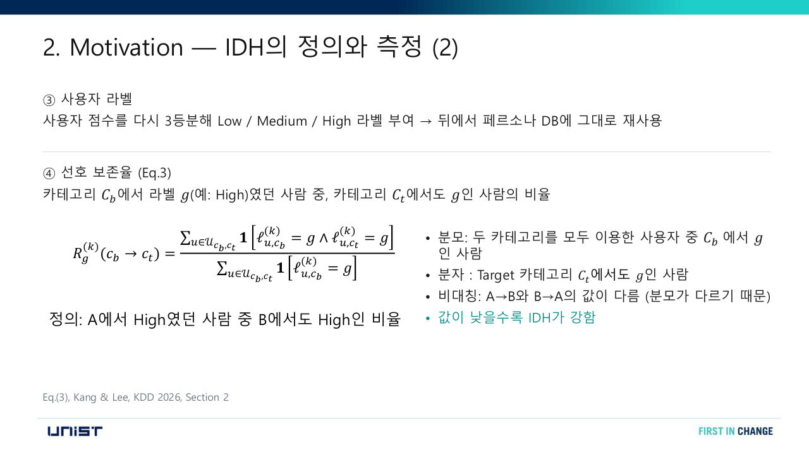

- **③ 사용자 라벨**: 사용자 점수를 다시 3등분해 Low / Medium / High 라벨을 부여한다. 이 라벨은 뒤에서 페르소나 DB에 그대로 재사용된다.
- **④ 선호 보존율 (Eq. 3)**: Rg(k)(cb → ct) = 카테고리 Cb에서 라벨 g(예: High)였던 사람 중, 카테고리 Ct에서도 g인 사람의 비율.
  - 분모: 두 카테고리를 모두 이용한 사용자 중 Cb에서 g인 사람
  - 분자: 그중 target 카테고리 Ct에서도 g인 사람
  - 비대칭: A→B와 B→A의 값이 다르다 (분모가 다르기 때문).
  - **값이 낮을수록 IDH가 강하다.**

#### 슬라이드 9 · Observations (Figure 2)

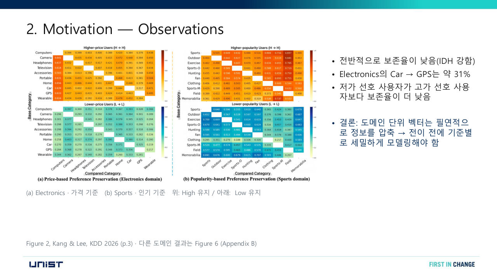

- (a) Electronics · 가격 기준, (b) Sports · 인기 기준의 카테고리 간 보존율 히트맵. 위는 High 유지, 아래는 Low 유지.
- 전반적으로 보존율이 낮다 (IDH가 강함). 예: Electronics의 Car → GPS는 약 31%. 라벨이 3등분이라 카테고리와 무관하게 무작위로 라벨이 붙어도 약 33%가 나오므로, 거의 무작위 수준이다.
- 저가 선호 사용자가 고가 선호 사용자보다 보존율이 더 낮다.
- 결론: 도메인 단위 벡터는 필연적으로 정보를 압축한다 → 전이 전에 기준별로 세밀하게 모델링해야 한다. (다른 도메인 결과는 Appendix B, Figure 6)

### 3. 제안 방법 Multi-TAP

#### 슬라이드 10 · Overview (Figure 3)

- **설정**: source 도메인, target 도메인, 두 도메인을 모두 이용한 overlapping users. 목표는 target 도메인 추천 정확도 향상(특히 overlapping users). 아이템 메타데이터로 카테고리·가격·스토어 등을 쓴다.
- **전체 흐름**: (P1) source · target 각각에서 페르소나 벡터 생성 → (P2) 도플갱어로 source 정보를 선별 전이 → target 아이템과 매칭해 추천.

#### 슬라이드 11 · (P1) Step 1: User Persona Database

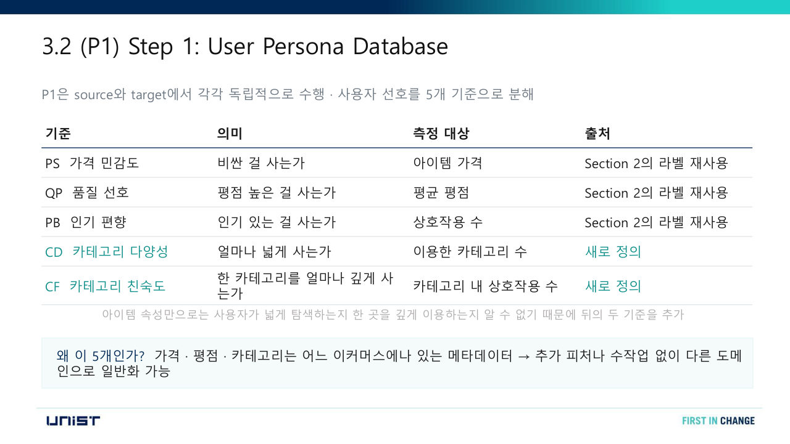

- P1은 source와 target에서 각각 독립적으로 수행하며, 사용자 선호를 5개 기준으로 분해한다.

| 기준 | 의미 | 측정 대상 | 출처 |
|---|---|---|---|
| PS 가격 민감도 | 비싼 걸 사는가 | 아이템 가격 | Section 2의 라벨 재사용 |
| QP 품질 선호 | 평점 높은 걸 사는가 | 평균 평점 | Section 2의 라벨 재사용 |
| PB 인기 편향 | 인기 있는 걸 사는가 | 상호작용 수 | Section 2의 라벨 재사용 |
| CD 카테고리 다양성 | 얼마나 넓게 사는가 | 이용한 카테고리 수 | 새로 정의 |
| CF 카테고리 친숙도 | 한 카테고리를 얼마나 깊게 사는가 | 카테고리 내 상호작용 수 | 새로 정의 |

- 왜 이 5개인가? 가격·평점·카테고리는 어느 이커머스에나 있는 메타데이터라, 추가 피처나 수작업 없이 다른 도메인으로 일반화할 수 있다.
- 아이템 속성만으로는 사용자가 넓게 탐색하는지 한곳을 깊게 이용하는지 알 수 없어서 뒤의 두 기준(CD, CF)을 더했다.

#### 슬라이드 12 · (P1) Step 1: 카테고리 다양성 · 친숙도 · Persona DB

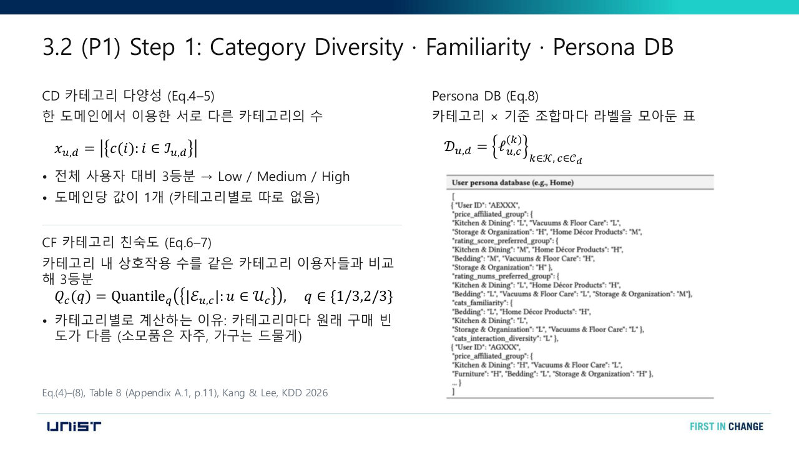

- **CD 카테고리 다양성 (Eq. 4–5)**: 한 도메인에서 이용한 서로 다른 카테고리의 수 xu,d = |{c(i) : i ∈ Iu,d}|. 전체 사용자 대비 3등분해 Low / Medium / High. 도메인당 값이 1개다 (카테고리별로 따로 없음).
- **CF 카테고리 친숙도 (Eq. 6–7)**: 카테고리 내 상호작용 수를 같은 카테고리 이용자들과 비교해 3등분 (Qc(q) = Quantileq, q ∈ {1/3, 2/3}). 카테고리별로 계산하는 이유는 카테고리마다 원래 구매 빈도가 다르기 때문이다 (소모품은 자주, 가구는 드물게).
- **Persona DB (Eq. 8)**: Du,d = {ℓu,c(k)}. 카테고리 × 기준 조합마다 라벨을 모아 둔 표 (Appendix A.1, Table 8).

#### 슬라이드 13 · (P1) Step 2: LLM으로 페르소나 만들기

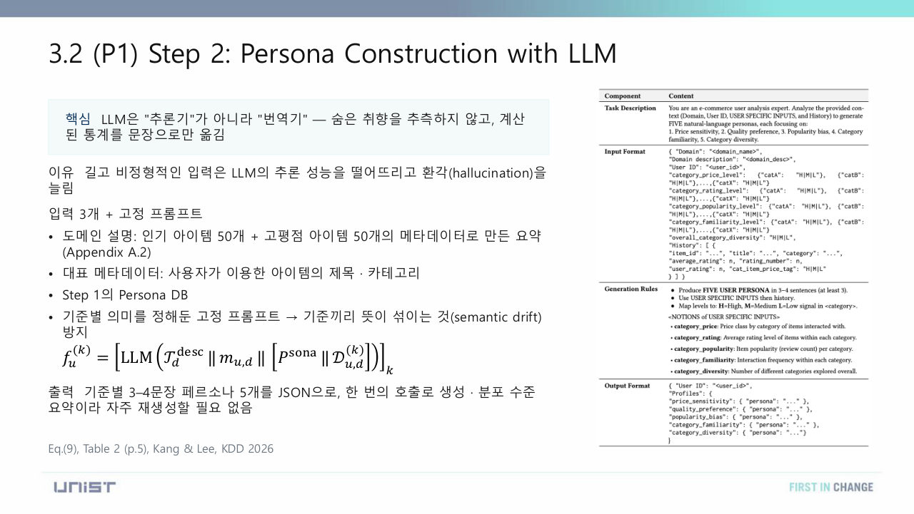

- **핵심: LLM은 "추론기"가 아니라 "번역기"**. 숨은 취향을 추측하지 않고, 계산된 통계를 문장으로만 옮긴다. 길고 비정형적인 입력은 LLM의 추론 성능을 떨어뜨리고 환각을 늘리기 때문이다.
- 입력 3개 + 고정 프롬프트 (Eq. 9: fu(k) = LLM(Tddesc ‖ mu,d ‖ Psona ‖ Du,d(k)))
  - 도메인 설명: 인기 아이템 50개 + 고평점 아이템 50개의 메타데이터로 만든 요약 (Appendix A.2)
  - 대표 메타데이터: 사용자가 이용한 아이템의 제목·카테고리
  - Step 1의 Persona DB
  - 기준별 의미를 정해 둔 고정 프롬프트 → 기준끼리 뜻이 섞이는 것(semantic drift) 방지
- 출력: 기준별 3–4문장 페르소나 5개를 JSON으로, 한 번의 호출로 생성한다. 분포 수준 요약이라 자주 재생성할 필요가 없다.

#### 슬라이드 14 · (P1) Step 3: 페르소나 인코딩과 결합

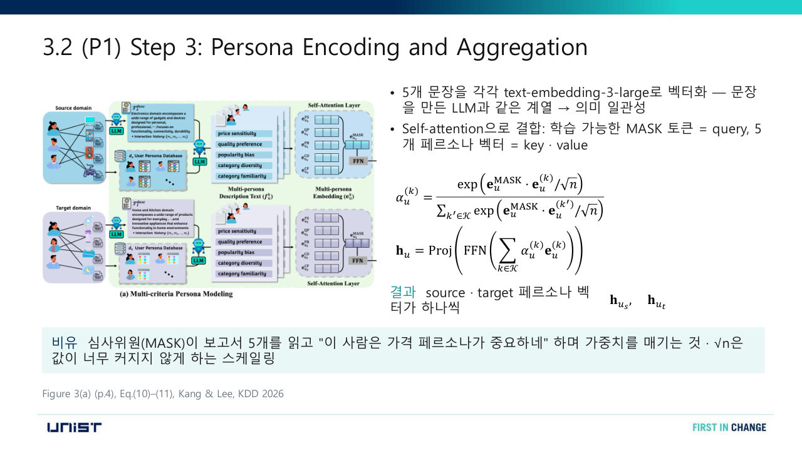

- 5개 문장을 각각 text-embedding-3-large로 벡터화한다. 문장을 만든 LLM과 같은 계열이라 의미 일관성이 있다.
- **Self-attention으로 결합 (Eq. 10–11)**: 학습 가능한 MASK 토큰이 query, 5개 페르소나 벡터가 key · value.
  - αu(k) = softmax(euMASK · eu(k) / √n)
  - hu = Proj(FFN(Σk αu(k) eu(k)))
- 결과: source · target 페르소나 벡터가 하나씩 (hus, hut).
- 비유: 심사위원(MASK)이 보고서 5개를 읽고 "이 사람은 가격 페르소나가 중요하네" 하며 가중치를 매기는 것. √n은 값이 너무 커지지 않게 하는 스케일링이다.

#### 슬라이드 15 · (P2) Step 1: 도플갱어 생성

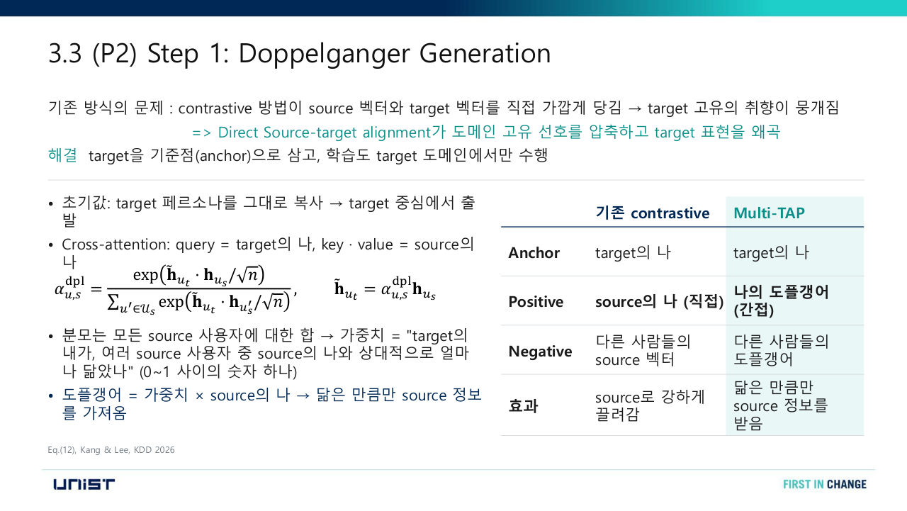

- **기존 방식의 문제**: contrastive 방법이 source 벡터와 target 벡터를 직접 가깝게 당긴다 → target 고유의 취향이 뭉개진다. 직접적인 source–target 정렬이 도메인 고유 선호를 압축하고 target 표현을 왜곡한다.
- **해결**: target을 기준점(anchor)으로 삼고, 학습도 target 도메인에서만 수행한다.
  - 초기값: target 페르소나를 그대로 복사 → target 중심에서 출발
  - Cross-attention (Eq. 12): query = target의 나, key · value = source의 나. αu,sdpl = softmax(h̃ut · hus / √n), h̃ut = αu,sdpl hus
  - 분모는 모든 source 사용자에 대한 합이므로, 가중치는 "target의 내가 여러 source 사용자 중 source의 나와 상대적으로 얼마나 닮았나"를 나타내는 0~1 사이의 숫자 하나다.
  - **도플갱어 = 가중치 × source의 나** → 닮은 만큼만 source 정보를 가져온다.

| | 기존 contrastive | Multi-TAP |
|---|---|---|
| Anchor | target의 나 | target의 나 |
| Positive | source의 나 (직접) | 나의 도플갱어 (간접) |
| Negative | 다른 사람들의 source 벡터 | 다른 사람들의 도플갱어 |
| 효과 | source로 강하게 끌려감 | 닮은 만큼만 source 정보를 받음 |

#### 슬라이드 16 · (P2) Step 2: 도플갱어 기반 지식 전이

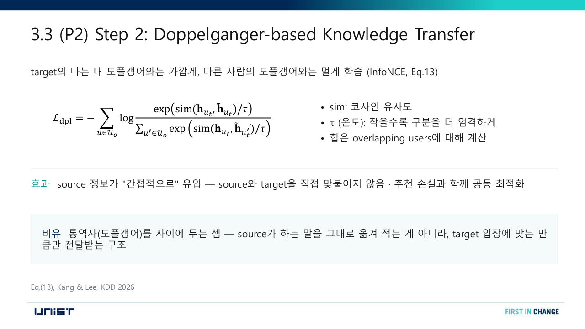

- target의 나는 내 도플갱어와는 가깝게, 다른 사람의 도플갱어와는 멀게 학습한다 (InfoNCE, Eq. 13).
  - Ldpl = −Σu∈Uo log [ exp(sim(hut, h̃ut)/τ) / Σu′ exp(sim(hut, h̃u′t)/τ) ]
  - sim은 코사인 유사도, τ(온도)는 작을수록 구분을 더 엄격하게 한다. 합은 overlapping users에 대해 계산한다.
- 효과: source 정보가 "간접적으로" 유입된다. source와 target을 직접 맞붙이지 않으며, 추천 손실과 함께 공동 최적화된다.
- 비유: 통역사(도플갱어)를 사이에 두는 셈. source가 하는 말을 그대로 옮겨 적는 게 아니라, target 입장에 맞는 만큼만 전달받는 구조다.

#### 슬라이드 17 · Training Process

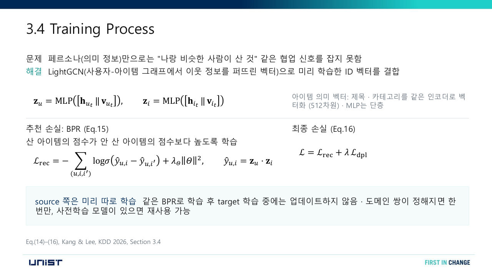

- **문제**: 페르소나(의미 정보)만으로는 "나랑 비슷한 사람이 산 것" 같은 협업 신호를 잡지 못한다.
- **해결**: LightGCN(사용자–아이템 그래프에서 이웃 정보를 퍼뜨린 벡터)으로 미리 학습한 ID 벡터를 결합한다 (Eq. 14).
  - zu = MLP(hut ‖ vut), zi = MLP(hit ‖ vit)
  - 아이템 의미 벡터는 제목·카테고리를 같은 인코더로 벡터화(512차원), MLP는 단층.
- **추천 손실 BPR (Eq. 15)**: 산 아이템의 점수가 안 산 아이템의 점수보다 높도록 학습. ŷu,i = zu · zi, 정규화 λΘ‖Θ‖².
- **최종 손실 (Eq. 16)**: L = Lrec + λLdpl.
- source 쪽은 미리 따로 같은 BPR로 학습하고, target 학습 중에는 업데이트하지 않는다. 도메인 쌍이 정해지면 한 번만 학습하면 되고, 사전학습 모델이 있으면 재사용할 수 있다.

### 4. Evaluation

#### 슬라이드 18 · Evaluation Questions & Datasets

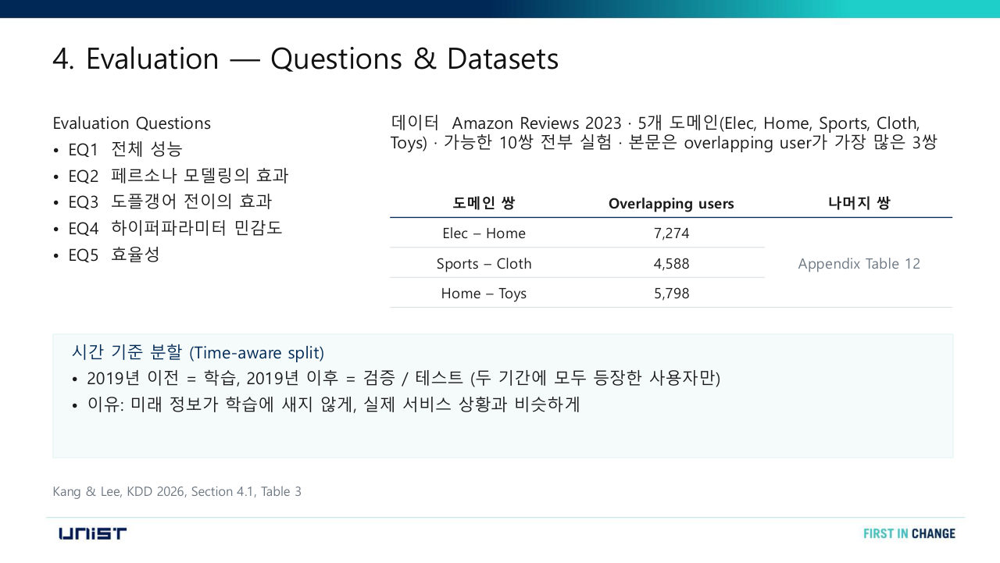

- EQ1 전체 성능 · EQ2 페르소나 모델링의 효과 · EQ3 도플갱어 전이의 효과 · EQ4 하이퍼파라미터 민감도 · EQ5 효율성.
- 데이터: Amazon Reviews 2023, 5개 도메인(Elec, Home, Sports, Cloth, Toys). 가능한 10쌍을 전부 실험했고, 본문은 overlapping user가 가장 많은 3쌍을 보고한다 (나머지는 Appendix Table 12).

| 도메인 쌍 | Overlapping users |
|---|---:|
| Elec – Home | 7,274 |
| Sports – Cloth | 4,588 |
| Home – Toys | 5,798 |

- **시간 기준 분할 (Time-aware split)**: 2019년 이전은 학습, 2019년 이후는 검증/테스트 (두 기간에 모두 등장한 사용자만). 미래 정보가 학습에 새지 않게, 실제 서비스 상황과 비슷하게 하려는 것이다.

#### 슬라이드 19 · Protocol & Implementation

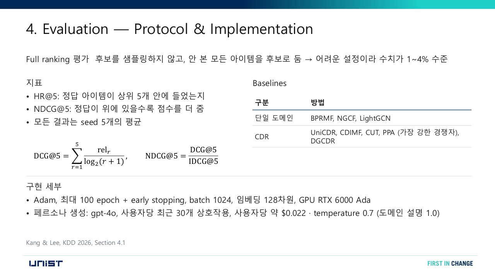

- **Full ranking 평가**: 후보를 샘플링하지 않고 안 본 모든 아이템을 후보로 둔다. 어려운 설정이라 수치가 1~4% 수준이다.
- 지표: HR@5(정답 아이템이 상위 5개 안에 들었는지), NDCG@5(정답이 위에 있을수록 점수를 더 줌, DCG@5 = Σ relr / log2(r+1), NDCG = DCG / IDCG). 모든 결과는 seed 5개의 평균.
- Baselines: 단일 도메인(BPRMF, NGCF, LightGCN), CDR(UniCDR, CDIMF, CUT, **PPA (가장 강한 경쟁자)**, DGCDR).
- 구현: Adam, 최대 100 epoch + early stopping, batch 1024, 임베딩 128차원, GPU RTX 6000 Ada. 페르소나 생성은 gpt-4o, 사용자당 최근 30개 상호작용, 사용자당 약 $0.022, temperature 0.7 (도메인 설명은 1.0).

#### 슬라이드 20 · EQ1 전체 성능

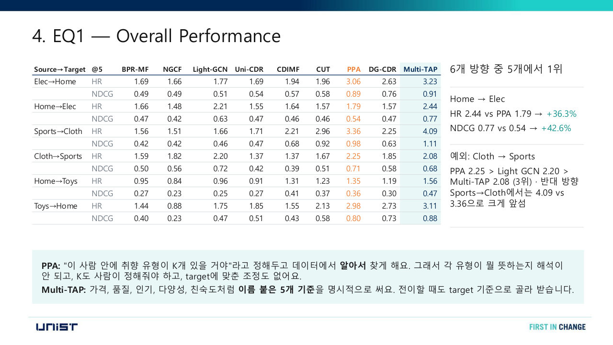

| Source→Target | @5 | LightGCN | PPA | DGCDR | **Multi-TAP** |
|---|---|---:|---:|---:|---:|
| Elec→Home | HR | 1.77 | 3.06 | 2.63 | **3.23** |
| | NDCG | 0.51 | 0.89 | 0.76 | **0.91** |
| Home→Elec | HR | 2.21 | 1.79 | 1.57 | **2.44** |
| | NDCG | 0.63 | 0.54 | 0.47 | **0.77** |
| Sports→Cloth | HR | 1.66 | 3.36 | 2.25 | **4.09** |
| | NDCG | 0.46 | 0.98 | 0.63 | **1.11** |
| Cloth→Sports | HR | 2.20 | **2.25** | 1.85 | 2.08 |
| | NDCG | **0.72** | 0.71 | 0.58 | 0.68 |
| Home→Toys | HR | 0.96 | 1.35 | 1.19 | **1.56** |
| | NDCG | 0.25 | 0.36 | 0.30 | **0.47** |
| Toys→Home | HR | 1.75 | 2.98 | 2.73 | **3.11** |
| | NDCG | 0.47 | 0.80 | 0.73 | **0.88** |

주요 모델만 발췌. 전체 9개 모델 수치는 슬라이드 참고.

- **6개 방향 중 5개에서 1위.** Home→Elec에서 HR 2.44 vs PPA 1.79 → **+36.3%**, NDCG 0.77 vs 0.54 → **+42.6%**.
- 예외: Cloth→Sports에서 PPA 2.25 > LightGCN 2.20 > Multi-TAP 2.08 (3위). 반대 방향 Sports→Cloth에서는 4.09 vs 3.36으로 크게 앞선다.
- Home→Elec에서는 단일 도메인 LightGCN(2.21)이 모든 CDR 베이스라인보다 높다. 무차별 전이가 오히려 해가 되는 사례로 볼 수 있다.
- PPA와의 차이: PPA는 "이 사람 안에 취향 유형이 K개 있을 거야"라고 정해 두고 데이터에서 알아서 찾게 한다. 각 유형이 뭘 뜻하는지 해석이 안 되고, K도 사람이 정해야 하고, target에 맞춘 조정도 없다. Multi-TAP은 이름 붙은 5개 기준을 명시적으로 쓰고, 전이할 때도 target 기준으로 골라 받는다.

#### 슬라이드 21 · EQ2 페르소나 모델링의 효과

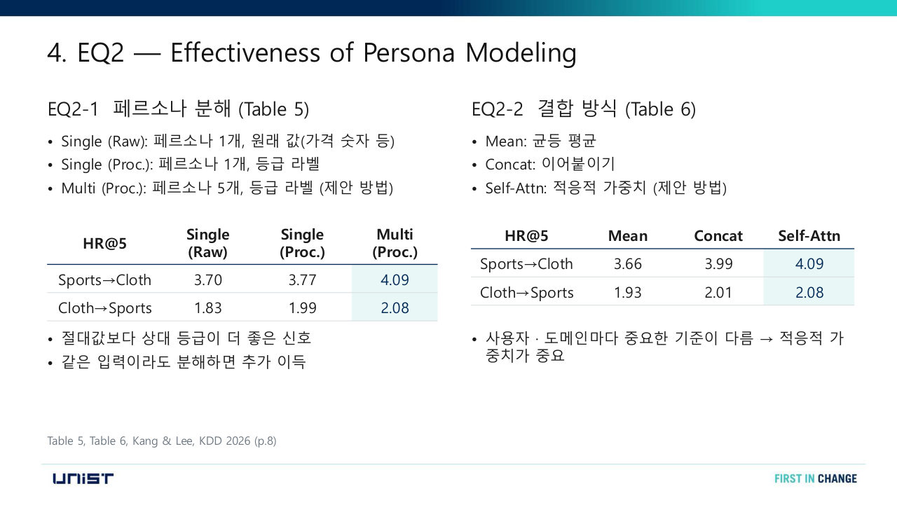

- **EQ2-1 페르소나 분해 (Table 5)**: Single(Raw) = 페르소나 1개, 원래 값(가격 숫자 등) / Single(Proc.) = 페르소나 1개, 등급 라벨 / Multi(Proc.) = 페르소나 5개, 등급 라벨 (제안 방법).

| HR@5 | Single (Raw) | Single (Proc.) | Multi (Proc.) |
|---|---:|---:|---:|
| Sports→Cloth | 3.70 | 3.77 | **4.09** |
| Cloth→Sports | 1.83 | 1.99 | **2.08** |

  - 절대값보다 상대 등급이 더 좋은 신호이고, 같은 입력이라도 분해하면 추가 이득이 있다.
- **EQ2-2 결합 방식 (Table 6)**: Mean(균등 평균) / Concat(이어붙이기) / Self-Attn(적응적 가중치, 제안 방법).

| HR@5 | Mean | Concat | Self-Attn |
|---|---:|---:|---:|
| Sports→Cloth | 3.66 | 3.99 | **4.09** |
| Cloth→Sports | 1.93 | 2.01 | **2.08** |

  - 사용자·도메인마다 중요한 기준이 다르므로 적응적 가중치가 중요하다.

#### 슬라이드 22 · EQ2-3 콜드스타트 시나리오

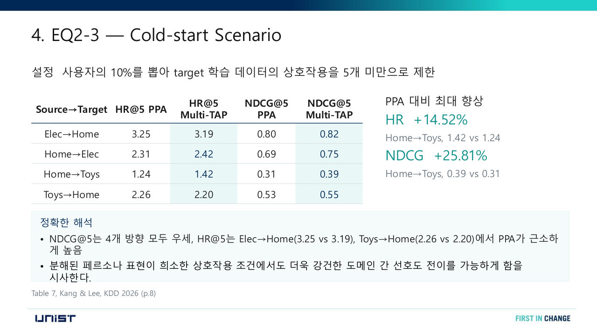

- 설정: 사용자의 10%를 뽑아 target 학습 데이터의 상호작용을 5개 미만으로 제한 (Table 7).

| Source→Target | HR@5 PPA | HR@5 Multi-TAP | NDCG@5 PPA | NDCG@5 Multi-TAP |
|---|---:|---:|---:|---:|
| Elec→Home | **3.25** | 3.19 | 0.80 | **0.82** |
| Home→Elec | 2.31 | **2.42** | 0.69 | **0.75** |
| Home→Toys | 1.24 | **1.42** | 0.31 | **0.39** |
| Toys→Home | **2.26** | 2.20 | 0.53 | **0.55** |

- PPA 대비 최대 향상: HR +14.52%, NDCG +25.81% (모두 Home→Toys).
- 정확한 해석: NDCG@5는 4개 방향 모두 우세하지만, HR@5는 Elec→Home과 Toys→Home에서 PPA가 근소하게 높다. 분해된 페르소나 표현이 희소한 상호작용 조건에서도 더 강건한 도메인 간 선호 전이를 가능하게 함을 시사한다.

#### 슬라이드 23 · EQ3 · EQ4 · EQ5

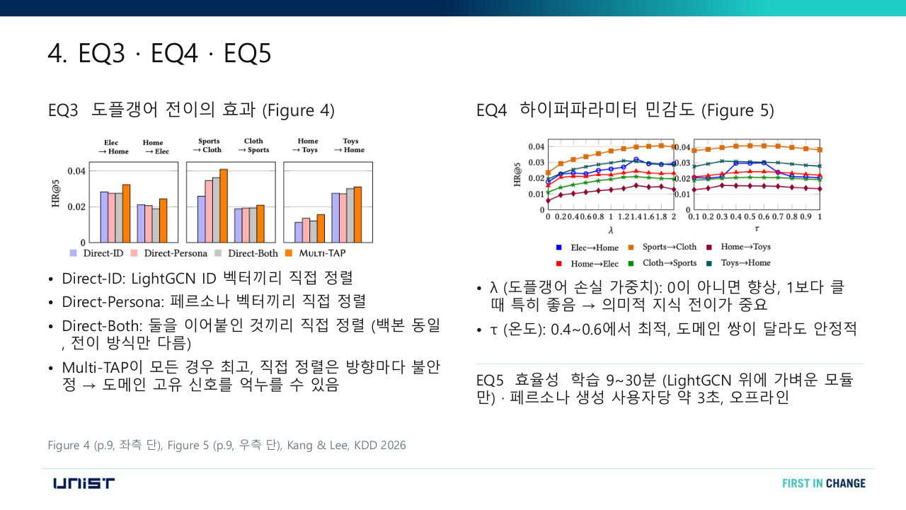

- **EQ3 도플갱어 전이의 효과 (Figure 4)**: 백본은 같고 전이 방식만 바꾼 세 변형과 비교.
  - Direct-ID: LightGCN ID 벡터끼리 직접 정렬
  - Direct-Persona: 페르소나 벡터끼리 직접 정렬
  - Direct-Both: 둘을 이어붙인 것끼리 직접 정렬
  - Multi-TAP이 모든 경우 최고. 직접 정렬은 방향마다 불안정해 도메인 고유 신호를 억누를 수 있다.
- **EQ4 하이퍼파라미터 민감도 (Figure 5)**: λ(도플갱어 손실 가중치)는 0이 아니면 향상되고 1보다 클 때 특히 좋다 → 의미적 지식 전이가 중요하다. τ(온도)는 0.4~0.6에서 최적이며 도메인 쌍이 달라도 안정적이다.
- **EQ5 효율성**: 학습 9~30분 (LightGCN 위에 가벼운 모듈만 추가). 페르소나 생성은 사용자당 약 3초이고 오프라인으로 처리한다.

### 5. Related Work · 결론 · 한계

#### 슬라이드 24 · Related Work

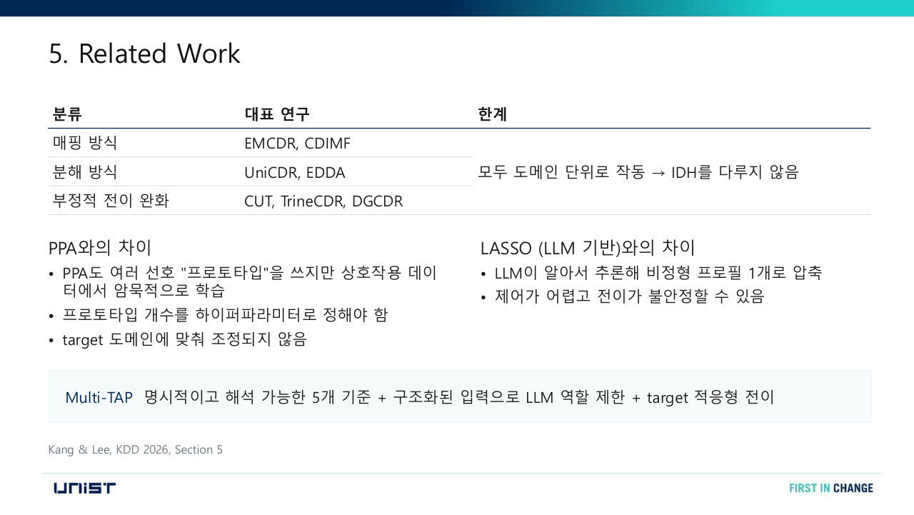

| 분류 | 대표 연구 | 한계 |
|---|---|---|
| 매핑 방식 | EMCDR, CDIMF | 모두 도메인 단위로 작동 → IDH를 다루지 않음 |
| 분해 방식 | UniCDR, EDDA | |
| 부정적 전이 완화 | CUT, TrineCDR, DGCDR | |

- **PPA와의 차이**: PPA도 여러 선호 "프로토타입"을 쓰지만 상호작용 데이터에서 암묵적으로 학습하고, 프로토타입 개수를 하이퍼파라미터로 정해야 하며, target 도메인에 맞춰 조정되지 않는다.
- **LASSO (LLM 기반)와의 차이**: LLM이 알아서 추론해 비정형 프로필 1개로 압축한다. 제어가 어렵고 전이가 불안정할 수 있다.
- **Multi-TAP**: 명시적이고 해석 가능한 5개 기준 + 구조화된 입력으로 LLM 역할 제한 + target 적응형 전이.

#### 슬라이드 25 · Conclusion

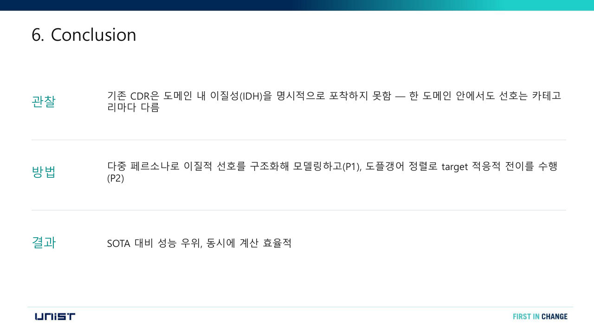

| | 내용 |
|---|---|
| 관찰 | 기존 CDR은 도메인 내 이질성(IDH)을 명시적으로 포착하지 못함. 한 도메인 안에서도 선호는 카테고리마다 다름 |
| 방법 | 다중 페르소나로 이질적 선호를 구조화해 모델링하고(P1), 도플갱어 정렬로 target 적응적 전이를 수행(P2) |
| 결과 | SOTA 대비 성능 우위, 동시에 계산 효율적 |

#### 슬라이드 26 · Limitations

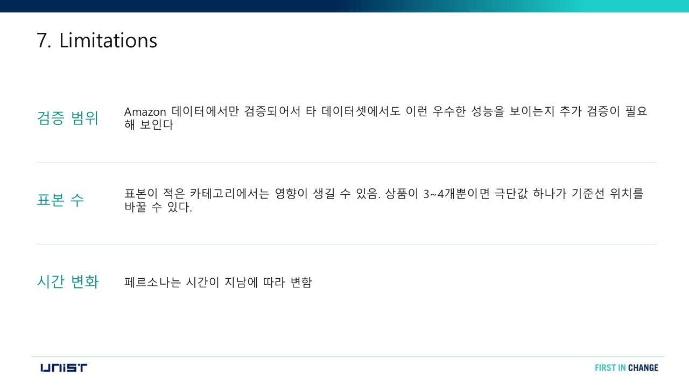

- **검증 범위**: Amazon 데이터에서만 검증되어, 다른 데이터셋에서도 같은 성능을 보이는지 추가 검증이 필요하다.
- **표본 수**: 표본이 적은 카테고리에서는 영향이 생길 수 있다. 상품이 3~4개뿐이면 극단값 하나가 3등분 기준선 위치를 바꿀 수 있다.
- **시간 변화**: 페르소나는 시간이 지남에 따라 변한다.

---

## 무엇을 배웠나

- **문제를 재정의하는 방법**: "선호를 어떻게 옮길까"에서 "어떤 선호를 옮길까"로 질문을 바꾸는 것만으로 연구 기여가 만들어진다. 이를 위해 IDH를 실데이터에서 먼저 정량 분석하는 동기 실험이 설득력을 만든다.
- **LLM의 역할을 제한하는 설계**: LLM에게 추론을 맡기지 않고 계산된 통계를 문장으로 옮기는 번역기로만 쓰면 환각과 제어 문제를 줄일 수 있다. 1회차 EchoTrace에서 본 LLM 환각·편향 문제와 이어지는 관점이다.
- **선별적 전이**: 두 도메인의 표현을 직접 정렬하면 target 고유 신호가 뭉개질 수 있고, target을 기준점으로 삼는 간접 전이가 대안이 된다.
- **결과를 정확히 읽기**: 평균 향상 수치 뒤에 예외 방향(Cloth→Sports)과 지표별 차이(콜드스타트에서 HR와 NDCG)가 있어, 본문 주장이 어떤 조건에서 성립하는지 확인하는 습관이 필요하다.
- **비교 기준**: 3등분 라벨의 무작위 기준선(약 33%)과 견줘야 "보존율 31%"가 낮다고 해석할 수 있는 것처럼, 수치는 기준선과 함께 읽어야 한다.
