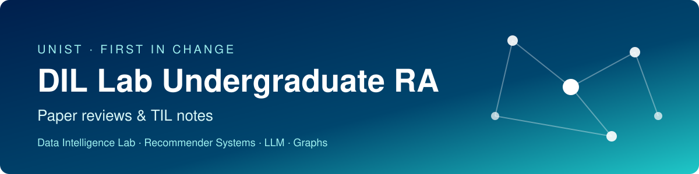

  

# 3회차 랩미팅 · MARIO

> [← 전체 목록으로](../../README.md)

| | |
|---|---|
| **논문** | *MARIO: Modality-Aware Attention and Modality-Preserving Decoders for Multimedia Recommendation* |
| **저자** | Taeri Kim, Yeon-Chang Lee, Kijung Shin, Sang-Wook Kim (Hanyang Univ. · KAIST) |
| **학회** | CIKM 2022 · [DOI 10.1145/3511808.3557387](https://doi.org/10.1145/3511808.3557387) |
| **발표** | 박민성 (2026-10-23) |
| **자료** | [발표 PDF](MARIO_labmeeting_03.pdf) |
| **키워드** | `Multimedia Recommendation` `Modality-aware Attention` `Modality-preserving Decoder` `Late Fusion` |

## 한눈에 보기

| 문제 | 방법 | 결과 |
|---|---|---|
| 기존 멀티미디어 추천은 ① 모달리티(이미지·텍스트·상호작용)의 영향력을 전역 또는 사용자 단위로만 보고, ② 학습 중 이미지·텍스트의 고유 정보를 잃는다 | (C2) (사용자, 상품) 쌍마다 세 모달리티에 다른 가중치를 주는 어텐션, (C3) 압축 임베딩에서 원래 특징을 복원하는 디코더와 MP Loss | Amazon 4개 데이터셋, 7개 경쟁 모델 대비 대부분 1위. 최강 경쟁자 대비 NDCG@10 최대 +14.61% |

## 무엇을 공부했나

**1. 배경과 한계**
- 멀티미디어 추천은 구매·클릭 기록에 상품의 이미지·텍스트 특징을 더해 data sparsity(실험 데이터 4종 모두 99% 이상이 빈칸)를 완화한다.
- MMGCN, GRCN, LATTICE 등 기존 방법은 영향력 단위가 전역(LATTICE) 또는 사용자(GRCN)여서, 같은 사람이 아이폰은 스펙, 에어팟은 디자인을 보고 사는 식의 **쌍 단위 차이**를 보지 못한다.

**2. 동기 실험**
- 모달리티별 상품 쌍 유사도의 피어슨 상관계수가 0.02~0.22로 거의 독립이다. 상호작용만으로는 잡을 수 없는 모달리티 고유 특성이 있다.
- 학습 후 최종 임베딩에서 인기 상품일수록 고유 정보를 많이 잃는다(p-유사도와 f-유사도의 평균 차이, LATTICE 인기 상품 이미지 0.41). 많은 사용자 임베딩 쪽으로 끌려가기 때문이다.

**3. 제안 방법 MARIO**
- **(C1) 인코더**: 임의의 CF 모델(BPRMF, NGCF, LightGCN)로 상호작용 임베딩을 얻고, 이미지(4,096차원)·텍스트(1,024차원) 특징은 압축층으로 64차원으로 줄인다. LATTICE처럼 kNN 상품 그래프와 GCN으로 임베딩을 보강한다.
- **(C2) 모달리티 인지 어텐션**: query는 사용자 임베딩, key·value는 상품의 V/T/IN 임베딩. (사용자, 상품) 쌍마다 세 가중치(합 1)를 계산해 개인화 상품 임베딩을 만들고 내적으로 점수를 낸다. 모달리티를 마지막에만 섞는 **Late Fusion**이라 이미지·텍스트 임베딩이 상호작용 신호에 오염되지 않는다.
- **(C3) 모달리티 보존 디코더**: 64차원 임베딩을 원래 차원으로 복원하는 선형층. 복원 오차(MP Loss)를 BPR Loss와 함께 최소화해 압축본에 원문의 핵심이 남게 한다(오토인코더와 같은 발상). 상호작용은 복원할 원본이 없어 디코더가 없다.

**4. 실험 설정**
- 데이터: Amazon Baby, Clothing, Office, Musical (희소도 99.20~99.88%). 상호작용 5회 미만 제거, 학습/검증/테스트 80/10/10.
- 지표: Precision, Recall, NDCG @10·@20, t-검정(95%). 베이스라인은 CF 3종과 멀티미디어 추천(MAML, MMGCN, GRCN, LATTICE 등).

**5. 주요 결과**
- **RQ1 전체 성능**: Clothing NDCG@10 .0259 vs MAML .0226 (+14.61%). 예외는 Office로, NDCG@10이 LATTICE(.0589)보다 근소하게 낮다(.0583, −0.89%). Early Fusion인 MMGCN은 모든 데이터·지표에서 최하위.
- **RQ2 모달리티**: 이미지 제거 시 NDCG@10 .0233, 텍스트 제거 시 .0243으로 둘 다 필요(전체 .0259).
- **RQ3 결합 방식**: 어텐션(.0259) > mean(.0256) > max(.0232) >> fc(.0117).
- **RQ4 고유 정보 보존**: 모든 설정에서 MARIO의 손실이 최소이고, 인기 상품 이미지에서 0.41 → 0.31로 가장 크게 개선. MP Loss 비중 μ=0이면 항상 최저이고 μ=1에서 NDCG@10 +2.31%. 다만 탐색 범위가 (0, 1]뿐이라 μ>1은 확인되지 않았다.
- **RQ5 플러그인**: Clothing NDCG@10 기준 BPRMF +215.57%, NGCF +23.45%, LightGCN +92.52%. 어떤 CF에 붙여도 향상되고, 더 좋은 CF를 쓸수록 MARIO도 좋아진다.

## 무엇을 배웠나

- **질문을 바꾸는 방법**: "모달리티를 어떻게 섞을까"에서 "고유 정보는 지키면서 쌍마다 다르게 섞으려면"으로 질문을 바꾸면 두 가지 기여(어텐션, 디코더)가 자연스럽게 나온다.
- **융합 시점의 중요성**: 처음부터 섞는 Early Fusion은 고유 정보를 가장 많이 잃고 성능도 가장 낮았다. 각자 독립적으로 만든 뒤 마지막에 섞는 설계가 근거와 함께 제시된다.
- **보존을 직접 학습 목표로 삼기**: 정보 손실을 측정(p/f-유사도)하고, 복원 손실로 직접 줄이는 구성이 동기 실험 → 방법 → 검증으로 일관된다.
- **결과를 정확히 읽기**: 대부분 1위지만 Office 같은 예외가 있고, 일부 표(Table 4, 5)는 Clothing만 본문에 실려 있어 일반화 범위를 따로 확인해야 한다.
