

  

# 3회차 랩미팅 · MARIO

> [← 전체 목록으로](../../README.md) · 같은 논문을 보강해 다시 다룬 [5회차 기록](../05)

| | |
|---|---|
| **논문** | *MARIO: Modality-Aware Attention and Modality-Preserving Decoders for Multimedia Recommendation* |
| **저자** | Taeri Kim, Yeon-Chang Lee, Kijung Shin, Sang-Wook Kim (Hanyang Univ. · KAIST) |
| **학회** | CIKM 2022 · [DOI 10.1145/3511808.3557387](https://doi.org/10.1145/3511808.3557387) |
| **발표** | 박민성 (2026-10-23) |
| **자료** | [발표 PDF](MARIO_labmeeting_03.pdf) · 슬라이드 24장 |
| **키워드** | `Multimedia Recommendation` `Modality-aware Attention` `Modality-preserving Decoder` `Late Fusion` |

## 한눈에 보기

| 문제 | 방법 | 결과 |
|---|---|---|
| 기존 멀티미디어 추천은 ① 모달리티(이미지·텍스트·상호작용)의 영향력을 전역 또는 사용자 단위로만 보고, ② 학습 중 이미지·텍스트의 고유 정보를 잃는다 | (C2) (사용자, 상품) 쌍마다 세 모달리티에 다른 가중치를 주는 어텐션, (C3) 압축 임베딩에서 원래 특징을 복원하는 디코더와 MP Loss | Amazon 4개 데이터셋, 7개 경쟁 모델 대비 대부분 1위. 최강 경쟁자 대비 NDCG@10 최대 +14.61% |

  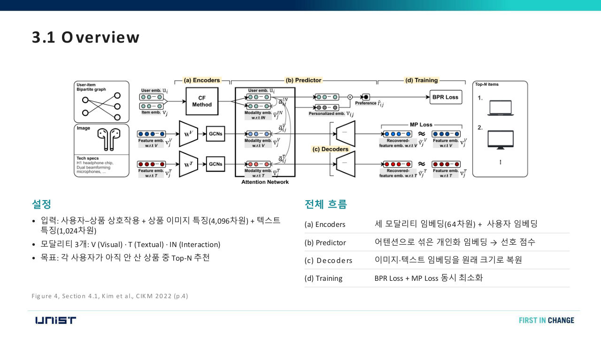 
  MARIO 전체 구조 (슬라이드 9, Figure 4)

## 목차

0. [Overview](#0-overview) · 슬라이드 1–2
1. [Introduction](#1-introduction) · 슬라이드 3–6
2. [Motivation](#2-motivation) · 슬라이드 7–8
3. [제안 방법 MARIO](#3-제안-방법-mario) · 슬라이드 9–15
4. [Evaluation](#4-evaluation) · 슬라이드 16–21
5. [Related Work · 결론](#5-related-work--결론) · 슬라이드 22–24

---

## 슬라이드별 상세 설명

### 0. Overview

#### 슬라이드 1 · 표지

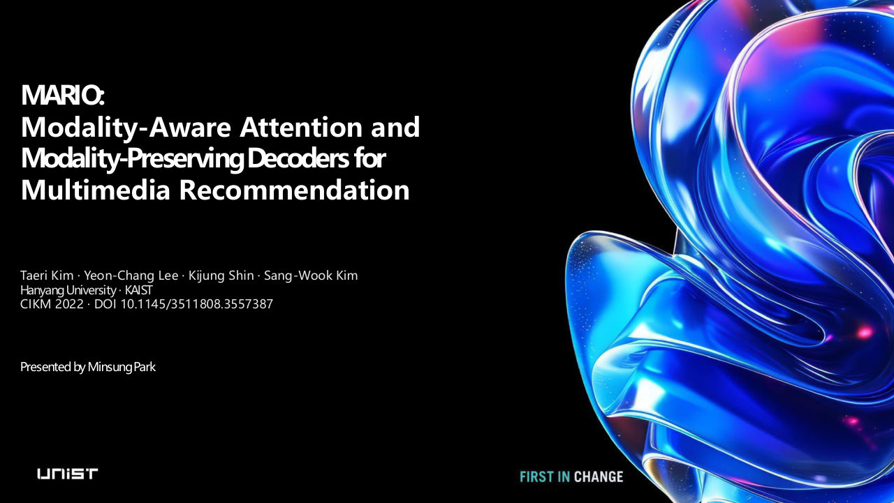

- 리뷰 논문은 *MARIO: Modality-Aware Attention and Modality-Preserving Decoders for Multimedia Recommendation* (Taeri Kim · Yeon-Chang Lee · Kijung Shin · Sang-Wook Kim, CIKM 2022).
- 제목에 두 핵심 장치가 그대로 들어 있다: **Modality-Aware Attention**(모달리티 영향력을 쌍마다 다르게)과 **Modality-Preserving Decoder**(모달리티 고유 정보 보존).

#### 슬라이드 2 · Overview

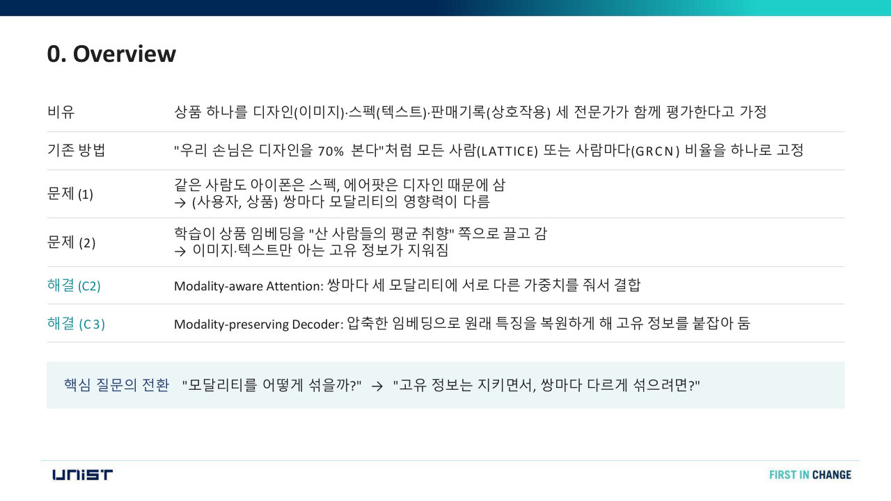

| | 내용 |
|---|---|
| 비유 | 상품 하나를 디자인(이미지)·스펙(텍스트)·판매기록(상호작용) 세 전문가가 함께 평가한다고 가정 |
| 기존 방법 | "우리 손님은 디자인을 70% 본다"처럼 모든 사람(LATTICE) 또는 사람마다(GRCN) 비율을 하나로 고정 |
| 문제 (1) | 같은 사람도 아이폰은 스펙, 에어팟은 디자인 때문에 삼 → (사용자, 상품) 쌍마다 모달리티의 영향력이 다름 |
| 문제 (2) | 학습이 상품 임베딩을 "산 사람들의 평균 취향" 쪽으로 끌고 감 → 이미지·텍스트만 아는 고유 정보가 지워짐 |
| 해결 (C2) | Modality-aware Attention: 쌍마다 세 모달리티에 서로 다른 가중치를 줘서 결합 |
| 해결 (C3) | Modality-preserving Decoder: 압축한 임베딩으로 원래 특징을 복원하게 해 고유 정보를 붙잡아 둠 |

- 핵심 질문의 전환: **"모달리티를 어떻게 섞을까?" → "고유 정보는 지키면서, 쌍마다 다르게 섞으려면?"**

### 1. Introduction

#### 슬라이드 3 · 멀티미디어 추천의 배경

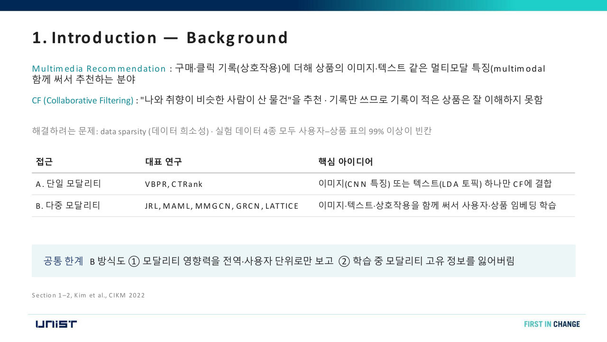

- **Multimedia Recommendation**: 구매·클릭 기록(상호작용)에 더해 상품의 이미지·텍스트 같은 멀티모달 특징을 함께 써서 추천하는 분야.
- **CF (Collaborative Filtering)**: "나와 취향이 비슷한 사람이 산 물건"을 추천한다. 기록만 쓰므로 기록이 적은 상품은 잘 이해하지 못한다.
- 해결하려는 문제: data sparsity. 실험 데이터 4종 모두 사용자–상품 표의 99% 이상이 빈칸이다.

| 접근 | 대표 연구 | 핵심 아이디어 |
|---|---|---|
| A. 단일 모달리티 | VBPR, CTRank | 이미지(CNN 특징) 또는 텍스트(LDA 토픽) 하나만 CF에 결합 |
| B. 다중 모달리티 | JRL, MAML, MMGCN, GRCN, LATTICE | 이미지·텍스트·상호작용을 함께 써서 사용자·상품 임베딩 학습 |

- 공통 한계: B 방식도 ① 모달리티 영향력을 전역·사용자 단위로만 보고, ② 학습 중 모달리티 고유 정보를 잃어버린다.

#### 슬라이드 4 · 기존 다중 모달리티 방법 비교

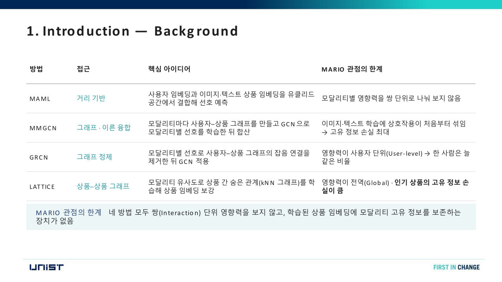

| 방법 | 접근 | 핵심 아이디어 | MARIO 관점의 한계 |
|---|---|---|---|
| MAML | 거리 기반 | 사용자 임베딩과 이미지·텍스트 상품 임베딩을 유클리드 공간에서 결합해 선호 예측 | 모달리티별 영향력을 쌍 단위로 나눠 보지 않음 |
| MMGCN | 그래프 · 이른 융합 | 모달리티마다 사용자–상품 그래프를 만들고 GCN으로 모달리티별 선호를 학습한 뒤 합산 | 이미지·텍스트 학습에 상호작용이 처음부터 섞임 → 고유 정보 손실 최대 |
| GRCN | 그래프 정제 | 모달리티별 선호로 사용자–상품 그래프의 잡음 연결을 제거한 뒤 GCN 적용 | 영향력이 사용자 단위 → 한 사람은 늘 같은 비율 |
| LATTICE | 상품–상품 그래프 | 모달리티 유사도로 상품 간 숨은 관계(kNN 그래프)를 학습해 상품 임베딩 보강 | 영향력이 전역 · 인기 상품의 고유 정보 손실이 큼 |

- 네 방법 모두 쌍(Interaction) 단위 영향력을 보지 않고, 학습된 상품 임베딩에 모달리티 고유 정보를 보존하는 장치가 없다.

#### 슬라이드 5 · Motivation: 영향력의 단위 (Figure 1)

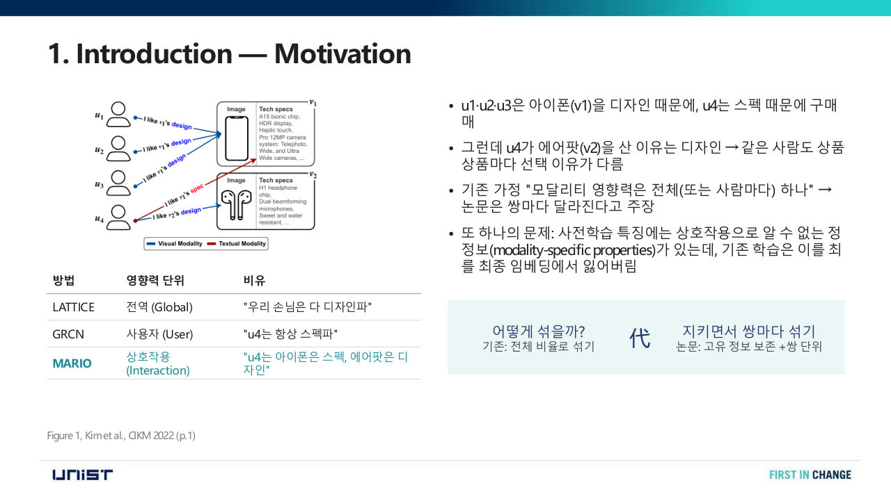

| 방법 | 영향력 단위 | 비유 |
|---|---|---|
| LATTICE | 전역 (Global) | "우리 손님은 다 디자인파" |
| GRCN | 사용자 (User) | "u4는 항상 스펙파" |
| MARIO | 상호작용 (Interaction) | "u4는 아이폰은 스펙, 에어팟은 디자인" |

- u1·u2·u3은 아이폰(v1)을 디자인 때문에, u4는 스펙 때문에 샀다. 그런데 u4가 에어팟(v2)을 산 이유는 디자인이다. **같은 사람도 상품마다 선택 이유가 다르다.**
- 기존 가정 "모달리티 영향력은 전체(또는 사람마다) 하나"에 대해, 논문은 쌍마다 달라진다고 주장한다.
- 또 하나의 문제: 사전학습 특징에는 상호작용으로 알 수 없는 정보(modality-specific properties)가 있는데, 기존 학습은 이를 최종 임베딩에서 잃어버린다.
- 정리: 기존은 "전체 비율로 섞기", 논문은 "고유 정보 보존 + 쌍 단위로 섞기".

#### 슬라이드 6 · Contributions

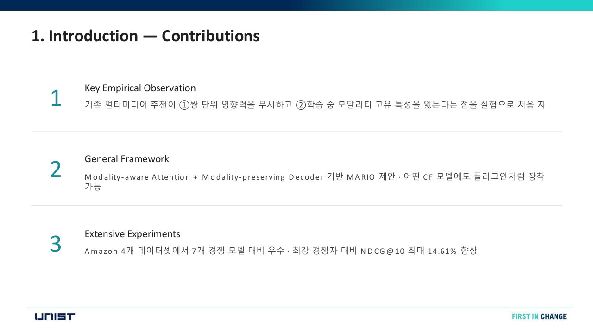

1. **Key Empirical Observation**: 기존 멀티미디어 추천이 ① 쌍 단위 영향력을 무시하고 ② 학습 중 모달리티 고유 특성을 잃는다는 점을 실험으로 처음 지적.
2. **General Framework**: Modality-aware Attention + Modality-preserving Decoder 기반 MARIO 제안. 어떤 CF 모델에도 플러그인처럼 장착 가능.
3. **Extensive Experiments**: Amazon 4개 데이터셋에서 7개 경쟁 모델 대비 우수. 최강 경쟁자 대비 NDCG@10 최대 14.61% 향상.

### 2. Motivation

#### 슬라이드 7 · 모달리티마다 "닮음"의 기준이 다르다 (Figure 2)

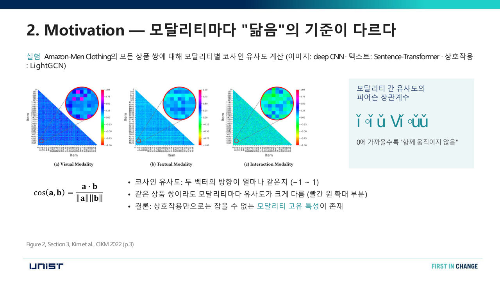

- 실험: Amazon Men Clothing의 모든 상품 쌍에 대해 모달리티별 코사인 유사도를 계산했다. 이미지는 deep CNN, 텍스트는 Sentence-Transformer, 상호작용은 LightGCN 임베딩을 쓴다.
- 코사인 유사도 cos(a, b) = a·b / (‖a‖‖b‖): 두 벡터의 방향이 얼마나 같은지 (−1 ~ 1).
- 모달리티 간 유사도의 **피어슨 상관계수가 0.02 ~ 0.22**로 0에 가깝다. 즉 두 모달리티의 유사도가 함께 움직이지 않는다. 같은 상품 쌍이라도 모달리티마다 유사도가 크게 다르다 (그림의 빨간 원 확대 부분).
- 결론: 상호작용만으로는 잡을 수 없는 모달리티 고유 특성이 존재한다.

#### 슬라이드 8 · 학습이 끝나면 고유 정보가 사라진다 (Figure 3)

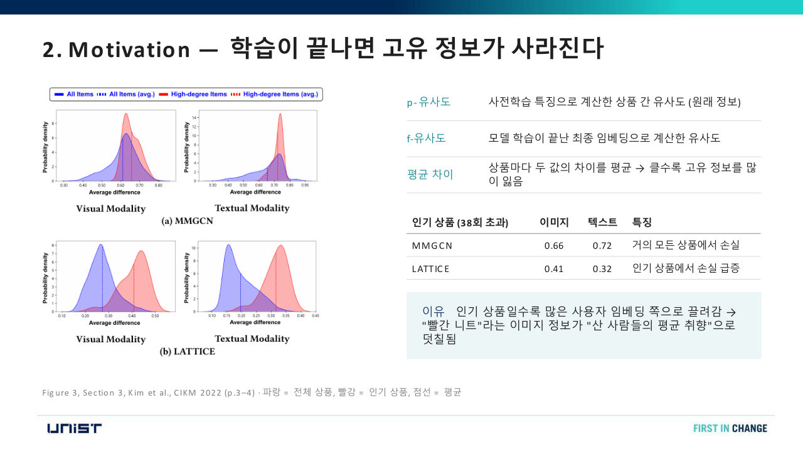

| 용어 | 뜻 |
|---|---|
| p-유사도 | 사전학습 특징으로 계산한 상품 간 유사도 (원래 정보) |
| f-유사도 | 모델 학습이 끝난 최종 임베딩으로 계산한 유사도 |
| 평균 차이 | 상품마다 두 값의 차이를 평균 → 클수록 고유 정보를 많이 잃음 |

| 인기 상품 (38회 초과) | 이미지 | 텍스트 | 특징 |
|---|---:|---:|---|
| MMGCN | 0.66 | 0.72 | 거의 모든 상품에서 손실 |
| LATTICE | 0.41 | 0.32 | 인기 상품에서 손실 급증 |

- 그림에서 파랑은 전체 상품, 빨강은 인기 상품, 점선은 평균이다.
- 이유: 인기 상품일수록 많은 사용자 임베딩 쪽으로 끌려간다. "빨간 니트"라는 이미지 정보가 "산 사람들의 평균 취향"으로 덧칠된다.

### 3. 제안 방법 MARIO

#### 슬라이드 9 · Overview (Figure 4)

- **설정**: 입력은 사용자–상품 상호작용 + 상품 이미지 특징(4,096차원) + 텍스트 특징(1,024차원). 모달리티 3개는 V (Visual) · T (Textual) · IN (Interaction). 목표는 각 사용자가 아직 안 산 상품 중 Top-N 추천.

| 단계 | 하는 일 |
|---|---|
| (a) Encoders | 세 모달리티 임베딩(64차원) + 사용자 임베딩 |
| (b) Predictor | 어텐션으로 섞은 개인화 임베딩 → 선호 점수 |
| (c) Decoders | 이미지·텍스트 임베딩을 원래 크기로 복원 |
| (d) Training | BPR Loss + MP Loss 동시 최소화 |

#### 슬라이드 10 · (C1) 인코더 ① 상호작용 모달리티와 압축층

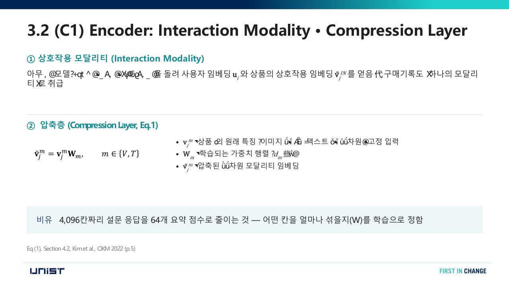

- **상호작용 모달리티**: 아무 CF 모델(BPRMF, NGCF, LightGCN)을 돌려 사용자 임베딩 ui와 상품의 상호작용 임베딩 v̄jIN을 얻는다. 구매 기록도 "하나의 모달리티"로 취급한다.
- **압축층 (Eq. 1)**: v̄jm = vjm Wm, m ∈ {V, T}
  - vjm: 상품 j의 원래 특징 (이미지 4,096 · 텍스트 1,024차원), 고정 입력
  - Wm: 학습되는 가중치 행렬 (dm × d)
  - v̄jm: 압축된 64차원 모달리티 임베딩
- 비유: 4,096칸짜리 설문 응답을 64개 요약 점수로 줄이는 것. 어떤 칸을 얼마나 섞을지(W)를 학습으로 정한다.

#### 슬라이드 11 · (C1) 인코더 ② kNN 상품 그래프와 GCN

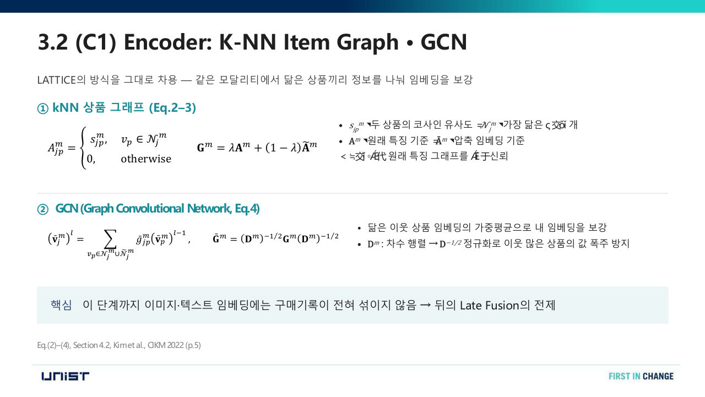

- LATTICE의 방식을 그대로 차용해, 같은 모달리티에서 닮은 상품끼리 정보를 나눠 임베딩을 보강한다.
- **kNN 상품 그래프 (Eq. 2–3)**
  - Ajpm = sjpm (vp가 j의 이웃이면), 아니면 0. sjpm은 두 상품의 코사인 유사도, 이웃 Njm은 가장 닮은 k = 10개.
  - Am은 원래 특징 기준, Ãm은 압축 임베딩 기준 그래프.
  - Gm = λAm + (1 − λ)Ãm, λ = 0.9 → 원래 특징 그래프를 90% 신뢰한다.
- **GCN (Eq. 4)**: (v̄jm)(l) = Σp ḡjpm (v̄pm)(l−1), Ḡm = (Dm)−1/2 Gm (Dm)−1/2
  - 닮은 이웃 상품 임베딩의 가중평균으로 내 임베딩을 보강한다.
  - Dm은 차수 행렬. D−1/2 정규화로 이웃 많은 상품의 값이 폭주하는 것을 막는다.
- **핵심**: 이 단계까지 이미지·텍스트 임베딩에는 구매 기록이 전혀 섞이지 않는다. 이것이 뒤의 Late Fusion의 전제다.

#### 슬라이드 12 · (C2) Modality-aware Attention

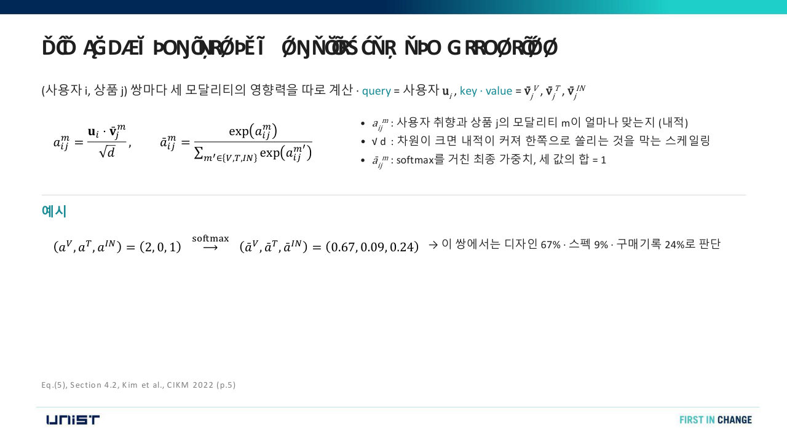

- (사용자 i, 상품 j) 쌍마다 세 모달리티의 영향력을 따로 계산한다. query = 사용자 ui, key · value = v̄jV, v̄jT, v̄jIN.
- **Eq. 5**: aijm = ui · v̄jm / √d, āijm = exp(aijm) / Σm′ exp(aijm′)
  - aijm: 사용자 취향과 상품 j의 모달리티 m이 얼마나 맞는지 (내적)
  - √d: 차원이 크면 내적이 커져 한쪽으로 쏠리는 것을 막는 스케일링
  - āijm: softmax를 거친 최종 가중치, 세 값의 합 = 1
- **예시**: (aV, aT, aIN) = (2, 0, 1) → softmax → (0.67, 0.09, 0.24). 이 쌍에서는 디자인 67% · 스펙 9% · 구매 기록 24%로 판단한다.

#### 슬라이드 13 · (C2) 개인화 임베딩과 Late Fusion

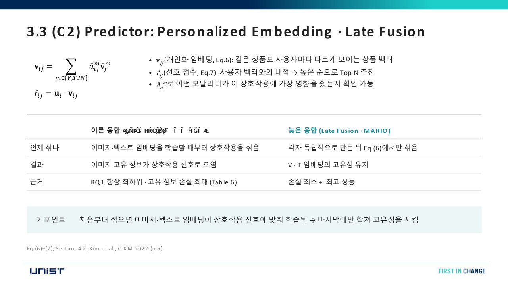

- **개인화 임베딩 (Eq. 6)**: vij = Σm∈{V,T,IN} āijm v̄jm. 같은 상품도 사용자마다 다르게 보이는 상품 벡터다.
- **선호 점수 (Eq. 7)**: r̂ij = ui · vij. 높은 순으로 Top-N 추천한다.
- āijm으로 어떤 모달리티가 이 상호작용에 가장 영향을 줬는지 확인할 수 있다 (해석 가능성).

| | 이른 융합 (Early Fusion · MMGCN) | 늦은 융합 (Late Fusion · MARIO) |
|---|---|---|
| 언제 섞나 | 이미지·텍스트 임베딩을 학습할 때부터 상호작용을 섞음 | 각자 독립적으로 만든 뒤 Eq. 6에서만 섞음 |
| 결과 | 이미지 고유 정보가 상호작용 신호로 오염 | V · T 임베딩의 고유성 유지 |
| 근거 | RQ1 항상 최하위 · 고유 정보 손실 최대 (Table 6) | 손실 최소 + 최고 성능 |

- 처음부터 섞으면 이미지·텍스트 임베딩이 상호작용 신호에 맞춰 학습된다. 마지막에만 합쳐야 고유성을 지킬 수 있다.

#### 슬라이드 14 · (C3) 모달리티 보존 디코더

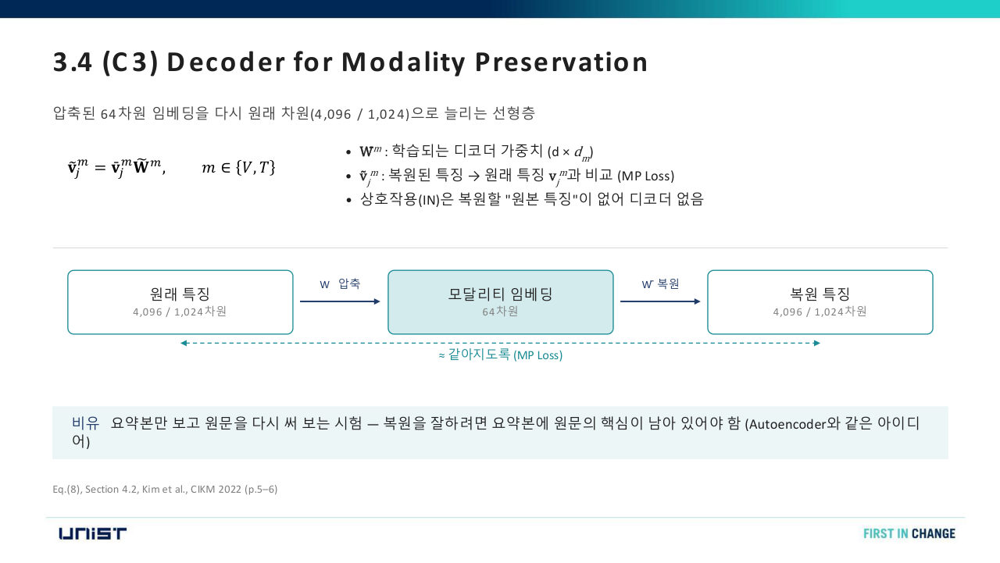

- 압축된 64차원 임베딩을 다시 원래 차원(4,096 / 1,024)으로 늘리는 선형층이다.
- **Eq. 8**: ṽjm = v̄jm W̃m, m ∈ {V, T}
  - W̃m: 학습되는 디코더 가중치 (d × dm)
  - ṽjm: 복원된 특징 → 원래 특징 vjm과 비교 (MP Loss)
  - 상호작용(IN)은 복원할 "원본 특징"이 없어 디코더가 없다.
- 흐름: 원래 특징(4,096 / 1,024차원) → W로 압축 → 모달리티 임베딩(64차원) → W̃로 복원 → 복원 특징 ≈ 원래 특징이 되도록 학습.
- 비유: 요약본만 보고 원문을 다시 써 보는 시험. 복원을 잘하려면 요약본에 원문의 핵심이 남아 있어야 한다 (Autoencoder와 같은 아이디어).

#### 슬라이드 15 · Training: BPR Loss + MP Loss

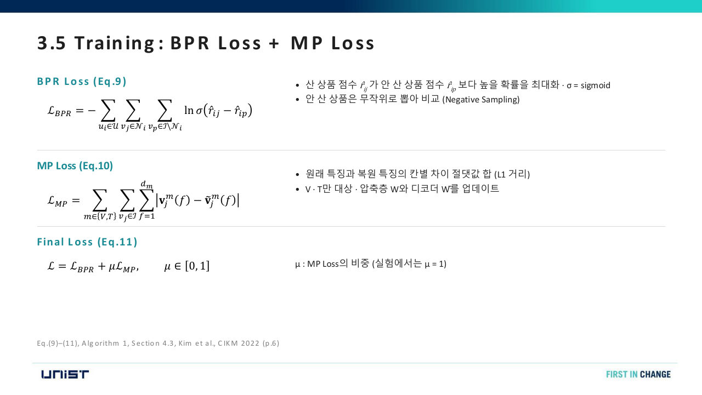

- **BPR Loss (Eq. 9)**: LBPR = −Σi Σj∈Ni Σp∈I∖Ni ln σ(r̂ij − r̂ip)
  - 산 상품 점수 r̂ij가 안 산 상품 점수 r̂ip보다 높을 확률을 최대화한다 (σ = sigmoid).
  - 안 산 상품은 무작위로 뽑아 비교한다 (Negative Sampling).
- **MP Loss (Eq. 10)**: LMP = Σm∈{V,T} Σj Σf |vjm(f) − ṽjm(f)|
  - 원래 특징과 복원 특징의 칸별 차이 절댓값 합 (L1 거리). V · T만 대상이고, 압축층 W와 디코더 W̃를 업데이트한다.
- **Final Loss (Eq. 11)**: L = LBPR + μLMP, μ ∈ [0, 1]. μ는 MP Loss의 비중으로, 실험에서는 μ = 1.

### 4. Evaluation

#### 슬라이드 16 · Research Questions & Datasets

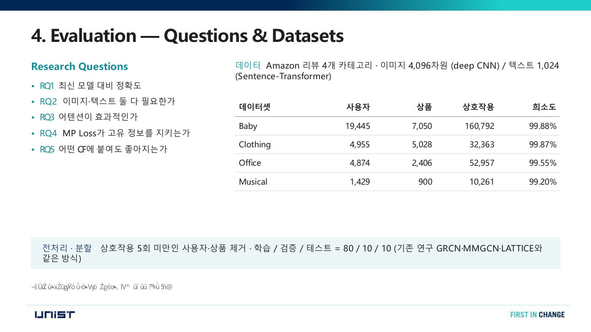

- RQ1 최신 모델 대비 정확도 · RQ2 이미지·텍스트 둘 다 필요한가 · RQ3 어텐션이 효과적인가 · RQ4 MP Loss가 고유 정보를 지키는가 · RQ5 어떤 CF에 붙여도 좋아지는가.
- 데이터: Amazon 리뷰 4개 카테고리. 이미지 4,096차원 (deep CNN) / 텍스트 1,024차원 (Sentence-Transformer).

| 데이터셋 | 사용자 | 상품 | 상호작용 | 희소도 |
|---|---:|---:|---:|---:|
| Baby | 19,445 | 7,050 | 160,792 | 99.88% |
| Clothing | 4,955 | 5,028 | 32,363 | 99.87% |
| Office | 4,874 | 2,406 | 52,957 | 99.55% |
| Musical | 1,429 | 900 | 10,261 | 99.20% |

- 전처리·분할: 상호작용 5회 미만인 사용자·상품 제거, 학습 / 검증 / 테스트 = 80 / 10 / 10 (GRCN·MMGCN·LATTICE와 같은 방식).

#### 슬라이드 17 · Protocol & Implementation

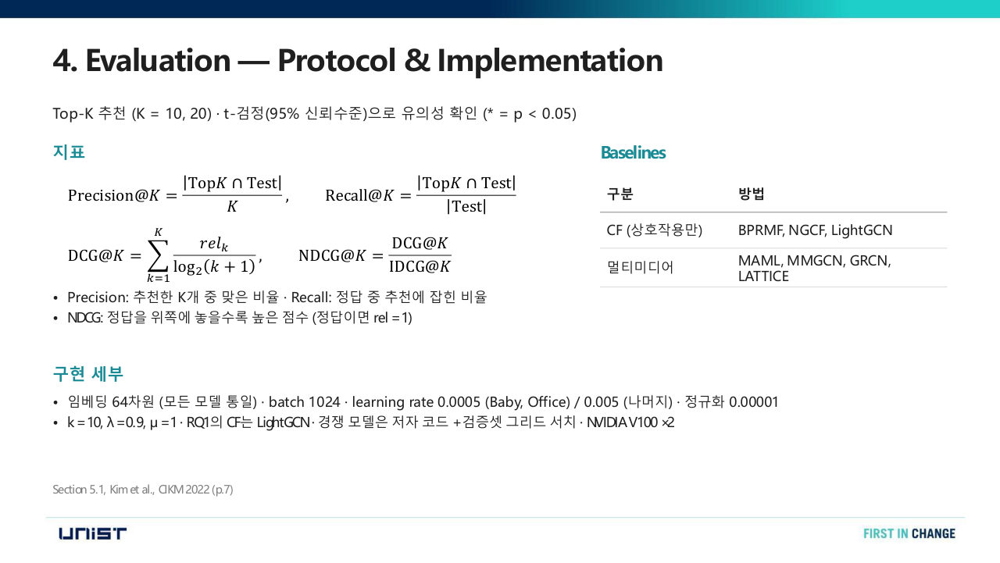

- Top-K 추천 (K = 10, 20), t-검정(95% 신뢰수준)으로 유의성 확인 (* = p < 0.05).
- 지표
  - Precision@K = |TopK ∩ Test| / K: 추천한 K개 중 맞은 비율
  - Recall@K = |TopK ∩ Test| / |Test|: 정답 중 추천에 잡힌 비율
  - NDCG@K = DCG@K / IDCG@K, DCG@K = Σ relk / log2(k+1): 정답을 위쪽에 놓을수록 높은 점수 (정답이면 rel = 1)
- Baselines: CF(상호작용만) BPRMF, NGCF, LightGCN / 멀티미디어 MAML, MMGCN, GRCN, LATTICE.
- 구현: 임베딩 64차원 (모든 모델 통일), batch 1024, learning rate 0.0005 (Baby, Office) / 0.005 (나머지), 정규화 0.00001, k = 10, λ = 0.9, μ = 1. RQ1의 CF는 LightGCN. 경쟁 모델은 저자 코드 + 검증셋 그리드 서치. NVIDIA V100 ×2.

#### 슬라이드 18 · RQ1 Overall Performance (Table 3, @10)

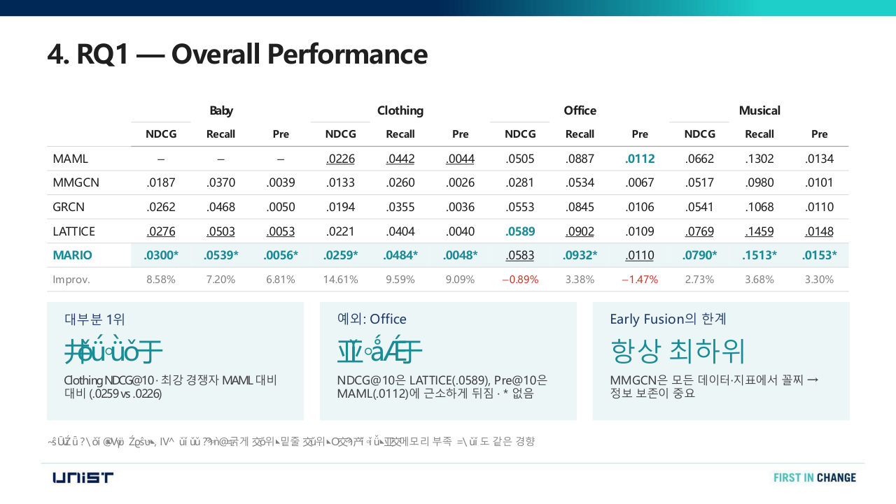

| | Baby NDCG | Clothing NDCG | Office NDCG | Musical NDCG |
|---|---:|---:|---:|---:|
| MAML | − | .0226 | .0505 | .0662 |
| MMGCN | .0187 | .0133 | .0281 | .0517 |
| GRCN | .0262 | .0194 | .0553 | .0541 |
| LATTICE | .0276 | .0221 | **.0589** | .0769 |
| **MARIO** | **.0300*** | **.0259*** | .0583 | **.0790*** |
| Improv. | 8.58% | 14.61% | −0.89% | 2.73% |

NDCG@10만 발췌. Recall·Precision은 슬라이드 참고. − = 메모리 부족.

- **대부분 1위**: Clothing NDCG@10에서 최강 경쟁자 MAML 대비 +14.61% (.0259 vs .0226).
- **예외 Office**: NDCG@10은 LATTICE(.0589), Pre@10은 MAML(.0112)에 근소하게 뒤지며 유의성(*)이 없다.
- **Early Fusion의 한계**: MMGCN은 모든 데이터·지표에서 꼴찌. 정보 보존이 중요하다는 근거다. @20도 같은 경향이다.

#### 슬라이드 19 · RQ2 · RQ3 모달리티와 어텐션 Ablation (Clothing)

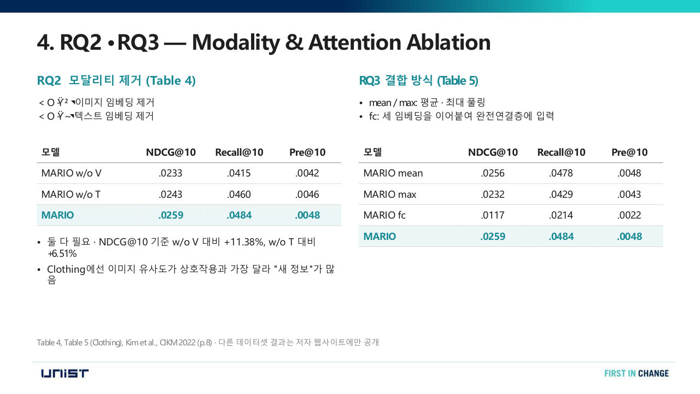

- **RQ2 모달리티 제거 (Table 4)**: w/o V = 이미지 임베딩 제거, w/o T = 텍스트 임베딩 제거.

| 모델 | NDCG@10 | Recall@10 | Pre@10 |
|---|---:|---:|---:|
| MARIO w/o V | .0233 | .0415 | .0042 |
| MARIO w/o T | .0243 | .0460 | .0046 |
| MARIO | **.0259** | **.0484** | **.0048** |

  - 둘 다 필요하다. NDCG@10 기준 w/o V 대비 +11.38%, w/o T 대비 +6.51%. Clothing에서는 이미지 유사도가 상호작용과 가장 달라 "새 정보"가 많아서 이미지를 뺄 때 손해가 더 크다.
- **RQ3 결합 방식 (Table 5)**: mean / max = 평균·최대 풀링, fc = 세 임베딩을 이어붙여 완전연결층에 입력.

| 모델 | NDCG@10 | Recall@10 | Pre@10 |
|---|---:|---:|---:|
| MARIO mean | .0256 | .0478 | .0048 |
| MARIO max | .0232 | .0429 | .0043 |
| MARIO fc | .0117 | .0214 | .0022 |
| MARIO (attention) | **.0259** | **.0484** | **.0048** |

  - 쌍 단위 어텐션이 가장 좋고, fc는 절반 이하로 급락한다. 다른 데이터셋 결과는 저자 웹사이트에만 공개되어 있다.

#### 슬라이드 20 · RQ4 Modality Preservation (Clothing)

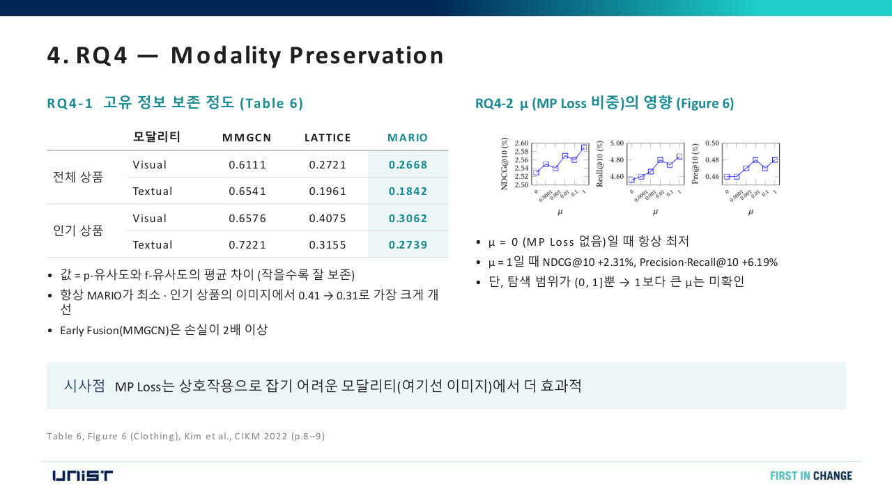

- **RQ4-1 고유 정보 보존 정도 (Table 6)**: 값 = p-유사도와 f-유사도의 평균 차이 (작을수록 잘 보존).

| | 모달리티 | MMGCN | LATTICE | MARIO |
|---|---|---:|---:|---:|
| 전체 상품 | Visual | 0.6111 | 0.2721 | **0.2668** |
| | Textual | 0.6541 | 0.1961 | **0.1842** |
| 인기 상품 | Visual | 0.6576 | 0.4075 | **0.3062** |
| | Textual | 0.7221 | 0.3155 | **0.2739** |

  - 항상 MARIO가 최소이고, 인기 상품의 이미지에서 0.41 → 0.31로 가장 크게 개선된다. Early Fusion(MMGCN)은 손실이 2배 이상이다.
- **RQ4-2 μ (MP Loss 비중)의 영향 (Figure 6)**: μ = 0 (MP Loss 없음)일 때 항상 최저. μ = 1일 때 NDCG@10 +2.31%, Precision·Recall@10 +6.19%. 단, 탐색 범위가 (0, 1]뿐이라 1보다 큰 μ는 확인되지 않았다.
- 시사점: MP Loss는 상호작용으로 잡기 어려운 모달리티(여기서는 이미지)에서 더 효과적이다.

#### 슬라이드 21 · RQ5 Plug-in to Any CF Method (Figure 5)

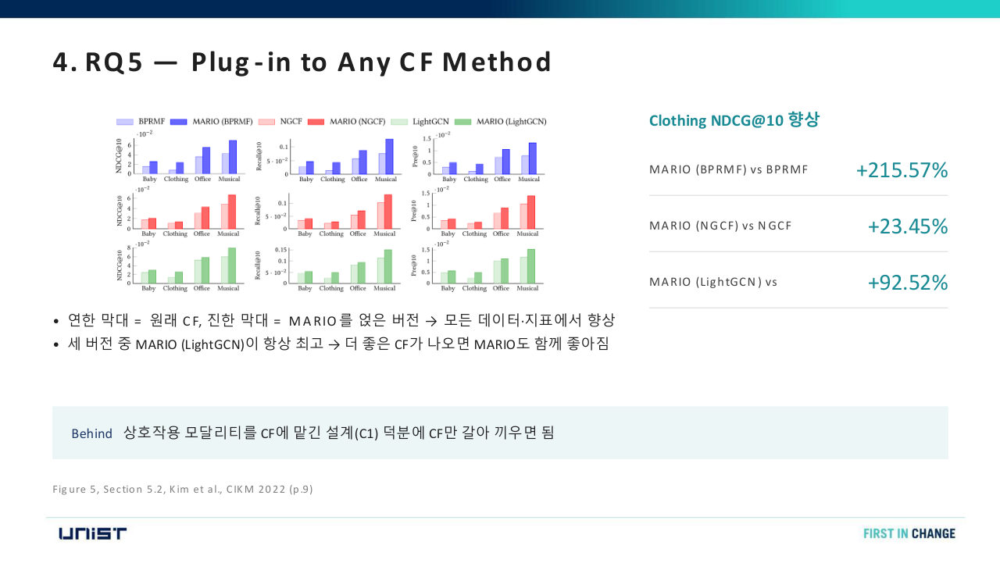

| Clothing NDCG@10 | 향상 |
|---|---:|
| MARIO (BPRMF) vs BPRMF | +215.57% |
| MARIO (NGCF) vs NGCF | +23.45% |
| MARIO (LightGCN) vs LightGCN | +92.52% |

- 연한 막대는 원래 CF, 진한 막대는 MARIO를 얹은 버전이다. 모든 데이터·지표에서 향상된다.
- 세 버전 중 MARIO (LightGCN)이 항상 최고다. 더 좋은 CF가 나오면 MARIO도 함께 좋아진다.
- 이유: 상호작용 모달리티를 CF에 맡긴 설계(C1) 덕분에 CF만 갈아 끼우면 된다.

### 5. Related Work · 결론

#### 슬라이드 22 · Related Work

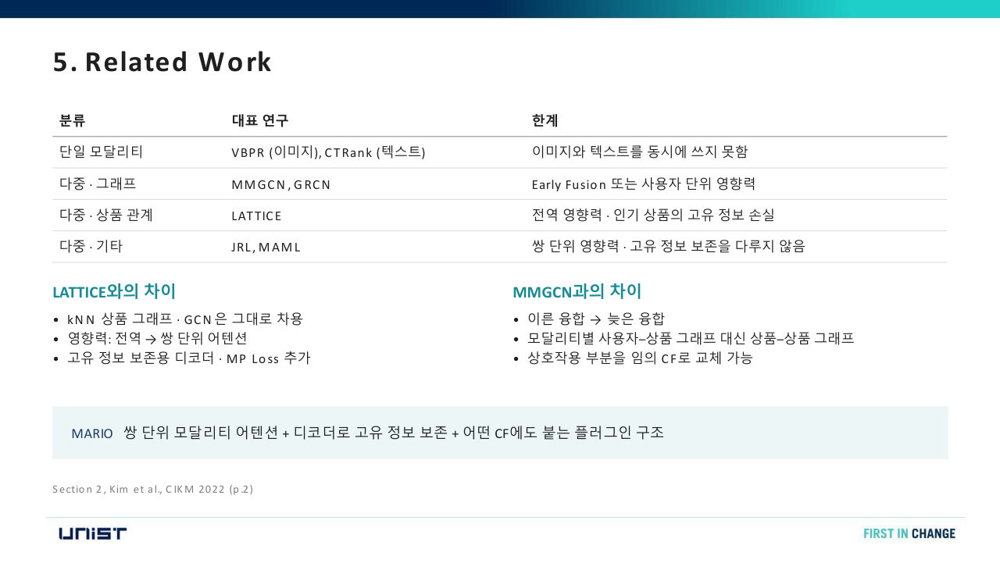

| 분류 | 대표 연구 | 한계 |
|---|---|---|
| 단일 모달리티 | VBPR (이미지), CTRank (텍스트) | 이미지와 텍스트를 동시에 쓰지 못함 |
| 다중 · 그래프 | MMGCN, GRCN | Early Fusion 또는 사용자 단위 영향력 |
| 다중 · 상품 관계 | LATTICE | 전역 영향력 · 인기 상품의 고유 정보 손실 |
| 다중 · 기타 | JRL, MAML | 쌍 단위 영향력 · 고유 정보 보존을 다루지 않음 |

- **LATTICE와의 차이**: kNN 상품 그래프 · GCN은 그대로 차용하고, 영향력을 전역에서 쌍 단위 어텐션으로 바꾸고, 고유 정보 보존용 디코더 · MP Loss를 추가했다.
- **MMGCN과의 차이**: 이른 융합 → 늦은 융합, 모달리티별 사용자–상품 그래프 대신 상품–상품 그래프, 상호작용 부분을 임의 CF로 교체 가능.

#### 슬라이드 23 · Conclusion

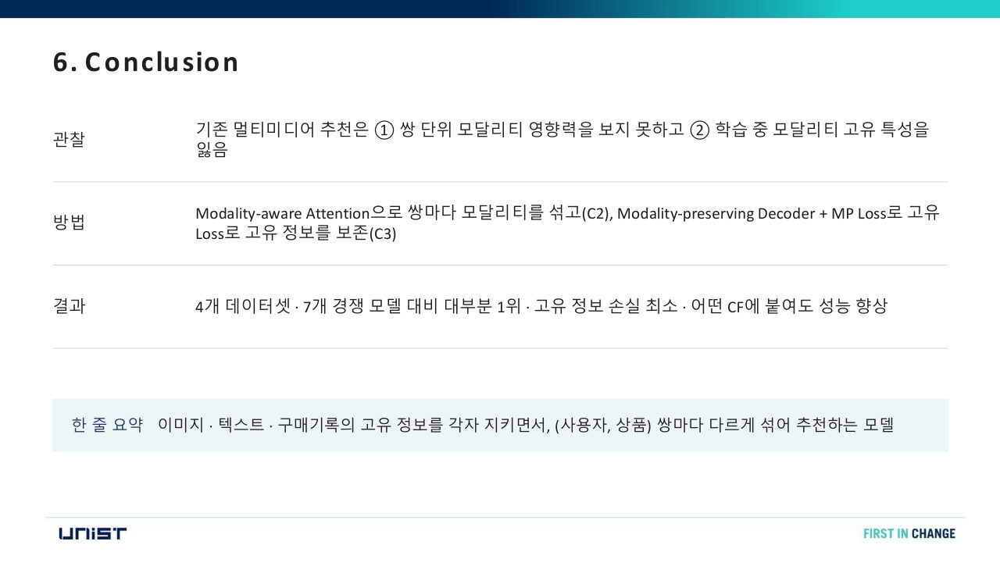

| | 내용 |
|---|---|
| 관찰 | 기존 멀티미디어 추천은 ① 쌍 단위 모달리티 영향력을 보지 못하고 ② 학습 중 모달리티 고유 특성을 잃음 |
| 방법 | Modality-aware Attention으로 쌍마다 모달리티를 섞고(C2), Modality-preserving Decoder + MP Loss로 고유 정보를 보존(C3) |
| 결과 | 4개 데이터셋 · 7개 경쟁 모델 대비 대부분 1위 · 고유 정보 손실 최소 · 어떤 CF에 붙여도 성능 향상 |

- 한 줄 요약: **이미지 · 텍스트 · 구매기록의 고유 정보를 각자 지키면서, (사용자, 상품) 쌍마다 다르게 섞어 추천하는 모델.**

#### 슬라이드 24 · Q&A

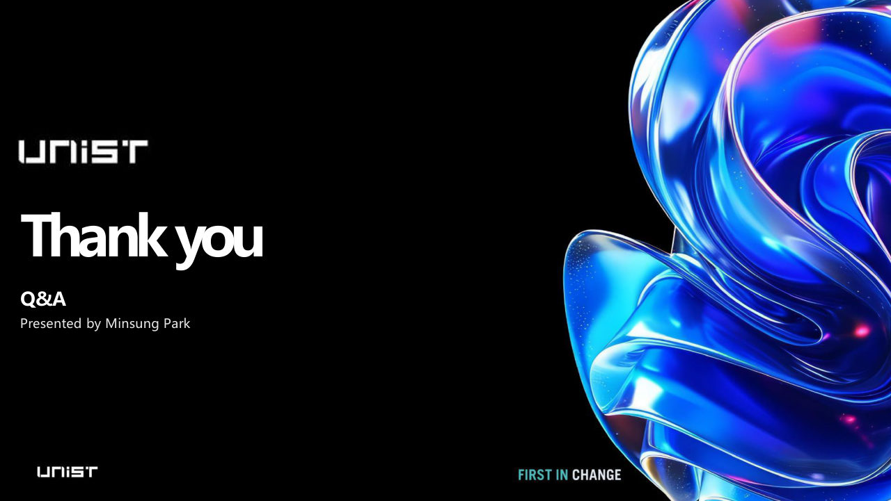

---

## 무엇을 배웠나

- **질문을 바꾸는 방법**: "모달리티를 어떻게 섞을까"에서 "고유 정보는 지키면서 쌍마다 다르게 섞으려면"으로 질문을 바꾸면 두 가지 기여(어텐션, 디코더)가 자연스럽게 나온다.
- **융합 시점의 중요성**: 처음부터 섞는 Early Fusion은 고유 정보를 가장 많이 잃고 성능도 가장 낮았다. 각자 독립적으로 만든 뒤 마지막에 섞는 설계가 근거와 함께 제시된다.
- **보존을 직접 학습 목표로 삼기**: 정보 손실을 측정(p/f-유사도)하고, 복원 손실로 직접 줄이는 구성이 동기 실험 → 방법 → 검증으로 일관된다.
- **결과를 정확히 읽기**: 대부분 1위지만 Office 같은 예외가 있고, 일부 표(Table 4, 5)는 Clothing만 본문에 실려 있어 일반화 범위를 따로 확인해야 한다.
