

  

# 4회차 랩미팅 · GNN & GCN

> [← 전체 목록으로](../../README.md)

| | |
|---|---|
| **주제** | *Graph Neural Networks & Graph Convolutional Networks* |
| **참고 자료** | AI Toolkits (AI503 · CSE613 · EE638) 강의 "Graph Neural Networks", "Graph Convolutional Networks: Hands-on Practice" (Yeon-Chang Lee, 2026 Spring) · 원출처 Stanford CS224W (Jure Leskovec) |
| **발표** | 박민성 (2026-11-20) |
| **자료** | [발표 PDF](GNN_GCN_labmeeting_04.pdf) · 슬라이드 21장 |
| **키워드** | `Node Embedding` `Permutation Invariance/Equivariance` `Neighborhood Aggregation` `GCN` `Inductive Learning` |

## 한눈에 보기

| 문제 | 방법 | 핵심 |
|---|---|---|
| 그래프에는 고정된 노드 순서와 격자가 없어서, 인접 행렬 A와 특징 행렬 X를 그대로 MLP에 넣으면 크기·순서에 따라 결과가 달라진다 | 노드마다 이웃 임베딩을 모아(aggregate) 신경망을 거쳐 갱신하는 층을 K번 쌓는다 (GCN) | 합·평균 집계는 순서와 무관하므로 permutation equivariance를 만족하고, 가중치를 모든 노드가 공유해 처음 보는 노드에도 임베딩을 만들 수 있다 |

  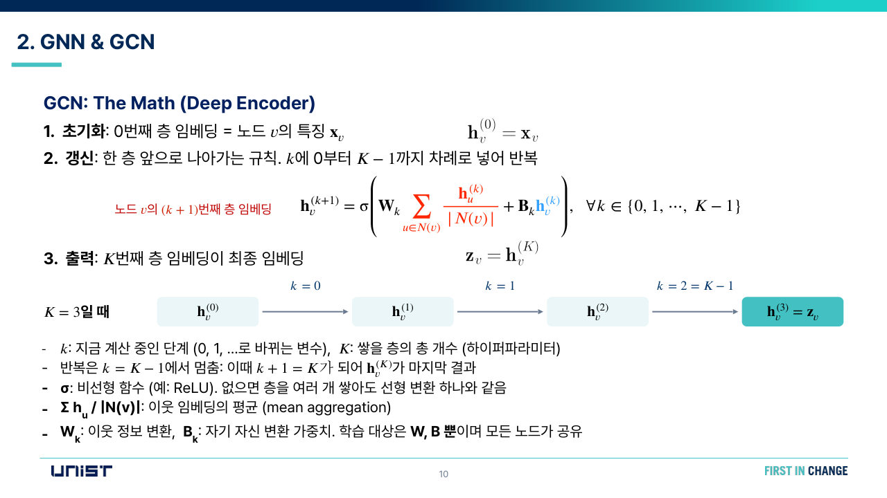 
  GCN 수식 (슬라이드 10)

## 목차

1. [Motivation](#1-motivation) · 슬라이드 1–7
2. [GNN & GCN: 핵심 아이디어와 수식](#2-gnn--gcn-핵심-아이디어와-수식) · 슬라이드 8–12
3. [GNN 학습](#3-gnn-학습) · 슬라이드 13–16
4. [GNN 설계 4단계](#4-gnn-설계-4단계) · 슬라이드 17–21

---

## 슬라이드별 상세 설명

### 1. Motivation

#### 슬라이드 1 · 표지

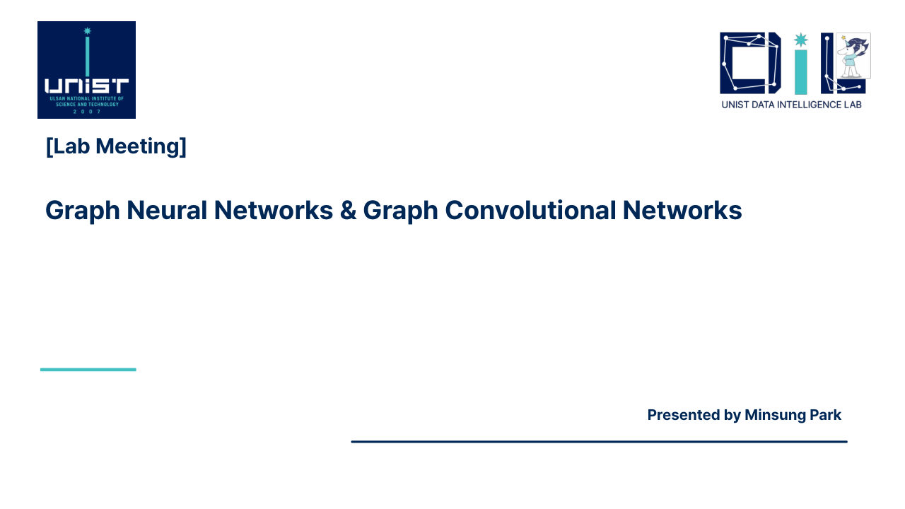

- 이번 회차는 논문이 아니라 그래프 신경망의 기초를 다뤘다. AI Toolkits 강의(Yeon-Chang Lee) "Graph Neural Networks"와 "Graph Convolutional Networks: Hands-on Practice"를 바탕으로, 원출처는 Stanford CS224W(Jure Leskovec)다.
- 1~3회차 논문에서 반복해서 나온 LightGCN, GCN, kNN 그래프를 제대로 이해하기 위한 기초 정리다.

#### 슬라이드 2 · Node Embedding

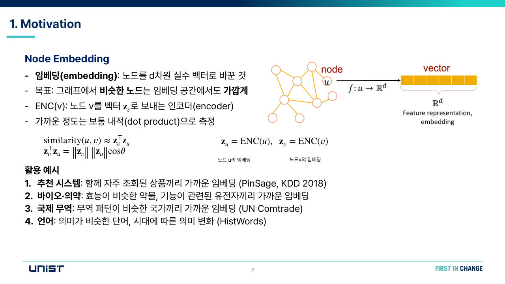

- **임베딩(embedding)**: 노드를 d차원 실수 벡터로 바꾼 것. 그림처럼 노드 u를 함수 f: u → ℝd로 보내 특징 표현(feature representation)을 얻는다.
- 목표: 그래프에서 **비슷한 노드는 임베딩 공간에서도 가깝게**.
- ENC(v): 노드 v를 벡터 zv로 보내는 인코더. zu = ENC(u), zv = ENC(v).
- 가까운 정도는 보통 내적으로 잰다: similarity(u, v) ≈ zvTzu = ‖zv‖‖zu‖cos θ.
- 활용 예시
  1. 추천 시스템: 함께 자주 조회된 상품끼리 가까운 임베딩 (PinSage, KDD 2018)
  2. 바이오·의약: 효능이 비슷한 약물, 기능이 관련된 유전자끼리 가까운 임베딩
  3. 국제 무역: 무역 패턴이 비슷한 국가끼리 가까운 임베딩 (UN Comtrade)
  4. 언어: 의미가 비슷한 단어, 시대에 따른 의미 변화 (HistWords)

#### 슬라이드 3 · Notation

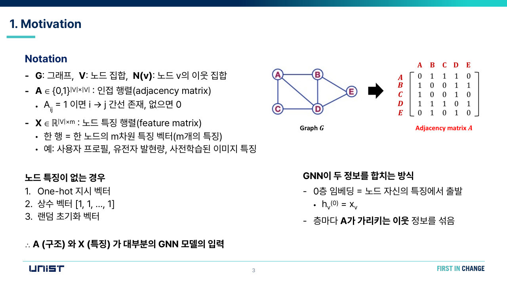

- G: 그래프, V: 노드 집합, N(v): 노드 v의 이웃 집합.
- **A ∈ {0,1}|V|×|V|: 인접 행렬**. Aij = 1이면 i → j 간선이 있고, 없으면 0. 그래프의 **구조**를 담는다.
- **X ∈ ℝ|V|×m: 노드 특징 행렬**. 한 행이 한 노드의 m차원 특징 벡터다 (예: 사용자 프로필, 유전자 발현량, 사전학습된 이미지 특징). 그래프의 **특징**을 담는다.
- 노드 특징이 없는 경우: one-hot 지시 벡터, 상수 벡터 [1, 1, …, 1], 랜덤 초기화 벡터를 쓴다.
- 따라서 **A(구조)와 X(특징)가 대부분의 GNN 모델의 입력**이다.
- GNN이 두 정보를 합치는 방식: 0층 임베딩은 노드 자신의 특징에서 출발하고(hv(0) = xv), 층마다 A가 가리키는 이웃 정보를 섞는다.

#### 슬라이드 4 · Naïve Approach: MLP

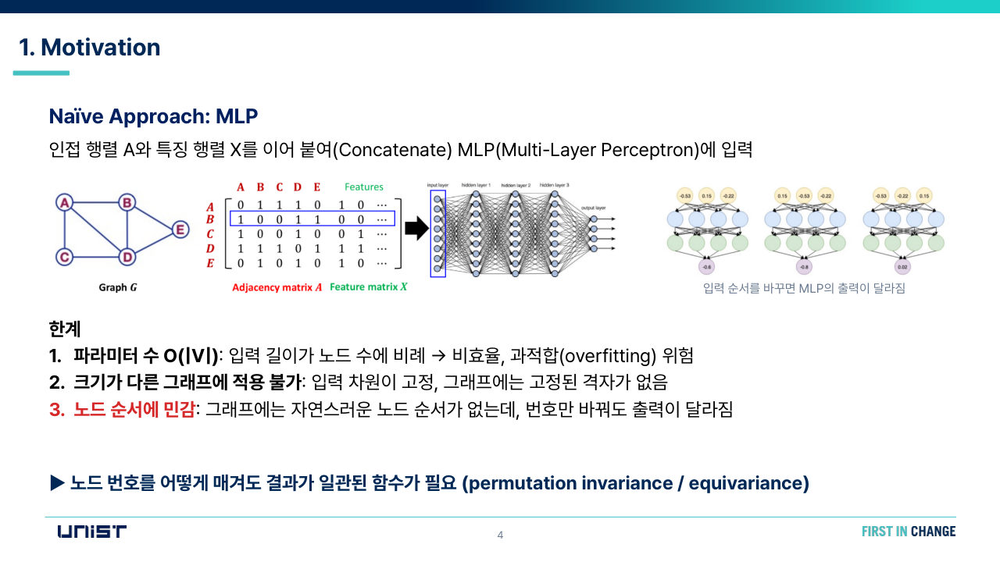

- 가장 단순한 방법은 인접 행렬 A와 특징 행렬 X를 이어 붙여(concatenate) MLP에 넣는 것이다. 그런데 입력 순서를 바꾸면 MLP의 출력이 달라진다.
- 한계
  - **파라미터 수 O(|V|)**: 입력 길이가 노드 수에 비례 → 비효율, 과적합 위험
  - **크기가 다른 그래프에 적용 불가**: 입력 차원이 고정되어 있는데, 그래프에는 고정된 격자가 없다
  - **노드 순서에 민감**: 그래프에는 자연스러운 노드 순서가 없는데, 번호만 바꿔도 출력이 달라진다
- 그래서 **노드 번호를 어떻게 매겨도 결과가 일관된 함수**가 필요하다 (permutation invariance / equivariance).

#### 슬라이드 5 · 그래프에는 정해진 노드 순서가 없다

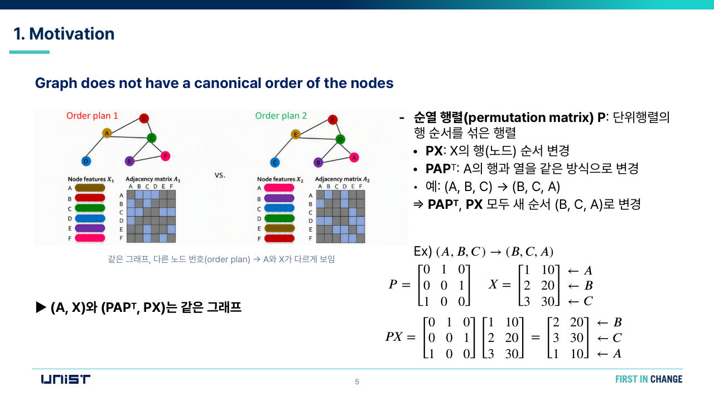

- 같은 그래프라도 노드 번호를 다르게 매기면(order plan) A와 X가 다르게 보인다.
- **순열 행렬 P**: 단위행렬의 행 순서를 섞은 행렬.
  - PX: X의 행(노드) 순서를 바꾼다.
  - PAPT: A의 행과 열을 같은 방식으로 바꾼다.
- 예: (A, B, C) → (B, C, A)로 바꾸면 PAPT, PX 모두 새 순서 (B, C, A)가 된다.
- 결론: **(A, X)와 (PAPT, PX)는 같은 그래프**다. 좋은 모델이라면 둘에 대해 일관된 출력을 내야 한다.

#### 슬라이드 6 · Permutation Invariance & Equivariance

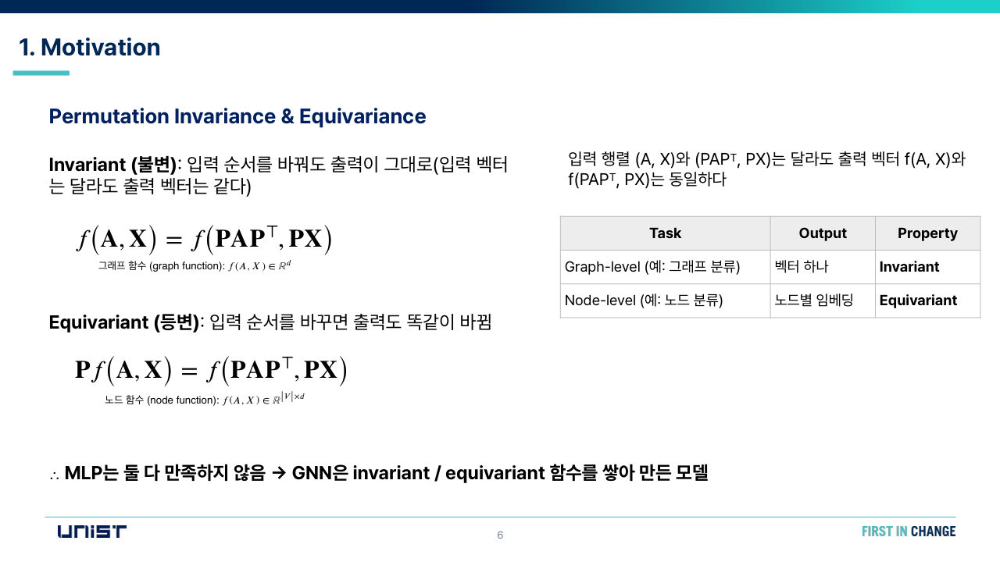

- **Invariant (불변)**: 입력 순서를 바꿔도 출력이 그대로. 입력 행렬 (A, X)와 (PAPT, PX)는 달라도 출력 f(A, X)와 f(PAPT, PX)는 같다.
- **Equivariant (등변)**: 입력 순서를 바꾸면 출력도 똑같이 바뀐다. f(PAPT, PX) = Pf(A, X).

| Task | 출력 | 필요한 성질 |
|---|---|---|
| Graph-level (예: 그래프 분류) | 벡터 하나 | Invariant |
| Node-level (예: 노드 분류) | 노드별 임베딩 | Equivariant |

- MLP는 둘 다 만족하지 않는다. **GNN은 invariant / equivariant 함수를 쌓아 만든 모델**이다.

#### 슬라이드 7 · 왜 A는 양쪽에, X는 왼쪽에만 곱하나?

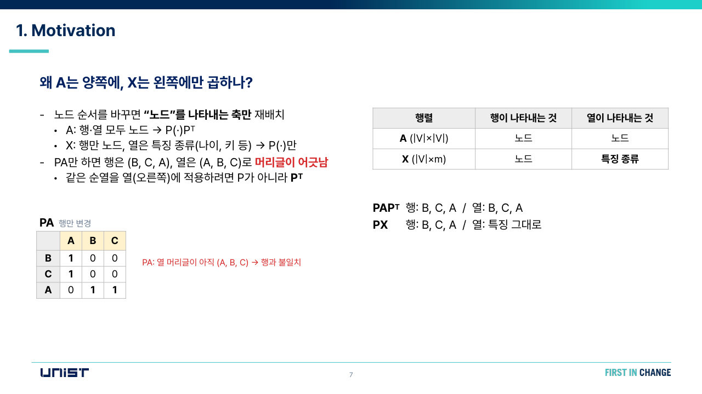

- 노드 순서를 바꾸면 "노드"를 나타내는 축만 재배치해야 한다.

| 행렬 | 행이 나타내는 것 | 열이 나타내는 것 | 순열 적용 |
|---|---|---|---|
| A (\|V\|×\|V\|) | 노드 | 노드 | P(·)PT |
| X (\|V\|×m) | 노드 | 특징 종류 (나이, 키 등) | P(·)만 |

- PA만 하면 행은 (B, C, A)로 바뀌지만 열 머리글은 아직 (A, B, C)라 행과 어긋난다. 같은 순열을 열(오른쪽)에 적용하려면 P가 아니라 **PT**를 곱해야 한다.
- 결과: PAPT는 행·열 모두 (B, C, A), PX는 행만 (B, C, A)이고 열(특징)은 그대로다.

### 2. GNN & GCN: 핵심 아이디어와 수식

#### 슬라이드 8 · Key Idea: Aggregate Neighbors

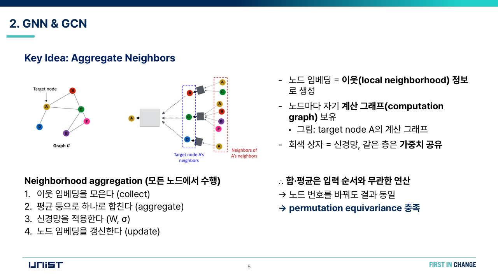

- **노드 임베딩 = 이웃(local neighborhood) 정보로 생성**. 노드마다 자기 계산 그래프(computation graph)를 가진다. 그림은 target node A의 계산 그래프로, A의 이웃(B, C, D)과 그 이웃들의 정보가 회색 상자(신경망)를 거쳐 A로 모인다. 같은 층의 상자는 가중치를 공유한다.
- **Neighborhood aggregation** (모든 노드에서 수행)
  1. 이웃 임베딩을 모은다 (collect)
  2. 평균 등으로 하나로 합친다 (aggregate)
  3. 신경망을 적용한다 (W, σ)
  4. 노드 임베딩을 갱신한다 (update)
- **합·평균은 입력 순서와 무관한 연산**이라 노드 번호를 바꿔도 결과가 같다 → permutation equivariance를 충족한다. 슬라이드 4–6에서 요구한 조건이 이 설계로 해결된다.

#### 슬라이드 9 · Deep Model: Many Layers

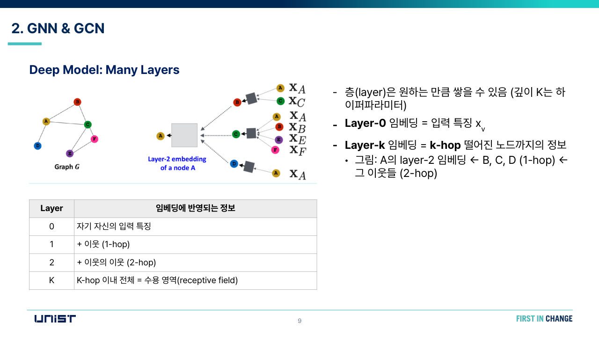

- 층(layer)은 원하는 만큼 쌓을 수 있다. 깊이 K는 하이퍼파라미터다.
- Layer-0 임베딩 = 입력 특징 xv. Layer-k 임베딩 = k-hop 떨어진 노드까지의 정보.
- 그림: A의 layer-2 임베딩 ← B, C, D (1-hop) ← 그 이웃들 (2-hop). 맨 오른쪽 xA, xC 등은 입력 특징이다.

| Layer | 임베딩에 반영되는 정보 |
|---|---|
| 0 | 자기 자신의 입력 특징 |
| 1 | + 이웃 (1-hop) |
| 2 | + 이웃의 이웃 (2-hop) |
| K | K-hop 이내 전체 = 수용 영역 (receptive field) |

#### 슬라이드 10 · GCN: The Math (Deep Encoder)

1. **초기화**: 0번째 층 임베딩 = 노드 v의 특징. hv(0) = xv
2. **갱신**: 한 층 앞으로 나아가는 규칙. k에 0부터 K−1까지 차례로 넣어 반복한다.
   - **hv(k+1) = σ( Wk Σu∈N(v) hu(k) / |N(v)| + Bk hv(k) ), ∀k ∈ {0, 1, …, K−1}**
3. **출력**: K번째 층 임베딩이 최종 임베딩. zv = hv(K)

- K = 3이면 h(0) → (k=0) → h(1) → (k=1) → h(2) → (k=2=K−1) → h(3) = zv.
- 각 기호의 의미
  - k: 지금 계산 중인 단계 (0, 1, …로 바뀌는 변수), K: 쌓을 층의 총 개수 (하이퍼파라미터)
  - 반복은 k = K−1에서 멈춘다. 이때 k+1 = K가 되어 hv(K)가 마지막 결과다.
  - σ: 비선형 함수 (예: ReLU). 없으면 층을 여러 개 쌓아도 선형 변환 하나와 같다.
  - Σ hu / |N(v)|: 이웃 임베딩의 평균 (mean aggregation)
  - Wk: 이웃 정보 변환, Bk: 자기 자신 변환 가중치. **학습 대상은 W, B뿐이며 모든 노드가 공유한다.**

#### 슬라이드 11 · GCN: Matrix Formulation

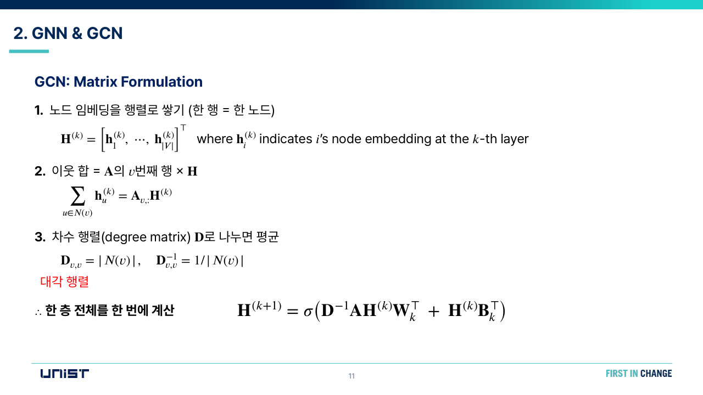

1. **노드 임베딩을 행렬로 쌓기** (한 행 = 한 노드): H(k) = [h1(k), …, h|V|(k)]T
2. **이웃 합 = A의 v번째 행 × H**: Σu∈N(v) hu(k) = Av,:H(k). A의 v번째 행은 이웃 위치만 1이므로, H와 곱하면 이웃 임베딩만 더해진다.
3. **차수 행렬 D로 나누면 평균**: Dv,v = |N(v)|, Dv,v−1 = 1/|N(v)|. D는 대각 행렬이다.

- 따라서 **한 층 전체를 한 번에 계산**할 수 있다: **H(k+1) = σ( D−1AH(k)WkT + H(k)BkT )**
- 노드마다 반복문을 도는 대신 행렬곱 몇 번으로 끝나므로, GPU에서 효율적으로 계산된다.

#### 슬라이드 12 · 가중치 곱하기: 왜 WT가 오른쪽에 붙나?

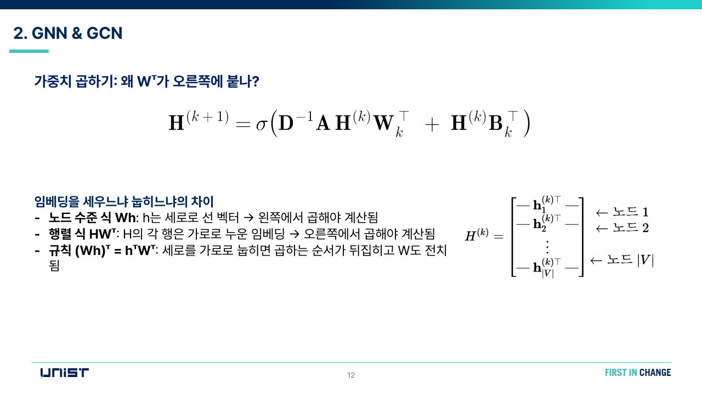

- 임베딩을 세우느냐 눕히느냐의 차이다.
  - **노드 수준 식 Wh**: h는 세로로 선 벡터 → 왼쪽에서 곱해야 계산된다.
  - **행렬 식 HWT**: H의 각 행은 가로로 누운 임베딩(hT) → 오른쪽에서 곱해야 계산된다.
  - **규칙 (Wh)T = hTWT**: 세로를 가로로 눕히면 곱하는 순서가 뒤집히고 W도 전치된다.
- 슬라이드 10의 노드 수준 식과 슬라이드 11의 행렬 식이 같은 계산이라는 것을 확인하는 부분이다.

### 3. GNN 학습

#### 슬라이드 13 · Training the GNNs: 무엇을 학습하나

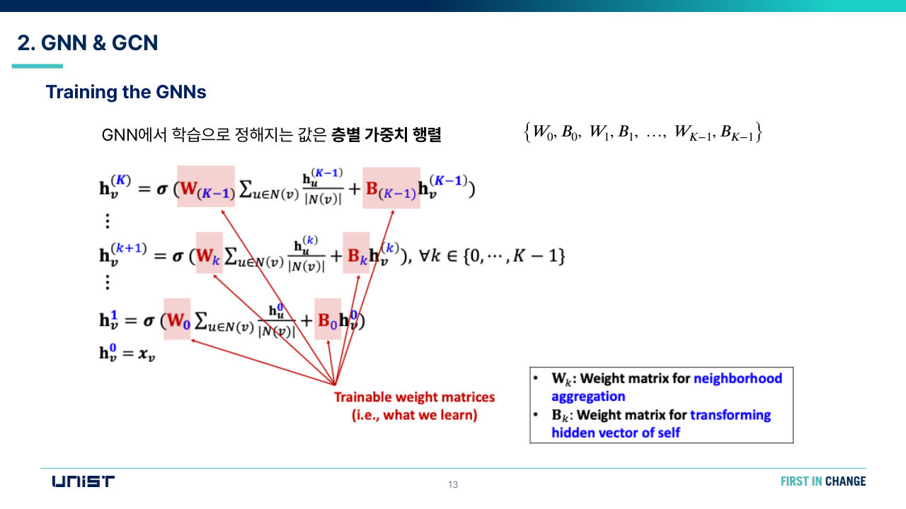

- GNN에서 학습으로 정해지는 값은 **층별 가중치 행렬** {W0, B0, W1, B1, …, WK−1, BK−1}이다.
- 그림처럼 hv(1)부터 hv(K)까지 각 층의 식에 들어가는 Wk(이웃 집계용)와 Bk(자기 자신 변환용)가 학습 대상(trainable weight matrices)이다. hv(0) = xv는 입력이라 학습하지 않는다.
- 노드별 임베딩을 직접 학습하는 것이 아니므로, 파라미터 수가 노드 수와 무관하다.

#### 슬라이드 14 · Training the GNNs: 손실과 경사 하강

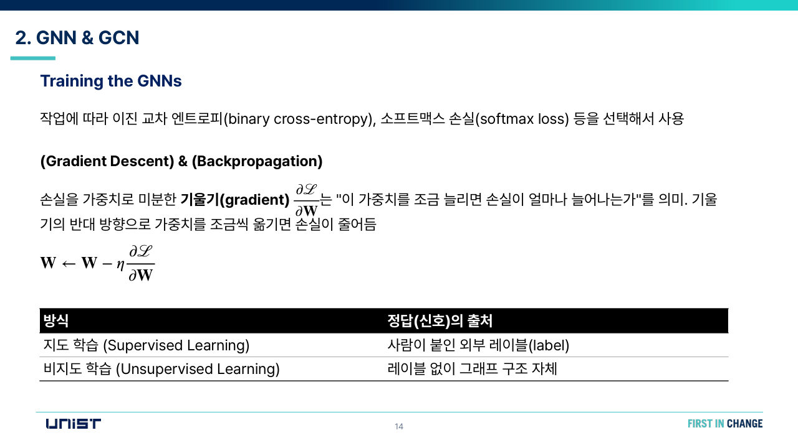

- 작업에 따라 이진 교차 엔트로피(binary cross-entropy), 소프트맥스 손실(softmax loss) 등을 선택해서 쓴다.
- **Gradient Descent & Backpropagation**: 손실을 가중치로 미분한 기울기 ∂L/∂W는 "이 가중치를 조금 늘리면 손실이 얼마나 늘어나는가"를 뜻한다. 기울기의 반대 방향으로 가중치를 조금씩 옮기면 손실이 줄어든다: W ← W − η ∂L/∂W.

| 방식 | 정답(신호)의 출처 |
|---|---|
| 지도 학습 (Supervised Learning) | 사람이 붙인 외부 레이블 (label) |
| 비지도 학습 (Unsupervised Learning) | 레이블 없이 그래프 구조 자체 |

#### 슬라이드 15 · Supervised task 예시: 약물 상호작용 네트워크의 노드 분류

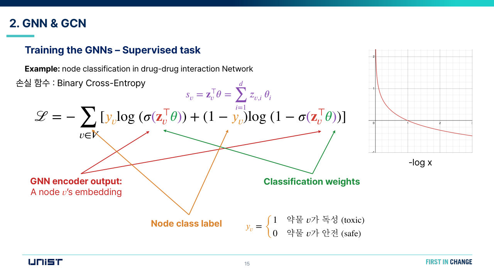

- 예시: 약물–약물 상호작용 네트워크에서 각 약물이 독성(toxic)인지 안전(safe)인지 분류한다. yv = 1이면 약물 v가 독성, 0이면 안전.
- 손실 함수는 Binary Cross-Entropy:
  - **L = −Σv∈V [ yv log σ(zvTθ) + (1 − yv) log(1 − σ(zvTθ)) ]**
- 식의 각 부분
  - zv: GNN encoder의 출력, 즉 노드 v의 임베딩 (빨강)
  - θ: 분류 가중치 (초록). sv = zvTθ = Σi zv,iθi는 점수
  - yv: 노드의 클래스 레이블 (주황)
- 오른쪽 −log x 그래프: 모델이 정답에 준 확률이 1에 가까우면 손실이 0에 가깝고, 0에 가까우면 손실이 급격히 커진다.

#### 슬라이드 16 · Supervised task: 학습 과정 정리

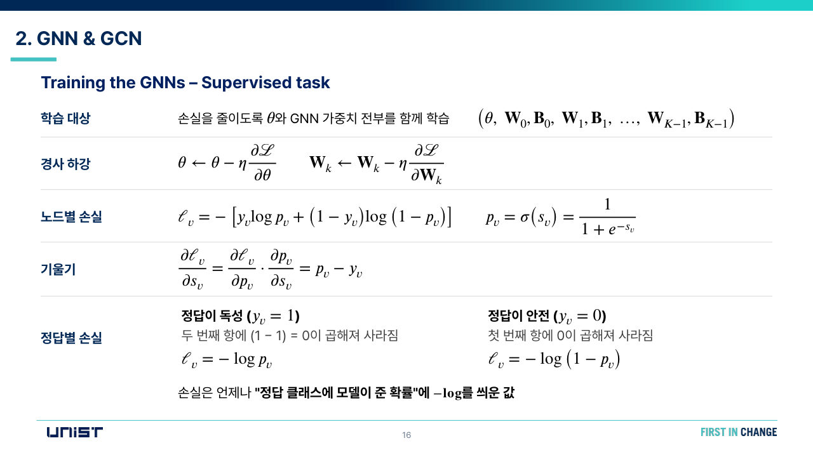

| 항목 | 내용 |
|---|---|
| 학습 대상 | 손실을 줄이도록 θ와 GNN 가중치 전부를 함께 학습: (θ, W0, B0, …, WK−1, BK−1) |
| 경사 하강 | θ ← θ − η ∂L/∂θ, Wk ← Wk − η ∂L/∂Wk |
| 노드별 손실 | ℓv = −[yv log pv + (1 − yv) log(1 − pv)], pv = σ(sv) = 1 / (1 + e−sv) |
| 기울기 | ∂ℓv/∂sv = (∂ℓv/∂pv)(∂pv/∂sv) = pv − yv |

- 정답별 손실
  - 정답이 독성 (yv = 1): 두 번째 항이 (1 − 1) = 0이 곱해져 사라짐 → ℓv = −log pv
  - 정답이 안전 (yv = 0): 첫 번째 항이 0이 곱해져 사라짐 → ℓv = −log(1 − pv)
- 정리: 손실은 언제나 **"정답 클래스에 모델이 준 확률"에 −log를 씌운 값**이다. 기울기가 pv − yv로 매우 단순한 것도 BCE + sigmoid 조합의 장점이다.

### 4. GNN 설계 4단계

#### 슬라이드 17 · (1) 이웃 집계 함수 정의

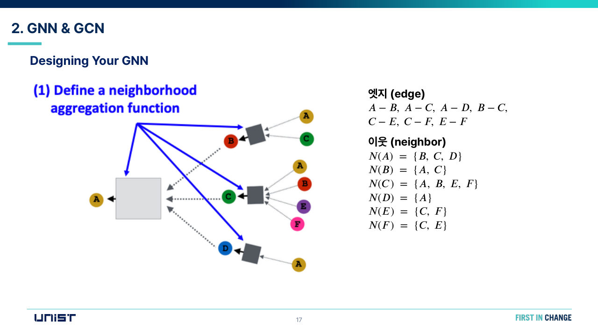

- 첫 단계는 이웃 정보를 어떻게 모을지(aggregation function)를 정하는 것이다. 파란 화살표가 가리키는 회색 상자들이 그 함수다.
- 예시 그래프의 엣지: A–B, A–C, A–D, B–C, C–E, C–F, E–F.
- 이웃: N(A) = {B, C, D}, N(B) = {A, C}, N(C) = {A, B, E, F}, N(D) = {A}, N(E) = {C, F}, N(F) = {C, E}.
- 그림은 노드 A의 2층 계산 그래프다. A는 B, C, D에게서, B는 A, C에게서, C는 A, B, E, F에게서, D는 A에게서 정보를 받는다.

#### 슬라이드 18 · (2) 임베딩에 대한 손실 함수 정의

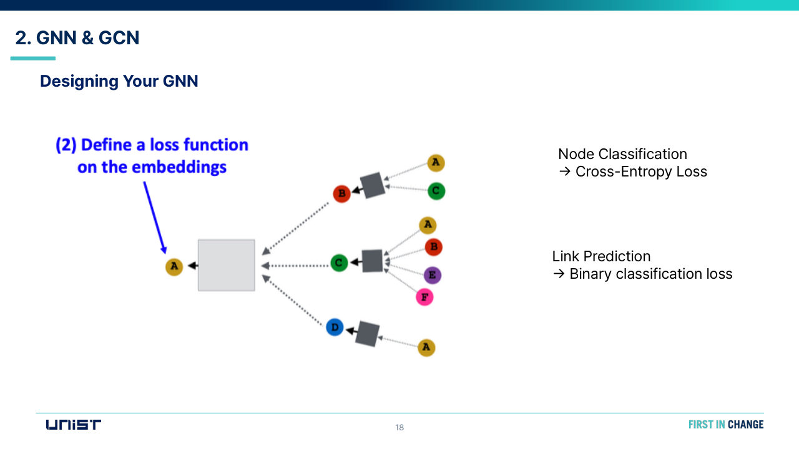

- 두 번째 단계는 최종 임베딩에 어떤 손실을 걸지 정하는 것이다. 작업에 따라 다르다.
  - **Node Classification** → Cross-Entropy Loss (슬라이드 15–16의 예시)
  - **Link Prediction** → Binary classification loss (두 노드 사이에 엣지가 있는지 없는지)

#### 슬라이드 19 · (3) 노드 집합으로 학습

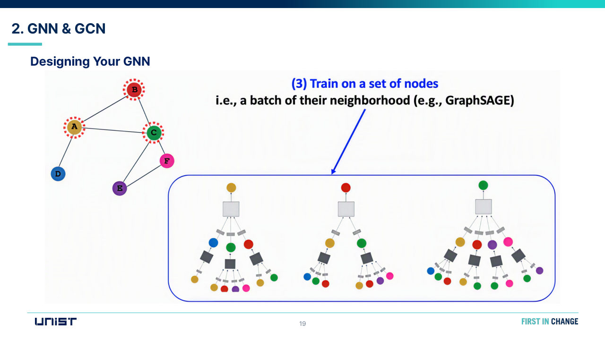

- 세 번째 단계는 노드 집합, 즉 그들의 이웃 묶음(batch)으로 학습하는 것이다 (예: GraphSAGE).
- 그림에서 점선 원으로 표시된 A, B, C가 학습 배치이고, 아래는 각각의 계산 그래프다. 세 계산 그래프는 같은 가중치(회색 상자)를 공유한다.

#### 슬라이드 20 · (4) 필요한 노드의 임베딩 생성

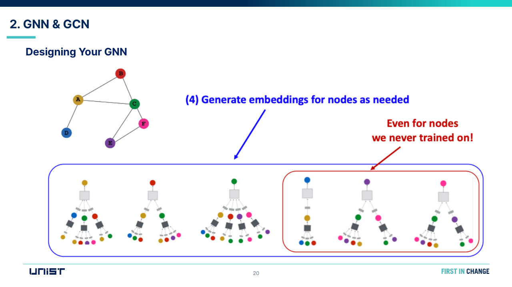

- 마지막 단계는 학습된 가중치로 필요한 노드의 임베딩을 만드는 것이다.
- 핵심은 빨간 상자: **학습에 쓰지 않은 노드(D, E, F)에도 임베딩을 만들 수 있다.** 가중치가 노드별이 아니라 층별로 공유되므로, 계산 그래프만 만들 수 있으면 어떤 노드에도 같은 함수를 적용할 수 있다.
- 이것이 GNN의 **inductive** 능력이다. 새 노드가 추가되거나 아예 새 그래프가 와도 다시 학습하지 않고 임베딩을 얻을 수 있다.

#### 슬라이드 21 · Thank you

---

## 무엇을 배웠나

- **설계 조건에서 모델이 나온다**: "노드 번호를 어떻게 매겨도 결과가 일관돼야 한다"는 조건 하나에서 순서와 무관한 집계(합·평균)와 이웃 기반 갱신이라는 GNN의 구조가 자연스럽게 따라 나온다.
- **수식의 모양까지 이해하기**: PAPT와 PX, 노드 수준의 Wh와 행렬 수준의 HWT처럼, 곱하는 위치와 전치는 "각 축이 무엇을 나타내는가"로 설명된다. 행렬 식으로 쓰면 한 층 전체를 한 번에 계산할 수 있다.
- **깊이 = 수용 영역**: 층을 하나 쌓을 때마다 한 hop씩 더 먼 정보가 들어온다. K는 성능과 계산량을 함께 결정하는 하이퍼파라미터다.
- **손실의 직관**: BCE는 결국 정답 클래스 확률에 −log를 씌운 값이고, 기울기는 p − y로 단순하다. 수식을 정답별로 나눠 보면 각 항이 왜 있는지 분명해진다.
- **가중치 공유가 일반화를 만든다**: 학습 대상이 노드별 벡터가 아니라 층별 W, B뿐이라 파라미터 수가 그래프 크기와 무관하고, 새 노드나 새 그래프에도 그대로 적용된다. 이는 3회차 MARIO처럼 상품 그래프에 GCN을 써서 임베딩을 보강하는 추천 모델을 이해하는 기반이 된다.
