

  

# 5회차 랩미팅 · MARIO

> [← 전체 목록으로](../../README.md) · 같은 논문을 다룬 [3회차 기록](../03)

| | |
|---|---|
| **논문** | *MARIO: Modality-Aware Attention and Modality-Preserving Decoders for Multimedia Recommendation* |
| **저자** | Taeri Kim, Yeon-Chang Lee, Kijung Shin, Sang-Wook Kim (Hanyang Univ. · KAIST) |
| **학회** | CIKM 2022 · [DOI 10.1145/3511808.3557387](https://doi.org/10.1145/3511808.3557387) |
| **발표** | 박민성 (2026-11-23) |
| **자료** | [발표 PDF](MARIO_labmeeting_05.pdf) · 슬라이드 26장 |
| **키워드** | `Multimedia Recommendation` `Modality-aware Attention` `Modality-preserving Decoder` `kNN Item Graph` `Late Fusion` |

## 한눈에 보기

| 문제 | 방법 | 결과 |
|---|---|---|
| ① 모달리티 영향력을 전역(LATTICE)·사용자(GRCN) 단위로만 보고, ② 학습 중 이미지·텍스트의 고유 정보를 잃는다 | (C1) 모달리티별 독립 인코딩, (C2) (사용자, 상품) 쌍마다 가중치를 주는 어텐션, (C3) 원래 특징을 복원하는 디코더 + MP Loss | Amazon 4개 데이터셋, 7개 경쟁 모델 대비 대부분 1위. 최강 경쟁자 대비 NDCG@10 최대 +14.61% |

  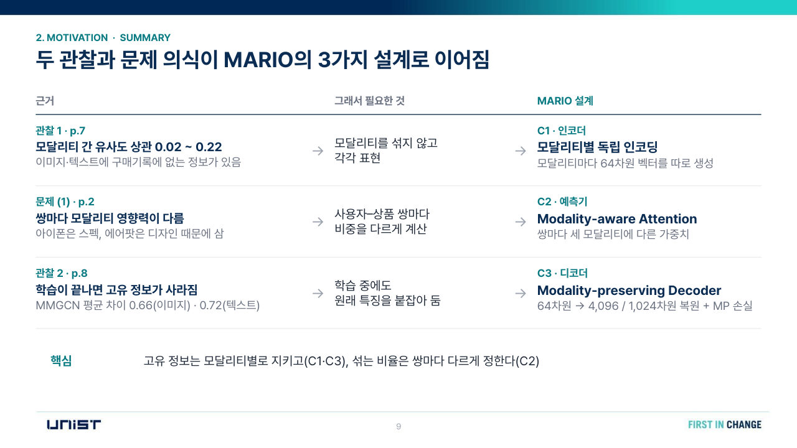 
  두 관찰과 문제 의식이 MARIO의 세 설계로 이어지는 구조 (슬라이드 9)

**3회차와 달라진 점**: 같은 논문이지만 이번 발표는 관찰 → 설계 대응표(슬라이드 9), 기존 방법을 영향력 단위의 축으로 정리한 그림(슬라이드 4), kNN 그래프와 GCN 수식의 기호별 설명(슬라이드 12–13), 상호작용 임베딩을 만드는 LightGCN·BPR 과정(슬라이드 14)을 새로 넣어 방법 부분을 더 자세히 다뤘다.

## 목차

1. [Introduction](#1-introduction) · 슬라이드 1–6
2. [Motivation](#2-motivation) · 슬라이드 7–9
3. [Method](#3-method) · 슬라이드 10–17
4. [Evaluation](#4-evaluation) · 슬라이드 18–23
5. [Related Work · Conclusion](#5-related-work--conclusion) · 슬라이드 24–26

---

## 슬라이드별 상세 설명

### 1. Introduction

#### 슬라이드 1 · 표지

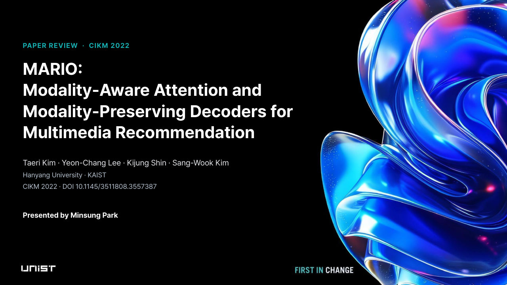

- *MARIO: Modality-Aware Attention and Modality-Preserving Decoders for Multimedia Recommendation* (Taeri Kim · Yeon-Chang Lee · Kijung Shin · Sang-Wook Kim, Hanyang University · KAIST, CIKM 2022).

#### 슬라이드 2 · 멀티미디어 추천과 기존 접근

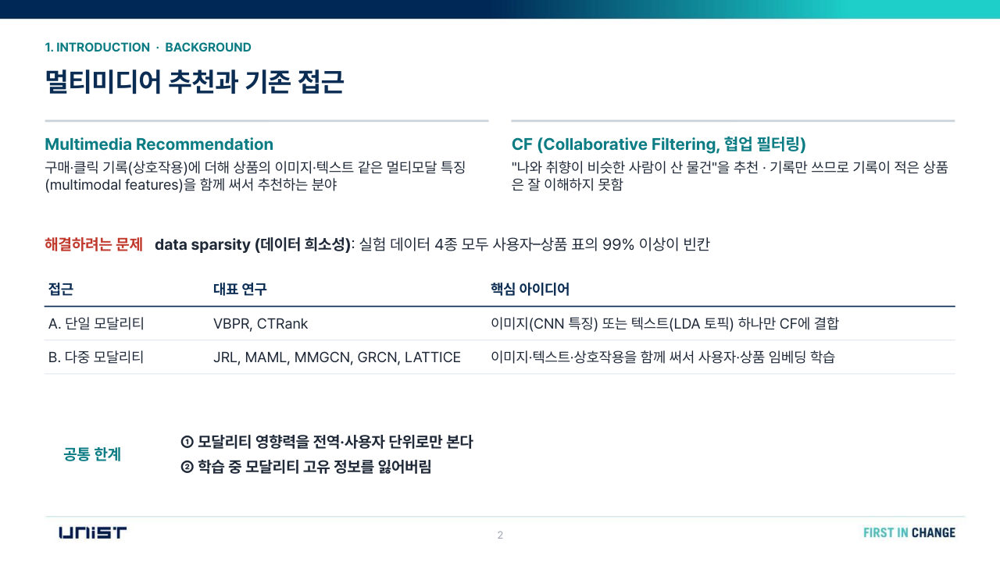

- **Multimedia Recommendation**: 구매·클릭 기록(상호작용)에 더해 상품의 이미지·텍스트 같은 멀티모달 특징을 함께 써서 추천하는 분야.
- **CF (Collaborative Filtering, 협업 필터링)**: "나와 취향이 비슷한 사람이 산 물건"을 추천. 기록만 쓰므로 기록이 적은 상품은 잘 이해하지 못한다.
- 해결하려는 문제: **data sparsity**. 실험 데이터 4종 모두 사용자–상품 표의 99% 이상이 빈칸이다.

| 접근 | 대표 연구 | 핵심 아이디어 |
|---|---|---|
| A. 단일 모달리티 | VBPR, CTRank | 이미지(CNN 특징) 또는 텍스트(LDA 토픽) 하나만 CF에 결합 |
| B. 다중 모달리티 | JRL, MAML, MMGCN, GRCN, LATTICE | 이미지·텍스트·상호작용을 함께 써서 사용자·상품 임베딩 학습 |

- 공통 한계: ① 모달리티 영향력을 전역·사용자 단위로만 본다, ② 학습 중 모달리티 고유 정보를 잃어버린다.

#### 슬라이드 3 · 기존 다중 모달리티 방법 비교 (표)

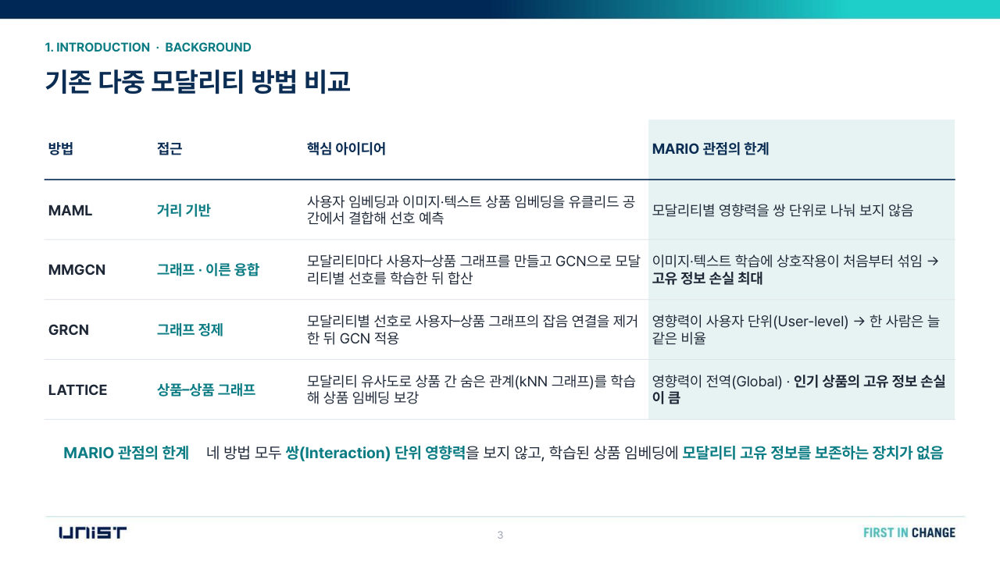

| 방법 | 접근 | 핵심 아이디어 | MARIO 관점의 한계 |
|---|---|---|---|
| MAML | 거리 기반 | 사용자 임베딩과 이미지·텍스트 상품 임베딩을 유클리드 공간에서 결합해 선호 예측 | 모달리티별 영향력을 쌍 단위로 나눠 보지 않음 |
| MMGCN | 그래프 · 이른 융합 | 모달리티마다 사용자–상품 그래프를 만들고 GCN으로 모달리티별 선호를 학습한 뒤 합산 | 이미지·텍스트 학습에 상호작용이 처음부터 섞임 → **고유 정보 손실 최대** |
| GRCN | 그래프 정제 | 모달리티별 선호로 사용자–상품 그래프의 잡음 연결을 제거한 뒤 GCN 적용 | 영향력이 사용자 단위 → 한 사람은 늘 같은 비율 |
| LATTICE | 상품–상품 그래프 | 모달리티 유사도로 상품 간 숨은 관계(kNN 그래프)를 학습해 상품 임베딩 보강 | 영향력이 전역 · **인기 상품의 고유 정보 손실이 큼** |

- 네 방법 모두 **쌍(Interaction) 단위 영향력**을 보지 않고, 학습된 상품 임베딩에 **모달리티 고유 정보를 보존하는 장치**가 없다.

#### 슬라이드 4 · 기존 다중 모달리티 방법 비교 (영향력 단위 축)

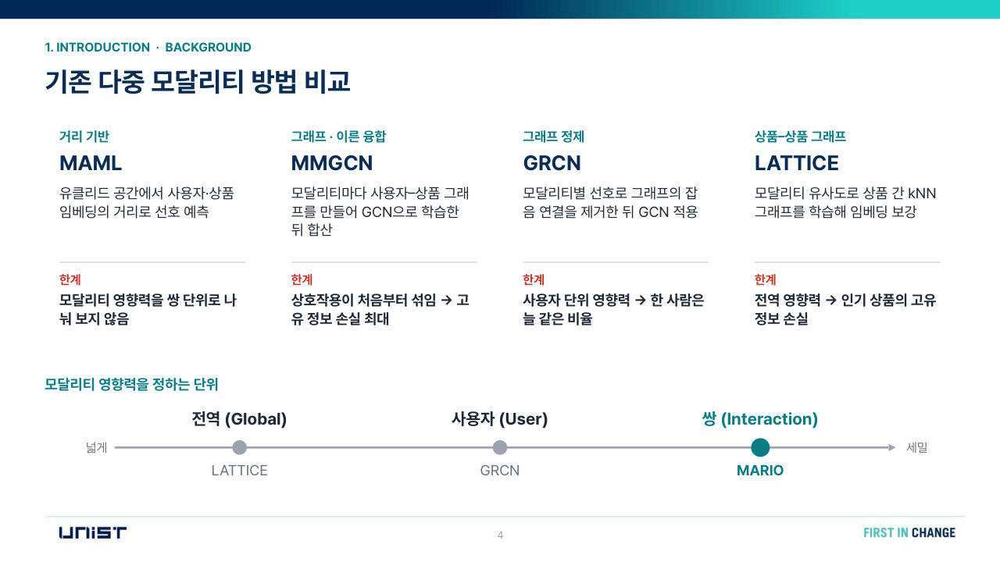

- 같은 네 방법을 카드로 다시 정리하고, 아래에 **"모달리티 영향력을 정하는 단위"** 축을 그렸다.
  - 왼쪽(넓게) **전역 (Global)** = LATTICE → 가운데 **사용자 (User)** = GRCN → 오른쪽(세밀) **쌍 (Interaction)** = MARIO.
- 축이 오른쪽으로 갈수록 영향력을 더 잘게 나눠 본다. MARIO의 위치가 기존 방법과 어떻게 다른지를 한눈에 보여 주는 슬라이드다.

#### 슬라이드 5 · 같은 사람도 상품마다 선택 이유가 다르다 (Figure 1)

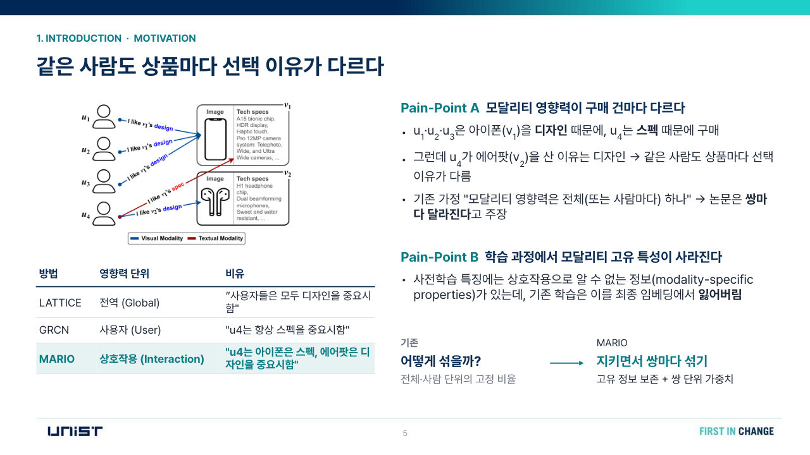

- 왼쪽 그림: u1·u2·u3은 아이폰(v1)을 디자인(파랑, Visual) 때문에, u4는 스펙(빨강, Textual) 때문에 샀다. 그런데 u4가 에어팟(v2)을 산 이유는 디자인이다.

| 방법 | 영향력 단위 | 비유 |
|---|---|---|
| LATTICE | 전역 (Global) | "사용자들은 모두 디자인을 중요시함" |
| GRCN | 사용자 (User) | "u4는 항상 스펙을 중요시함" |
| MARIO | 상호작용 (Interaction) | "u4는 아이폰은 스펙, 에어팟은 디자인을 중요시함" |

- **Pain-Point A · 모달리티 영향력이 구매 건마다 다르다**: 기존 가정 "모달리티 영향력은 전체(또는 사람마다) 하나" → 논문은 쌍마다 달라진다고 주장한다.
- **Pain-Point B · 학습 과정에서 모달리티 고유 특성이 사라진다**: 사전학습 특징에는 상호작용으로 알 수 없는 정보(modality-specific properties)가 있는데, 기존 학습은 이를 최종 임베딩에서 잃어버린다.
- 질문의 전환: 기존 "어떻게 섞을까?"(전체·사람 단위의 고정 비율) → MARIO "지키면서 쌍마다 섞기"(고유 정보 보존 + 쌍 단위 가중치).

#### 슬라이드 6 · 논문의 세 가지 기여

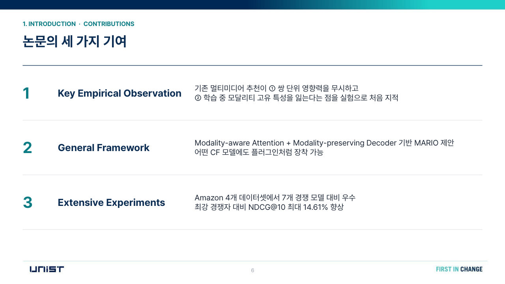

1. **Key Empirical Observation**: 기존 멀티미디어 추천이 ① 쌍 단위 영향력을 무시하고 ② 학습 중 모달리티 고유 특성을 잃는다는 점을 실험으로 처음 지적.
2. **General Framework**: Modality-aware Attention + Modality-preserving Decoder 기반 MARIO 제안. 어떤 CF 모델에도 플러그인처럼 장착 가능.
3. **Extensive Experiments**: Amazon 4개 데이터셋에서 7개 경쟁 모델 대비 우수. 최강 경쟁자 대비 NDCG@10 최대 14.61% 향상.

### 2. Motivation

#### 슬라이드 7 · Observation 1: 이미지·텍스트를 추가로 쓰는 것이 의미가 있는가? (Figure 2)

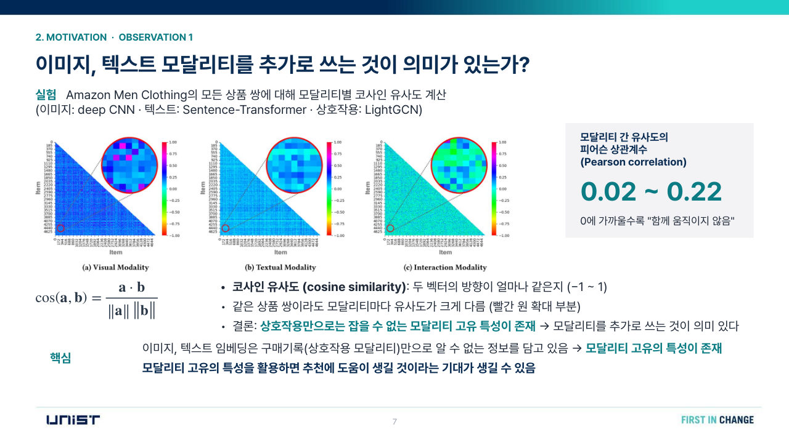

- 실험: Amazon Men Clothing의 모든 상품 쌍에 대해 모달리티별 코사인 유사도를 계산했다 (이미지: deep CNN · 텍스트: Sentence-Transformer · 상호작용: LightGCN).
- 그림의 세 삼각 히트맵은 (a) Visual, (b) Textual, (c) Interaction 모달리티의 상품 쌍 유사도이고, 빨간 원은 같은 영역을 확대한 것이다. 같은 상품 쌍이라도 모달리티마다 색(유사도)이 크게 다르다.
- 모달리티 간 유사도의 **피어슨 상관계수: 0.02 ~ 0.22**. 0에 가까울수록 "함께 움직이지 않음"이다.
- 코사인 유사도 cos(a, b) = a·b / (‖a‖‖b‖): 두 벡터의 방향이 얼마나 같은지 (−1 ~ 1).
- 결론: **상호작용만으로는 잡을 수 없는 모달리티 고유 특성이 존재**한다 → 모달리티를 추가로 쓰는 것이 의미 있다. 이미지·텍스트 임베딩은 구매 기록만으로 알 수 없는 정보를 담고 있고, 그 고유 특성을 활용하면 추천에 도움이 될 것이라는 기대가 생긴다.

#### 슬라이드 8 · Observation 2: 학습이 끝나면 고유 정보가 사라진다 (Figure 3)

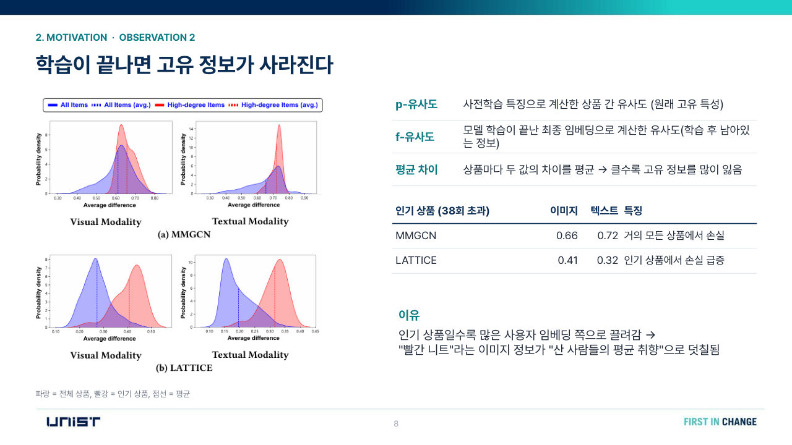

| 용어 | 뜻 |
|---|---|
| p-유사도 | 사전학습 특징으로 계산한 상품 간 유사도 (원래 고유 특성) |
| f-유사도 | 모델 학습이 끝난 최종 임베딩으로 계산한 유사도 (학습 후 남아 있는 정보) |
| 평균 차이 | 상품마다 두 값의 차이를 평균 → 클수록 고유 정보를 많이 잃음 |

- 왼쪽 그림은 평균 차이의 분포다. 파랑 = 전체 상품, 빨강 = 인기 상품, 점선 = 평균. (a) MMGCN은 두 분포 모두 오른쪽(손실 큼)에 있고, (b) LATTICE는 빨간 인기 상품 분포만 오른쪽으로 치우쳐 있다.

| 인기 상품 (38회 초과) | 이미지 | 텍스트 | 특징 |
|---|---:|---:|---|
| MMGCN | 0.66 | 0.72 | 거의 모든 상품에서 손실 |
| LATTICE | 0.41 | 0.32 | 인기 상품에서 손실 급증 |

- 이유: 인기 상품일수록 많은 사용자 임베딩 쪽으로 끌려간다 → "빨간 니트"라는 이미지 정보가 "산 사람들의 평균 취향"으로 덧칠된다.

#### 슬라이드 9 · Summary: 두 관찰과 문제 의식이 MARIO의 3가지 설계로 이어짐

| 근거 | 그래서 필요한 것 | MARIO 설계 |
|---|---|---|
| 관찰 1 (p.7): 모달리티 간 유사도 상관 0.02~0.22. 이미지·텍스트에 구매 기록에 없는 정보가 있음 | 모달리티를 섞지 않고 각각 표현 | **C1 · 인코더**: 모달리티별 독립 인코딩. 모달리티마다 64차원 벡터를 따로 생성 |
| 문제 (1) (p.2): 쌍마다 모달리티 영향력이 다름. 아이폰은 스펙, 에어팟은 디자인 때문에 삼 | 사용자–상품 쌍마다 비중을 다르게 계산 | **C2 · 예측기**: Modality-aware Attention. 쌍마다 세 모달리티에 다른 가중치 |
| 관찰 2 (p.8): 학습이 끝나면 고유 정보가 사라짐. MMGCN 평균 차이 0.66(이미지) · 0.72(텍스트) | 학습 중에도 원래 특징을 붙잡아 둠 | **C3 · 디코더**: Modality-preserving Decoder. 64차원 → 4,096 / 1,024차원 복원 + MP 손실 |

- 핵심: **고유 정보는 모달리티별로 지키고(C1·C3), 섞는 비율은 쌍마다 다르게 정한다(C2).**

### 3. Method

#### 슬라이드 10 · MARIO 전체 구조 (Figure 4)

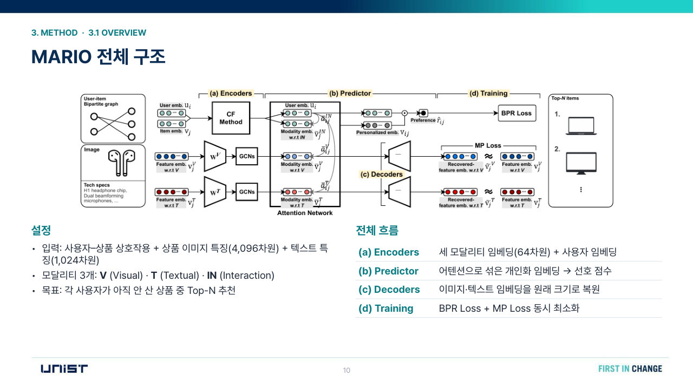

- **설정**: 입력은 사용자–상품 상호작용 + 상품 이미지 특징(4,096차원) + 텍스트 특징(1,024차원). 모달리티 3개는 V (Visual) · T (Textual) · IN (Interaction). 목표는 각 사용자가 아직 안 산 상품 중 Top-N 추천.

| 단계 | 하는 일 |
|---|---|
| (a) Encoders | 세 모달리티 임베딩(64차원) + 사용자 임베딩 |
| (b) Predictor | 어텐션으로 섞은 개인화 임베딩 → 선호 점수 |
| (c) Decoders | 이미지·텍스트 임베딩을 원래 크기로 복원 |
| (d) Training | BPR Loss + MP Loss 동시 최소화 |

#### 슬라이드 11 · (C1) 인코더 ① 상호작용 모달리티 · 압축층

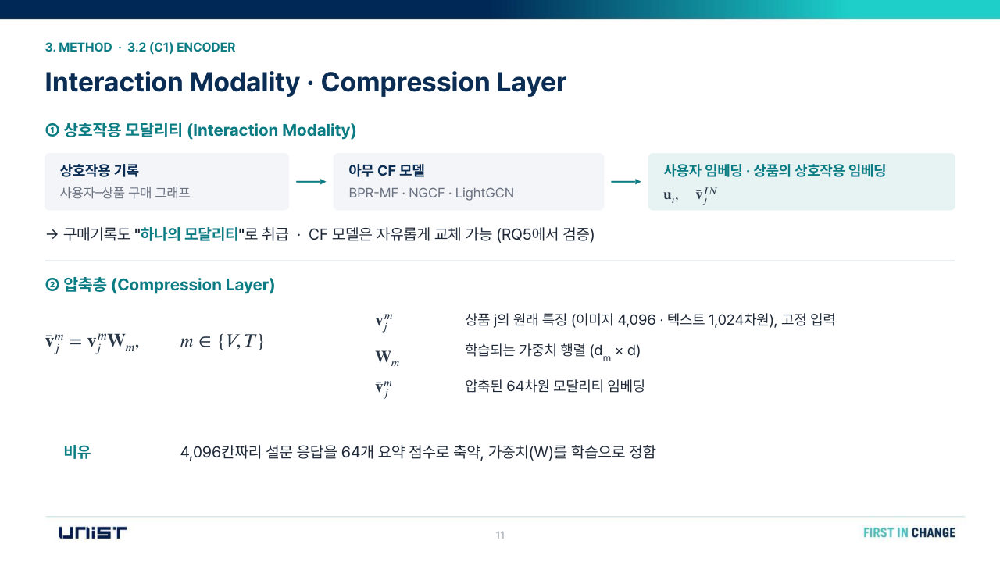

- **① 상호작용 모달리티**: 상호작용 기록(사용자–상품 구매 그래프)에 아무 CF 모델(BPR-MF · NGCF · LightGCN)을 적용해 사용자 임베딩과 상품의 상호작용 임베딩을 얻는다. 구매 기록도 "하나의 모달리티"로 취급하며, CF 모델은 자유롭게 교체할 수 있다 (RQ5에서 검증).
- **② 압축층 (Eq. 1)**: v̄jm = vjm Wm, m ∈ {V, T}
  - vjm: 상품 j의 원래 특징 (이미지 4,096 · 텍스트 1,024차원), 고정 입력
  - Wm: 학습되는 가중치 행렬 (dm × d)
  - v̄jm: 압축된 64차원 모달리티 임베딩
- 비유: 4,096칸짜리 설문 응답을 64개 요약 점수로 축약한다. 어떻게 요약할지(W)는 학습으로 정한다.

#### 슬라이드 12 · (C1) 인코더 ② kNN 상품 그래프

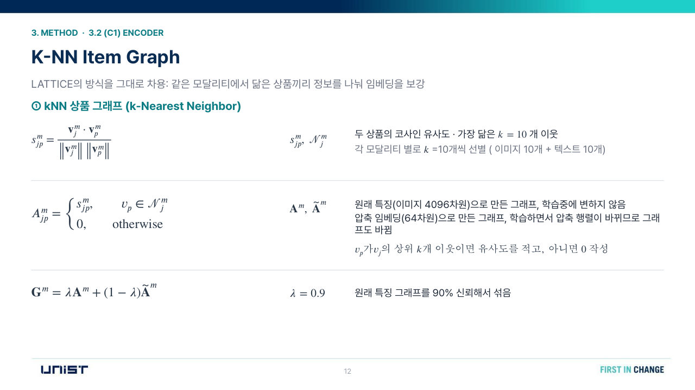

- LATTICE의 방식을 그대로 차용: 같은 모달리티에서 닮은 상품끼리 정보를 나눠 임베딩을 보강한다.

| 수식 | 기호 | 의미 |
|---|---|---|
| sjpm = vjm·vpm / (‖vjm‖‖vpm‖) | sjpm, Njm | 두 상품의 코사인 유사도 · 가장 닮은 k = 10개 이웃. 모달리티별로 따로 선별 (이미지 10개 + 텍스트 10개) |
| Ajpm = sjpm (vp ∈ Njm), 0 (otherwise) | Am, Ãm | Am: 원래 특징(이미지 4,096차원)으로 만든 그래프, 학습 중에 변하지 않음. Ãm: 압축 임베딩(64차원)으로 만든 그래프, 학습하면서 압축 행렬이 바뀌므로 그래프도 바뀜. vp가 vj의 상위 k개 이웃이면 유사도를 적고, 아니면 0 |
| Gm = λAm + (1 − λ)Ãm | λ = 0.9 | 원래 특징 그래프를 90% 신뢰해서 섞음 |

- 고정된 원래 그래프에 무게를 두면서도, 학습 중 바뀌는 압축 그래프를 10% 섞어 학습 신호에 맞게 조금씩 조정할 여지를 남긴다.

#### 슬라이드 13 · (C1) 인코더 ③ GCN

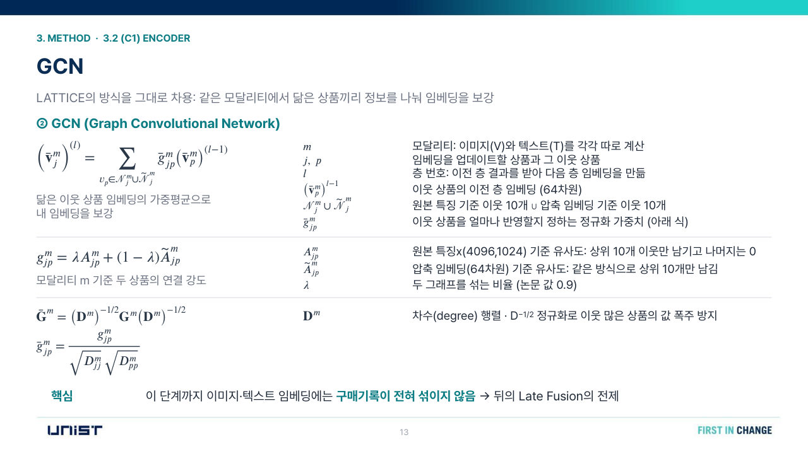

| 수식 | 기호 | 의미 |
|---|---|---|
| (v̄jm)(l) = Σvp∈Njm∪Ñjm ḡjpm (v̄pm)(l−1) | m, j·p, l | 모달리티(V, T 각각 따로 계산), 업데이트할 상품과 그 이웃, 층 번호(이전 층 결과를 받아 다음 층 임베딩을 만듦) |
| | (v̄pm)(l−1) | 이웃 상품의 이전 층 임베딩 (64차원) |
| | Njm ∪ Ñjm | 원본 특징 기준 이웃 10개 ∪ 압축 임베딩 기준 이웃 10개 |
| gjpm = λAjpm + (1 − λ)Ãjpm | Ajpm, Ãjpm, λ | 모달리티 m 기준 두 상품의 연결 강도. 원본 특징(4,096 / 1,024) 기준 유사도와 압축 임베딩(64차원) 기준 유사도를 섞음 (λ = 0.9) |
| Ḡm = (Dm)−1/2 Gm (Dm)−1/2, ḡjpm = gjpm / (√Djjm √Dppm) | Dm | 차수(degree) 행렬. D−1/2 정규화로 이웃 많은 상품의 값 폭주 방지 |

- 닮은 이웃 상품 임베딩의 가중평균으로 내 임베딩을 보강한다. 4회차에서 정리한 GCN의 D−1A(평균)를 대칭 정규화 D−1/2GD−1/2로 바꾼 형태다.
- **핵심**: 이 단계까지 이미지·텍스트 임베딩에는 **구매 기록이 전혀 섞이지 않는다**. 이것이 뒤의 Late Fusion의 전제다.

#### 슬라이드 14 · (C1) 인코더 ④ 상호작용 모달리티와 사용자 임베딩을 만드는 과정

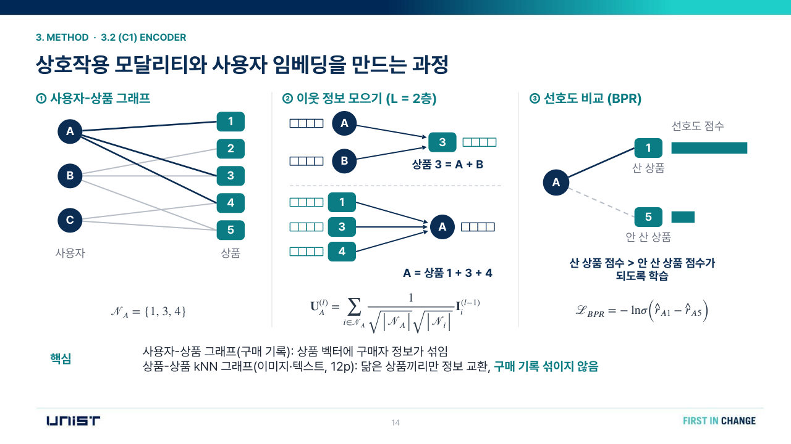

- **① 사용자–상품 그래프**: 사용자 A, B, C와 상품 1~5가 구매 엣지로 연결된다. 예: A가 산 상품은 NA = {1, 3, 4}.
- **② 이웃 정보 모으기 (L = 2층, LightGCN)**: 상품 3의 벡터는 그것을 산 사용자 A + B의 정보로, 사용자 A의 벡터는 산 상품 1 + 3 + 4의 정보로 만들어진다.
  - UA(l) = Σi∈NA 1/(√|NA| √|Ni|) · Ii(l−1)
- **③ 선호도 비교 (BPR)**: A가 산 상품 1과 안 산 상품 5를 비교해, 산 상품 점수 > 안 산 상품 점수가 되도록 학습한다. LBPR = −ln σ(r̂A1 − r̂A5).
- **핵심 대비**
  - 사용자–상품 그래프(구매 기록): 상품 벡터에 **구매자 정보가 섞인다**.
  - 상품–상품 kNN 그래프(이미지·텍스트, 슬라이드 12): 닮은 상품끼리만 정보를 교환하고 **구매 기록은 섞이지 않는다**.

#### 슬라이드 15 · (C2) Modality-aware Attention

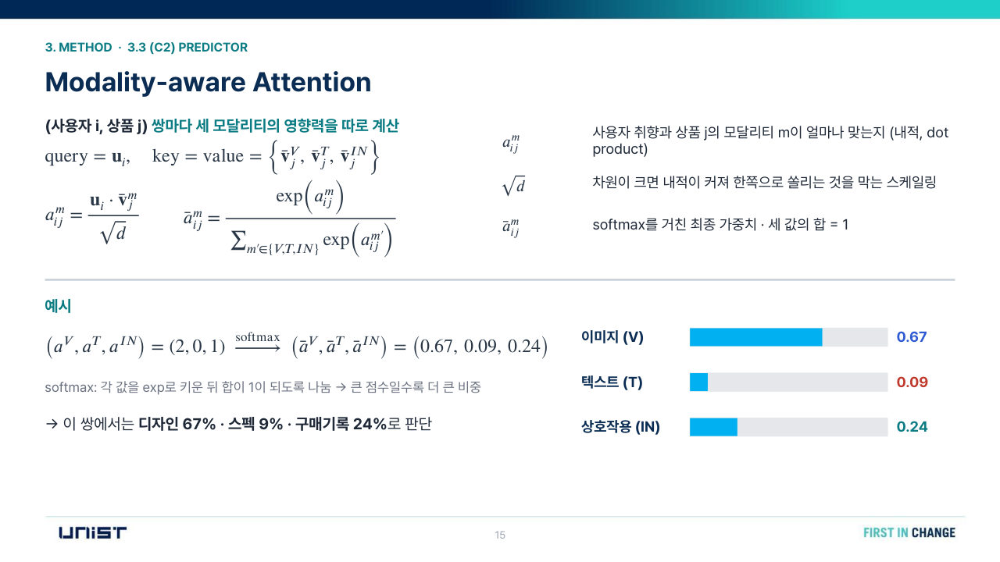

- (사용자 i, 상품 j) 쌍마다 세 모달리티의 영향력을 따로 계산한다. query = ui, key = value = {v̄jV, v̄jT, v̄jIN}.
- aijm = ui · v̄jm / √d, āijm = exp(aijm) / Σm′∈{V,T,IN} exp(aijm′)
  - aijm: 사용자 취향과 상품 j의 모달리티 m이 얼마나 맞는지 (내적)
  - √d: 차원이 크면 내적이 커져 한쪽으로 쏠리는 것을 막는 스케일링
  - āijm: softmax를 거친 최종 가중치, 세 값의 합 = 1
- **예시**: (aV, aT, aIN) = (2, 0, 1) → softmax → (0.67, 0.09, 0.24). softmax는 각 값을 exp로 키운 뒤 합이 1이 되도록 나누므로, 큰 점수일수록 더 큰 비중을 갖는다. 이 쌍에서는 **디자인 67% · 스펙 9% · 구매 기록 24%**로 판단한다 (오른쪽 막대그래프).
- 이렇게 얻은 가중치로 세 임베딩을 더해 개인화 상품 임베딩 vij = Σm āijm v̄jm을 만들고, 선호 점수 r̂ij = ui · vij로 추천한다. 모달리티를 이 마지막 단계에서만 섞으므로 Late Fusion이다.

#### 슬라이드 16 · (C3) Decoder for Modality Preservation

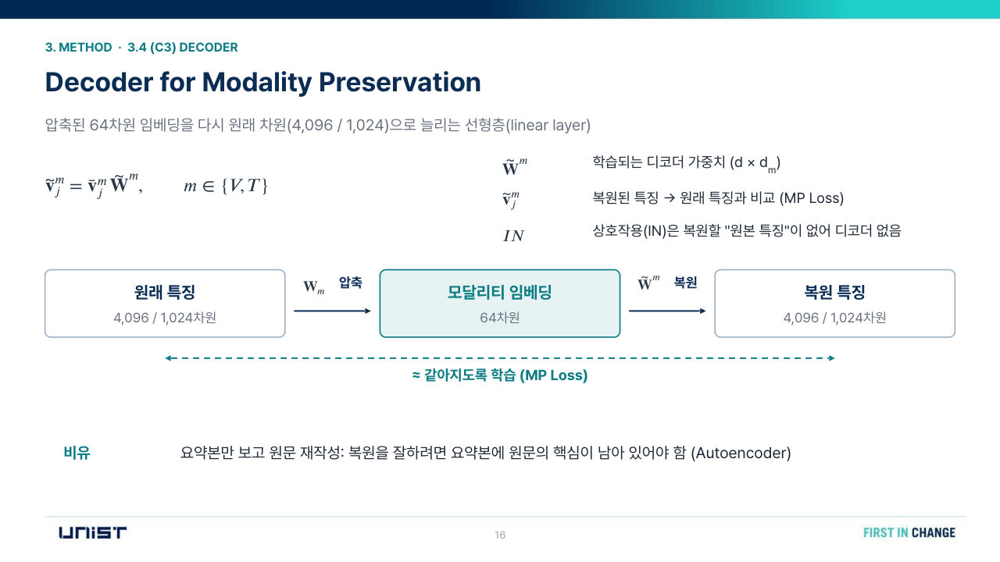

- 압축된 64차원 임베딩을 다시 원래 차원(4,096 / 1,024)으로 늘리는 선형층: ṽjm = v̄jm W̃m.
  - W̃m: 학습되는 디코더 가중치 (d × dm)
  - ṽjm: 복원된 특징 → 원래 특징과 비교 (MP Loss)
  - 상호작용(IN)은 복원할 "원본 특징"이 없어 디코더가 없다.
- 흐름: 원래 특징(4,096 / 1,024차원) → 압축 → 모달리티 임베딩(64차원) → 복원 → 복원 특징(4,096 / 1,024차원). 원래 특징 ≈ 복원 특징이 되도록 학습한다.
- 비유: 요약본만 보고 원문을 재작성하는 것. 복원을 잘하려면 요약본에 원문의 핵심이 남아 있어야 한다 (Autoencoder).

#### 슬라이드 17 · Training: BPR Loss + MP Loss

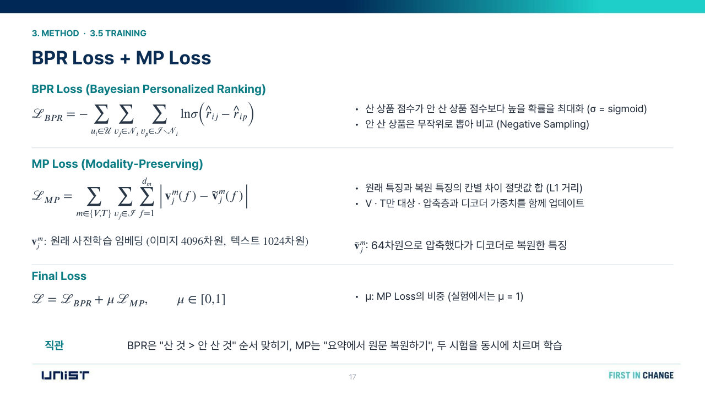

- **BPR Loss**: LBPR = −Σui∈U Σvj∈Ni Σvp∈I∖Ni ln σ(r̂ij − r̂ip)
  - 산 상품 점수가 안 산 상품 점수보다 높을 확률을 최대화 (σ = sigmoid)
  - 안 산 상품은 무작위로 뽑아 비교 (Negative Sampling)
- **MP Loss (Modality-Preserving)**: LMP = Σm∈{V,T} Σvj∈I Σf=1dm |vjm(f) − ṽjm(f)|
  - 원래 특징과 복원 특징의 칸별 차이 절댓값 합 (L1 거리)
  - V · T만 대상이고, 압축층과 디코더 가중치를 함께 업데이트
  - vjm: 원래 사전학습 임베딩 (이미지 4,096차원, 텍스트 1,024차원), ṽjm: 64차원으로 압축했다가 디코더로 복원한 특징
- **Final Loss**: L = LBPR + μLMP, μ ∈ [0, 1]. μ는 MP Loss의 비중 (실험에서는 μ = 1).
- 직관: BPR은 "산 것 > 안 산 것" 순서 맞히기, MP는 "요약에서 원문 복원하기". 두 시험을 동시에 치르며 학습한다.

### 4. Evaluation

#### 슬라이드 18 · Research Questions & Datasets

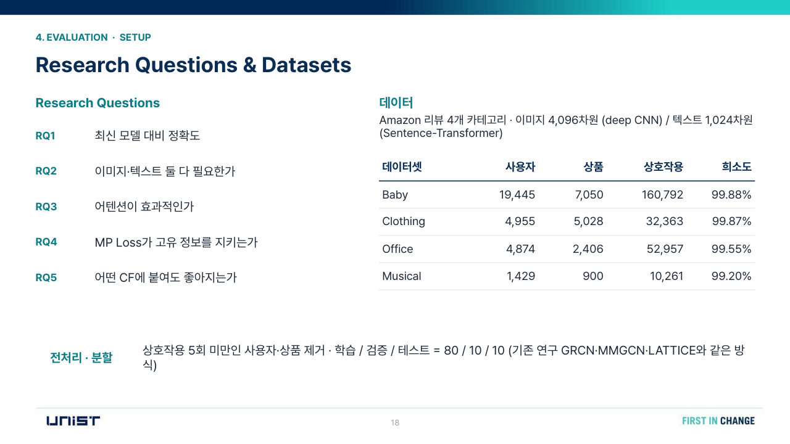

| RQ | 질문 |
|---|---|
| RQ1 | 최신 모델 대비 정확도 |
| RQ2 | 이미지·텍스트 둘 다 필요한가 |
| RQ3 | 어텐션이 효과적인가 |
| RQ4 | MP Loss가 고유 정보를 지키는가 |
| RQ5 | 어떤 CF에 붙여도 좋아지는가 |

- 데이터: Amazon 리뷰 4개 카테고리. 이미지 4,096차원 (deep CNN) / 텍스트 1,024차원 (Sentence-Transformer).

| 데이터셋 | 사용자 | 상품 | 상호작용 | 희소도 |
|---|---:|---:|---:|---:|
| Baby | 19,445 | 7,050 | 160,792 | 99.88% |
| Clothing | 4,955 | 5,028 | 32,363 | 99.87% |
| Office | 4,874 | 2,406 | 52,957 | 99.55% |
| Musical | 1,429 | 900 | 10,261 | 99.20% |

- 전처리·분할: 상호작용 5회 미만인 사용자·상품 제거, 학습 / 검증 / 테스트 = 80 / 10 / 10 (GRCN·MMGCN·LATTICE와 같은 방식).

#### 슬라이드 19 · Protocol & Implementation

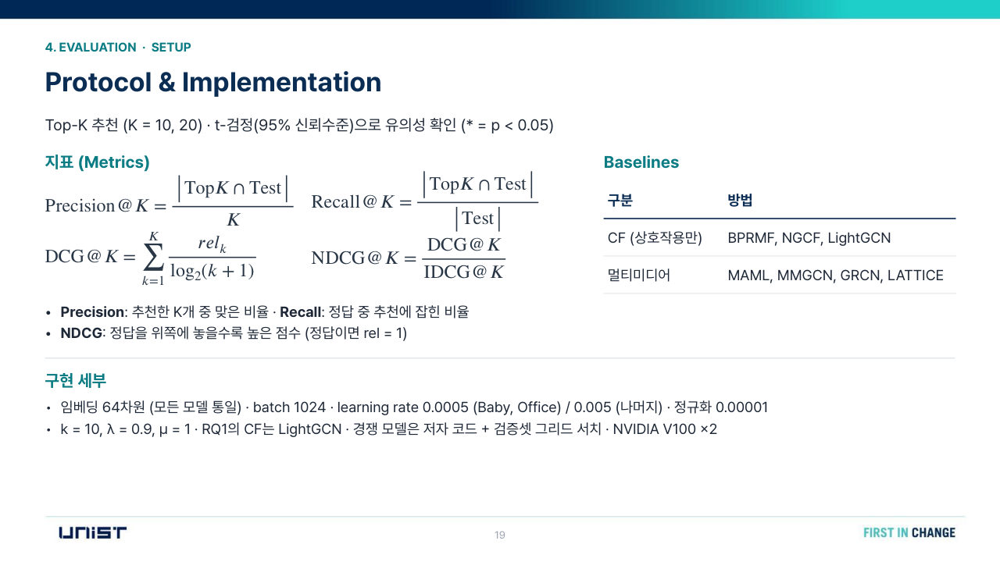

- Top-K 추천 (K = 10, 20), t-검정(95% 신뢰수준)으로 유의성 확인 (* = p < 0.05).
- 지표: Precision(추천한 K개 중 맞은 비율), Recall(정답 중 추천에 잡힌 비율), NDCG(정답을 위쪽에 놓을수록 높은 점수, 정답이면 rel = 1).
- Baselines: CF(상호작용만) BPRMF, NGCF, LightGCN / 멀티미디어 MAML, MMGCN, GRCN, LATTICE.
- 구현: 임베딩 64차원 (모든 모델 통일) · batch 1024 · learning rate 0.0005 (Baby, Office) / 0.005 (나머지) · 정규화 0.00001 · k = 10, λ = 0.9, μ = 1 · RQ1의 CF는 LightGCN · 경쟁 모델은 저자 코드 + 검증셋 그리드 서치 · NVIDIA V100 ×2.

#### 슬라이드 20 · RQ1 Overall Performance (@10)

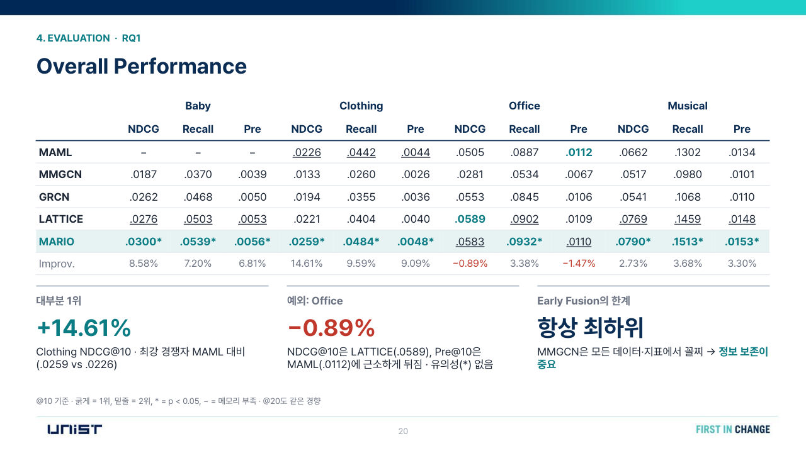

| | Baby NDCG | Clothing NDCG | Office NDCG | Musical NDCG |
|---|---:|---:|---:|---:|
| MAML | − | .0226 | .0505 | .0662 |
| MMGCN | .0187 | .0133 | .0281 | .0517 |
| GRCN | .0262 | .0194 | .0553 | .0541 |
| LATTICE | .0276 | .0221 | **.0589** | .0769 |
| **MARIO** | **.0300*** | **.0259*** | .0583 | **.0790*** |
| Improv. | 8.58% | 14.61% | −0.89% | 2.73% |

NDCG@10만 발췌. Recall·Precision은 슬라이드 참고. − = 메모리 부족. @20도 같은 경향.

- **대부분 1위 · +14.61%**: Clothing NDCG@10, 최강 경쟁자 MAML 대비 (.0259 vs .0226).
- **예외 Office · −0.89%**: NDCG@10은 LATTICE(.0589), Pre@10은 MAML(.0112)에 근소하게 뒤지고 유의성(*)이 없다.
- **Early Fusion의 한계 · 항상 최하위**: MMGCN은 모든 데이터·지표에서 꼴찌 → 정보 보존이 중요하다.

#### 슬라이드 21 · RQ2 · RQ3 Modality & Attention Ablation (Clothing)

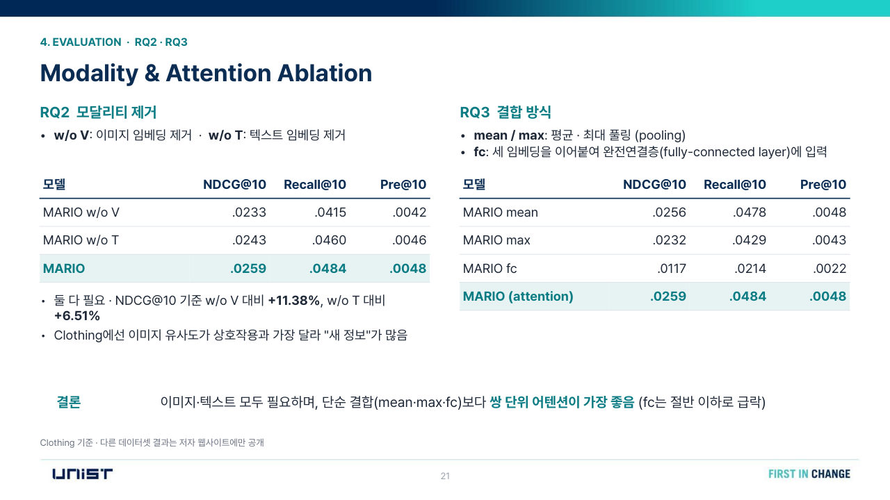

| RQ2 모달리티 제거 | NDCG@10 | Recall@10 | Pre@10 |
|---|---:|---:|---:|
| MARIO w/o V (이미지 제거) | .0233 | .0415 | .0042 |
| MARIO w/o T (텍스트 제거) | .0243 | .0460 | .0046 |
| MARIO | **.0259** | **.0484** | **.0048** |

- 둘 다 필요하다. NDCG@10 기준 w/o V 대비 +11.38%, w/o T 대비 +6.51%. Clothing에서는 이미지 유사도가 상호작용과 가장 달라 "새 정보"가 많다.

| RQ3 결합 방식 | NDCG@10 | Recall@10 | Pre@10 |
|---|---:|---:|---:|
| MARIO mean (평균 풀링) | .0256 | .0478 | .0048 |
| MARIO max (최대 풀링) | .0232 | .0429 | .0043 |
| MARIO fc (이어붙여 완전연결층) | .0117 | .0214 | .0022 |
| MARIO (attention) | **.0259** | **.0484** | **.0048** |

- 결론: 이미지·텍스트 모두 필요하며, 단순 결합(mean·max·fc)보다 쌍 단위 어텐션이 가장 좋다. fc는 절반 이하로 급락한다. 다른 데이터셋 결과는 저자 웹사이트에만 공개되어 있다.

#### 슬라이드 22 · RQ4 Modality Preservation (Clothing)

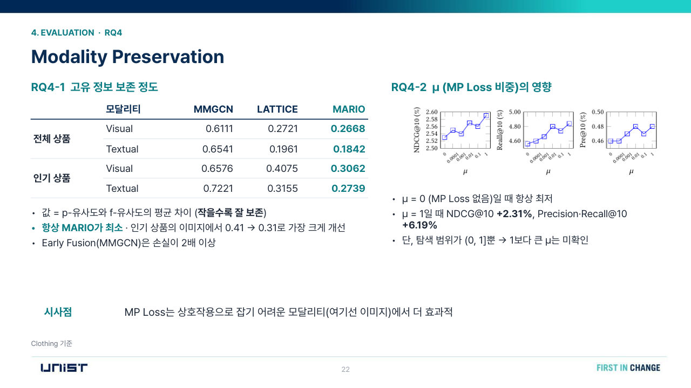

| RQ4-1 | 모달리티 | MMGCN | LATTICE | MARIO |
|---|---|---:|---:|---:|
| 전체 상품 | Visual | 0.6111 | 0.2721 | **0.2668** |
| | Textual | 0.6541 | 0.1961 | **0.1842** |
| 인기 상품 | Visual | 0.6576 | 0.4075 | **0.3062** |
| | Textual | 0.7221 | 0.3155 | **0.2739** |

- 값 = p-유사도와 f-유사도의 평균 차이 (작을수록 잘 보존). 항상 MARIO가 최소이고, 인기 상품의 이미지에서 0.41 → 0.31로 가장 크게 개선된다. Early Fusion(MMGCN)은 손실이 2배 이상이다.
- **RQ4-2 μ (MP Loss 비중)의 영향**: μ = 0 (MP Loss 없음)일 때 항상 최저. μ = 1일 때 NDCG@10 +2.31%, Precision·Recall@10 +6.19%. 단, 탐색 범위가 (0, 1]뿐이라 1보다 큰 μ는 확인되지 않았다.
- 시사점: MP Loss는 상호작용으로 잡기 어려운 모달리티(여기서는 이미지)에서 더 효과적이다.

#### 슬라이드 23 · RQ5 Plug-in to Any CF Method

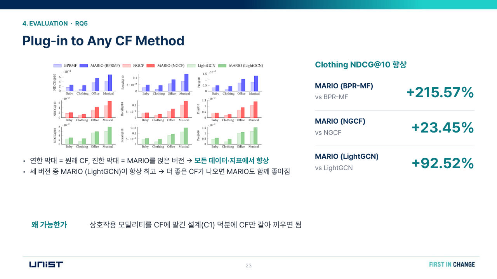

| Clothing NDCG@10 향상 | |
|---|---:|
| MARIO (BPR-MF) vs BPR-MF | +215.57% |
| MARIO (NGCF) vs NGCF | +23.45% |
| MARIO (LightGCN) vs LightGCN | +92.52% |

- 연한 막대 = 원래 CF, 진한 막대 = MARIO를 얹은 버전. 모든 데이터·지표에서 향상된다.
- 세 버전 중 MARIO (LightGCN)이 항상 최고 → 더 좋은 CF가 나오면 MARIO도 함께 좋아진다.
- 왜 가능한가: 상호작용 모달리티를 CF에 맡긴 설계(C1, 슬라이드 11·14) 덕분에 CF만 갈아 끼우면 된다.

### 5. Related Work · Conclusion

#### 슬라이드 24 · 관련 연구와 MARIO의 차별점

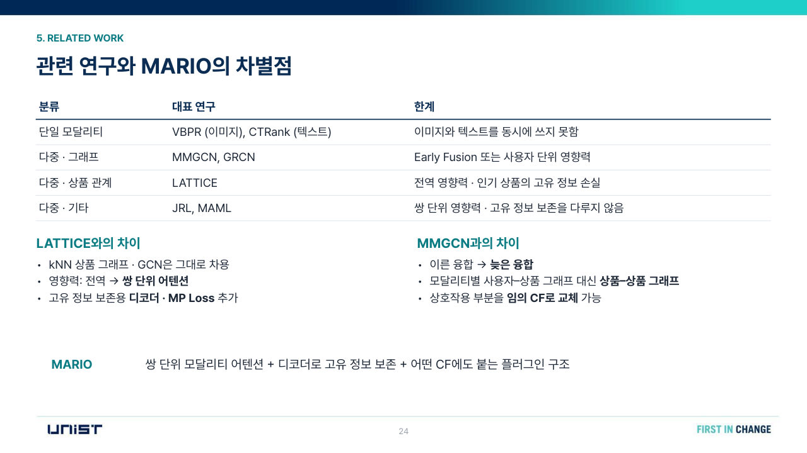

| 분류 | 대표 연구 | 한계 |
|---|---|---|
| 단일 모달리티 | VBPR (이미지), CTRank (텍스트) | 이미지와 텍스트를 동시에 쓰지 못함 |
| 다중 · 그래프 | MMGCN, GRCN | Early Fusion 또는 사용자 단위 영향력 |
| 다중 · 상품 관계 | LATTICE | 전역 영향력 · 인기 상품의 고유 정보 손실 |
| 다중 · 기타 | JRL, MAML | 쌍 단위 영향력 · 고유 정보 보존을 다루지 않음 |

- **LATTICE와의 차이**: kNN 상품 그래프 · GCN은 그대로 차용, 영향력은 전역 → 쌍 단위 어텐션, 고유 정보 보존용 디코더 · MP Loss 추가.
- **MMGCN과의 차이**: 이른 융합 → 늦은 융합, 모달리티별 사용자–상품 그래프 대신 상품–상품 그래프, 상호작용 부분을 임의 CF로 교체 가능.
- MARIO = 쌍 단위 모달리티 어텐션 + 디코더로 고유 정보 보존 + 어떤 CF에도 붙는 플러그인 구조.

#### 슬라이드 25 · 결론

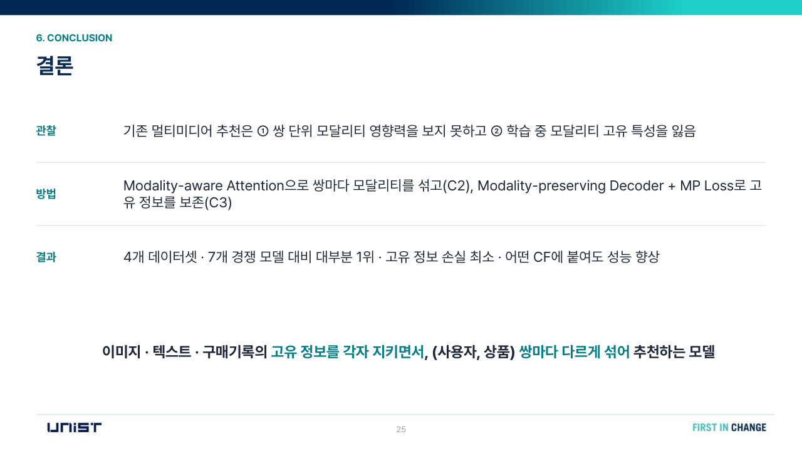

| | 내용 |
|---|---|
| 관찰 | 기존 멀티미디어 추천은 ① 쌍 단위 모달리티 영향력을 보지 못하고 ② 학습 중 모달리티 고유 특성을 잃음 |
| 방법 | Modality-aware Attention으로 쌍마다 모달리티를 섞고(C2), Modality-preserving Decoder + MP Loss로 고유 정보를 보존(C3) |
| 결과 | 4개 데이터셋 · 7개 경쟁 모델 대비 대부분 1위 · 고유 정보 손실 최소 · 어떤 CF에 붙여도 성능 향상 |

- 한 줄 요약: **이미지 · 텍스트 · 구매기록의 고유 정보를 각자 지키면서, (사용자, 상품) 쌍마다 다르게 섞어 추천하는 모델.**

#### 슬라이드 26 · Q&A

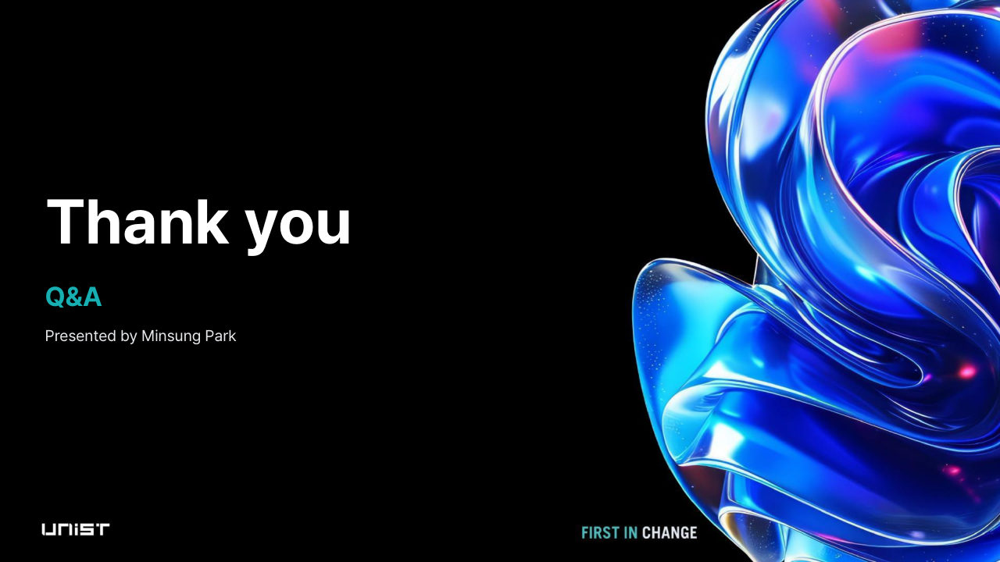

---

## 무엇을 배웠나

- **관찰에서 설계까지 한 줄로 잇기**: 두 관찰과 한 가지 문제 의식이 각각 C1·C2·C3로 일대일 대응된다. 모델의 구성 요소마다 "왜 필요한가"에 대한 실험 근거가 있다.
- **수식을 구성 요소 단위로 읽기**: kNN 그래프의 λ 혼합, GCN의 D−1/2 정규화, 어텐션의 √d 스케일링처럼, 각 항이 어떤 문제(그래프 안정성, 값 폭주, 쏠림)를 막는지로 이해하면 수식이 덜 낯설다. 4회차에 공부한 GCN이 인코더 안에서 어떻게 쓰이는지도 연결된다.
- **Late Fusion의 전제 확인하기**: 이미지·텍스트 임베딩이 구매 기록과 섞이지 않는 구간(인코더)을 명확히 해 두어야 마지막에 섞는 설계의 이점이 성립한다. 사용자–상품 그래프와 상품–상품 그래프를 나란히 놓고 보면 이 차이가 분명해진다.
- **결과를 정확히 읽기**: 대부분 1위지만 Office 같은 예외가 있고, RQ2~RQ4 상세 표는 Clothing만 본문에 있으며, μ는 (0, 1] 범위만 탐색됐다.
